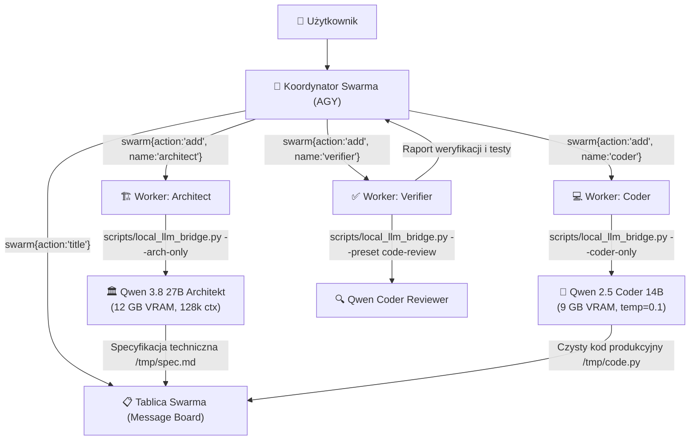

# Local LLM Swarm — Oficjalny Standard Pracy Wieloagentowej z Qwenem

## 1. Dlaczego Natywny `swarm` Deklasuje Generyczny `/teamwork`?

W projekcie AcousticHddSentinel preferowanym, oficjalnym standardem orkiestracji zespołowej jest **narzędzie `swarm`** połączone z lokalnym tandemem modeli open-weights na GPU **AMD Radeon RX 9060 XT (16 GB VRAM)**.

| Kryterium | Tryb generyczny `/teamwork` | Natywny `swarm` + Lokalne Qwen (ZALECANY) |
|:---|:---|:---|
| **Zużycie tokenów chmurowych** | 🔴 Ekstremalnie wysokie (miliony tokenów na czytanie repozytorium przez każdego subagenta). Ryzyko błędu `429 Resource Exhausted`. | 🟢 **Oszczędność ~90%**: Koordynator trzyma minimalny kontekst sterujący. Cały ciężar analizy i pisania kodu spoczywa na lokalnym GPU! |
| **Generowanie kodu** | ⚠️ Modele chmurowe mają tendencję do skrótów, placeholderów `// TODO` i omijania lokalnego GPU. | 🟢 **Zero placeholderów**: Qwen 2.5 Coder 14B (deterministyczny, `temp=0.1`) pisze kompletny, gotowy do wdrożenia kod produkcyjny. |
| **Głębokie projektowanie (Reasoning)** | ⚠️ Ograniczone limity chmurowe. | 🟢 **128k kontekstu**: Qwen 3.8 27B RCO analizuje całe specyfikacje i historię zmian w VRAM (FlashAttention + Q4_0 KV Cache). |
| **Dyscyplina wykonawcza** | ⚠️ Subagenci mogą samowolnie modyfikować pliki bez pełnej kontroli niezmienników. | 🟢 **Ścisła kontrola**: Koordynator definiuje briefy w narzędziu `swarm`, a workerzy mają sztywny obowiązek delegacji do `local_llm_bridge.py`. |
| **Koszt i limity API** | 🔴 Płatne/limitowane wywołania API chmury. | 🟢 **Darmowe, nielimitowane** obliczenia na lokalnym sprzęcie (15.9 GB wolnego VRAM na dGPU). |

---

## 2. Architektura Tandemu Modeli na RX 9060 XT

System operacyjny i monitor działają na procesorze graficznym procesora (**iGPU Ryzen 7 7700**). Dedykowana karta **AMD Radeon RX 9060 XT (16 GB VRAM)** jest w całości dedykowana dla AI:



> [!IMPORTANT]
> Modele **nigdy nie mogą rezydować w VRAM równocześnie** (12 GB + 9 GB > 16 GB).
> Most `local_llm_bridge.py` automatycznie ładuje wymagany model i natychmiast zwalnia VRAM (`keep_alive=0`) po zakończeniu generowania.

---

## 3. Złote Zasady Swarma z Qwenem (Niezmienniki Koordynatora)

1. **Do not do the work (Zakaz pisania kodu przez koordynatora i chmurowe workery):**
   Koordynator AGY ani chmurowy worker **nigdy nie piszą kodu produkcyjnego z głowy**. Ich rolą jest sformułowanie precyzyjnego briefu i wywołanie lokalnego modelu poprzez `local_llm_bridge.py`. Modele chmurowe jedynie weryfikują wyjście, scalają pliki i uruchamiają testy.
2. **Front-Loaded Execution (Wczesne uruchamianie zapytań GPU):**
   Generowanie na lokalnym GPU osiąga ~19 tok/s (Qwen 3.8) i ~40 tok/s (Qwen Coder). Aby nie blokować zespołu, **zadania dla modeli Qwen MUSZĄ być zlecane w pierwszej kolejności na samym początku etapu**, a nie po wieloetapowych dyskusjach.
3. **Sekwencyjność VRAM:**
   Tylko jedno zapytanie do GPU może być wykonywane w danym momencie. Kolejność potoku:
   `Architect (Qwen 3.8)` $\to$ `Coder (Qwen 2.5 Coder)` $\to$ `Verifier / Tester (AGY & PyTest)`.
4. **Czysty VRAM przed treningiem:**
   Przed uruchomieniem skryptów treningowych PyTorch (`train_cnn.py`, `train_ensemble.py`), pamięć karty **musi być w 100% pusta** (`python scripts/local_llm_bridge.py --free-vram`).

---

## 4. Szablony Briefów dla Workerów Swarma (`swarm{action:"add"}`)

Koordynator tworzy zespół w swarmie za pomocą precyzyjnych briefów:

### A. Worker: `architect` (Qwen 3.8 27B — Specyfikacja i Analiza)
```
swarm{action:"add", name:"architect", workspace:"share",
      brief:"Jesteś Architektem Oprogramowania & DSP. Twoje zadanie: <OPIS_ZADANIA>.

      OBOWIĄZKOWA DELEGACJA DO QWEN 3.8:
      Wykonaj natychmiast polecenie na lokalnym GPU:
      python scripts/local_llm_bridge.py \
        --task '<precyzyjny opis wymagań z odniesieniem do ADR-001/ADR-002>' \
        --arch-only \
        --output /tmp/architect_spec.md \
        --ctx 65536

      Przeczytaj wygenerowaną specyfikację z /tmp/architect_spec.md.
      Upewnij się, że nie narusza niezmienników z AGENTS.md (DSP, 100% Java 17 na Androidzie, Zero Data Leakage).
      Gdy gotowe, opublikuj na tablicy: @coder oto specyfikacja: <podsumowanie>. @coordinator [done]"}
```

### B. Worker: `coder` (Qwen 2.5 Coder 14B — Implementacja Kodu)
```
swarm{action:"add", name:"coder", workspace:"share",
      brief:"Jesteś Głównym Programistą (Senior Staff Coder). Twoje zadanie: <OPIS_ZADANIA>.

      OBOWIĄZKOWA DELEGACJA DO QWEN 2.5 CODER:
      Wykonaj natychmiast polecenie na lokalnym GPU:
      python scripts/local_llm_bridge.py \
        --task '<zadanie + treść specyfikacji od @architect>' \
        --coder-only \
        --output /tmp/coder_implementation.py \
        --ctx 32768

      Przeczytaj wygenerowany kod z /tmp/coder_implementation.py.
      Zapisz kod w docelowych plikach repozytorium.
      Upewnij się, że nie ma żadnych placeholderów, skrótów ani 'TODO'.
      Gdy pliki są zapisane: @verifier zweryfikuj zmiany. @coordinator [done]"}
```

### C. Worker: `verifier` / `reviewer` (Audyt i Testy)
```
swarm{action:"add", name:"verifier",
      brief:"Jesteś Audytorem Kodu i Testerem. Twoje zadanie: zweryfikować kod od @coder.

      1. Uruchom niezależny Code Review przez Qwen 2.5 Coder:
         python scripts/local_llm_bridge.py \
           --task 'Audyt poprawności i wyścigów wątkowych dla: <ścieżki_plików>' \
           --preset code-review \
           --output /tmp/review_report.md

      2. Uruchom oficjalne testy systemu:
         python tests/test_project_logic.py
         python tests/test_smpc_architecture.py
         cd android && ./gradlew test

      Jeśli testy przechodzą: @coordinator [done] kod w pełni sprawny i zweryfikowany.
      Jeśli są błędy: @coder popraw <lista_błędów>."}
```

### D. Worker: `implementer` (Kompletny tandem Architekt $\to$ Coder)
Stosowany dla szybkich, zwartej wielkości zadań:
```
swarm{action:"add", name:"implementer", workspace:"share",
      brief:"Zrealizuj pełną implementację zadania: <OPIS>.
      Uruchom pełny most tandemu:
      python scripts/local_llm_bridge.py --task '<OPIS>' --context kontekst.md --output /tmp/result_code.py --ctx 65536
      Wdróż wygenerowany kod, uruchom testy jednostkowe i zaraportuj: @coordinator [done]"}
```

---

## 5. Profile Zadaniowe (`--preset`) dla Wyspecjalizowanych Workerów

Gdy zadanie dotyczy specyficznej dziedziny, worker używa dedykowanego profilu w `local_llm_bridge.py`:

| Profil (`--preset`) | Model docelowy | Zastosowanie w projekcie |
|:---|:---|:---|
| `code-review` | Qwen 2.5 Coder 14B | Rygorystyczny audyt bezpieczeństwa, bug hunting, wyścigi wątkowe |
| `dsp-translate` | Qwen 2.5 Coder 14B | Translacja DSP z Pythona do 100% czystej Javy 17 (ADR-002, 0 Kotlina) |
| `adversarial-gen` | Qwen 3.8 27B | Matematyczna synteza zakłóceń audio, vibrato głosu, szumu wentylatorów |
| `android-opt` | Qwen 2.5 Coder 14B | Optymalizacja Zero-Allocation, unikanie GC pauses na telefonie |
| `smpc-arch` | Qwen 3.8 27B | Architektura wielomodalnych podcentrów Sub-Center ArcFace i metryk |
| `num-audit` | Qwen 2.5 Coder 14B | Weryfikacja numeryczna IEEE 754 (zabezpieczenia przed NaN, log(0), clipping) |
| `smart-telemetry` | Qwen 3.8 27B (128k) | Korelacja telemetrii SMART dysków z sygnaturami widmowymi FFT |

---

## 6. Procedura Rozpoczęcia Sesji Swarm (Krok po Kroku)

Gdy użytkownik wydaje polecenie zespołowe (np. `swarm`, `/teamwork`, "uruchom zespół"):

1. **Sprawdzenie i oczyszczenie środowiska GPU:**
   ```bash
   python scripts/local_llm_bridge.py --check-ready
   ```
2. **Inicjalizacja Swarma:**
   ```
   swarm{action:"title", title:"<Nazwa Zadania>"}
   ```
3. **Powołanie workerów:**
   - Jeśli zadanie wymaga analizy i nowego modułu: powołaj `architect` i `coder`.
   - Jeśli zadanie jest czysto wdrożeniowe: powołaj `coder` i `verifier`.
4. **Nadzór i przejście do stanu uśpienia (`swarm_wait`):**
   Koordynator publikuje briefy i przechodzi w tryb reaktywny (`swarm_wait`), czekając na powiadomienia na tablicy.
