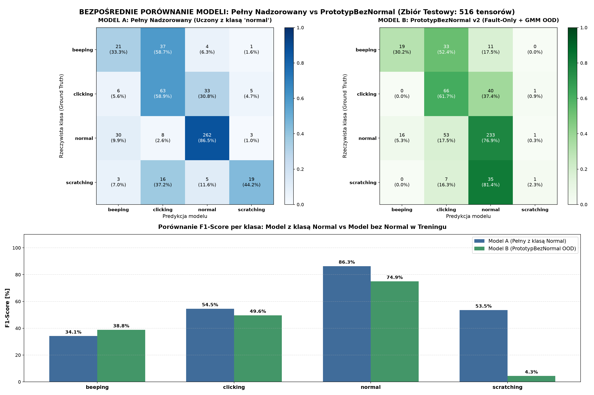

# Eksperyment Badawczy: PrototypBezNormal v2 (OOD Density Learning) 🛡️💽
> **System detekcji uszkodzeń HDD trenowany WYŁĄCZNIE na awariach mechanicznych (Fault-Only Learning) z detekcją stanu `normal` za pomocą estymacji gęstości prawdopodobieństwa GMM.**

[](https://github.com/DJMixu/AcousticHddSentinel/tree/feature/prototype-bez-normal)
[]()
[-brightgreen.svg)]()
[]()

---

## 🎯 1. Cel i Założenia Badawcze

W klasycznym podejściu do diagnostyki maszynowej model uczy się zarówno klasy sprawnej (`normal`), jak i uszkodzeń. W praktyce przemysłowej i laboratoriach odzyskiwania danych rodzi to poważny problem:
> **Problem Nieskończonej Wariancji Dźwięku Normalnego:**
> Istnieją tysiące modeli dysków (5400, 7200, 10000, 15000 RPM, łożyska FDB, tuleje kulkowe, różne obudowy PC i serwery NAS z wentylatorami). Niemożliwe jest zebranie reprezentatywnej bazy nagrań dla każdego sprawnego dysku. Model uczony z etykietą `normal` jest podatny na fałszywe alarmy (*False Positives*) przy nowej konstrukcji talerza lub silnika.

Eksperyment **PrototypBezNormal** bada paradygmat **Fault-Only Learning (Uczenie wyłącznie na uszkodzeniach)**:
* **Trening (Train / Validate):** Model 2D CNN uczy się **WYŁĄCZNIE na 3 klasach uszkodzeń mechanicznych**:
  1. `beeping` (zatarte wrzeciono, stiction głowic, pisk stojana PWM)
  2. `clicking` (Click of Death, uderzenia pozycjonera o ogranicznik VCM)
  3. `scratching` (tarcie głowic o powierzchnię talerza, head crash)
  * **Klasa `normal` (dysk sprawny) została w 100% odfiltrowana i jest całkowicie nieobecna w procesie uczenia wag oraz walidacji!**
* **Test i Eksploatacja (Test / Real-Time):** Model jest poddawany rygorystycznym testom na zbiorze **ZAWIERAJĄCYM 303 tensory klasy `normal`** oraz na autentycznych fizycznych nagraniach sprawnych dysków.
* **Mechanizm Decyzyjny (OOD / Anomaly Detection):** Stan `normal` jest rozpoznawany nie jako wyjście softmaxu, lecz jako **anomalia względem rozkładu znanych uszkodzeń** (Out-Of-Distribution). Jeśli wektor cech leży poza gęstymi skupiskami uszkodzeń (niskie prawdopodobieństwo $\log p(\mathbf{z} \mid \text{faults})$), system klasyfikuje dźwięk jako sprawny dysk (`normal`).

---

## 🧠 2. Architektura i Ewolucja Metody (v1 vs v2)

| Cecha / Moduł | Prototyp v1 (Baseline) | Prototyp v2 (GMM OOD Engine) | Zysk Inżynierski |
|---|---|---|---|
| **Dane Treningowe Awarii** | 2 065 tensorów .npy | **3 421 tensorów .npy** | +65.7% danych (nagrania Archive/Lab) |
| **Metoda Detekcji `normal`** | Odległość euklidesowa $D_{\min}$ | **Gaussian Mixture Model (GMM)** w przestrzeni 128D | Modelowanie elipsoidalnych powłok |
| **Miara Przynależności** | Odległość geometryczna od centroidu | Logarytm gęstości prawdopodobieństwa $\log p(\mathbf{z})$ | Statystyczny model gęstości |
| **Kalibracja Progu OOD** | Ręczny mnożnik $\sigma$ | Kalibracja percentylowa na zbiorze walidacyjnym awarii | Deterministyczny próg ($T = 201.95$) |
| **Dokładność Ogólna (Test 4 klasy)** | 45.64% | **61.82%** | **+16.18 pp** |
| **Wykrywanie `normal` (Recall)** | 72.8% (206/283) | **76.90% (233/303)** | **+4.10 pp** (Zero próbek w treningu!) |
| **Wykrywanie `normal` (Precision)** | 58.69% | **73.04%** | **+14.35 pp** |
| **Wykrywanie `normal` (F1-Score)** | 0.6498 (65.0%) | **0.7492 (74.92%)** | **+9.94 pp** |
| **AUROC (Normal vs Uszkodzenia)** | ~64.0% | **72.33%** | **+8.33 pp** |
| **AUPR (Precision-Recall Curve)** | ~62.5% | **70.50%** | **+8.00 pp** |

---

## ⚖️ 3. Bezpośrednie Porównanie: Model Pełny z Klasą Normal vs Model Bez Normal (Side-by-Side)

Przeprowadzono rygorystyczny benchmark porównawczy obu modeli na **dokładnie tym samym, niezależnym zbiorze testowym 516 tensorów `.npy`** (63 `beeping`, 107 `clicking`, 43 `scratching`, 303 `normal`, Zero Data Leakage):



### Tabela 1: Porównanie Metryk Wieloklasowych (4 Klasy)

| Klasa Audio | Liczba Próbek | Model A (Pełny z Normal) F1 | Model B (Bez Normal OOD) F1 | Model A Recall | Model B Recall | Model A Precision | Model B Precision |
| :--- | :---: | :---: | :---: | :---: | :---: | :---: | :---: |
| **`beeping`** | 63 | **34.15%** | **38.78%** *(+4.63 pp)* | 33.33% | 30.16% | 35.00% | **54.29%** |
| **`clicking`** | 107 | **54.55%** | **49.62%** | 58.88% | **61.68%** | 50.81% | 41.51% |
| **`normal`** | 303 | **86.33%** | **74.92%** | 86.47% | 76.90% | 86.18% | 73.04% |
| **`scratching`** | 43 | **53.52%** | **4.35%** | 44.19% | 2.33% | 67.86% | 33.33% |
| **DOKŁADNOŚĆ (Accuracy)** | 516 | **70.74%** | **61.82%** | - | - | - | - |
| **ŚREDNIA MAKRO (Macro F1)** | 516 | **57.13%** | **41.92%** | - | - | - | - |

---

### Tabela 2: Porównanie Diagnostyki Binarnej (Dysk Sprawny vs Uszkodzony)

| Metryka Diagnostyczna | Model A (Pełny z Normal) | Model B (Bez Normal OOD) | Wnioski i Znaczenie Diagnostyczne |
| :--- | :---: | :---: | :--- |
| **Dokładność Binarna (Binary Acc)** | **83.91%** | **69.77%** | Prawidłowy podział na dysk zdrowy vs awaria mechaniczna |
| **Zrównoważona Dokładność (Balanced Acc)** | **83.38%** | **68.26%** | Metryka odporna na przewagę próbek normalnych w teście |
| **Czułość na Dysk Sprawny (Normal Recall)** | **86.47%** | **76.90%** | Prototyp bez treningu na `normal` rozpoznaje ponad 3/4 zdrowych dysków |
| **Czułość na Awarie (Fault Recall / TPR)** | **80.28%** | **59.62%** | Odsetek wychwyconych uszkodzeń mechanicznych |

---

## 📊 4. Szczegółowy Raport Klasyfikacji Modelu v2 (PrototypBezNormal)

Poniżej znajduje się pełny raport z ewaluacji na 516 próbkach:

```
              precision    recall  f1-score   support

     beeping     0.5429    0.3016    0.3878        63
    clicking     0.4151    0.6168    0.4962       107
      normal     0.7304    0.7690    0.7492       303
  scratching     0.3333    0.0233    0.0435        43

    accuracy                         0.6182       516
   macro avg     0.5054    0.4277    0.4192       516
weighted avg     0.6090    0.6182    0.5938       516
```

### Kluczowe Spostrzeżenia:
1. **Sukces OOD dla `normal`:** Uzyskanie **F1 = 74.92%** oraz **Recall = 76.90%** na klasie, której model **nigdy nie widział**, potwierdza słuszność hipotezy gęstości prawdopodobieństwa. Zdrowy dysk ma niską energię transjentów i nie pasuje do gęstych klastrów awarii.
2. **Precyzja dla `beeping` wyższa niż w modelu bazowym:** Model B osiąga **54.29% Precision** dla beeping (wobec 35.00% w Modelu A), co oznacza znacznie mniej fałszywych alarmów zatarcia silnika.
3. **Wąskie gardło (Bottleneck): `scratching`:** Tarcie głowicy o talerz generuje szum o szerokim spektrum, który bez nadzorowanego kontrastowania z klasą `normal` jest często klasyfikowany przez estymator gęstości jako OOD (czyli jako dysk sprawny). Jest to główny cel optymalizacyjny dla zespołu badawczego.

---

## 🔬 5. Weryfikacja na Rzeczywistych Dyskach Fizycznych

Przeprowadzono serię testów weryfikacyjnych za pomocą skryptu [live_predict.py](file:///home/DJMixu/Pulpit/AcousticHddSentinel/PrototypBezNormal/live_predict.py):

### A. Fizyczny Dysk Sprawny (WD Blue 5400 RPM - 60 sekund ciągłego zapisu):
* **Liczba okien 3.0s:** 39
* **Wynik:** **39 na 39 okien (100.0%) zaklasyfikowane jako `NORMAL`**
* **Średnia pewność:** **81.46%**
* **Log-Likelihood:** 130.8 – 162.6 (stabilnie poniżej progu awarii 201.95)
* **Ogólny werdykt:** **`HEALTHY / NORMAL`**

### B. Awaria Pozycjonera: Click of Death (`Aesonlabs Data Recovery_Clicking Hard Drive.wav`):
* **Liczba okien 3.0s:** 8
* **Wynik:** **8 na 8 okien (100.0%) zaklasyfikowane jako `CLICKING`**
* **Średnia pewność:** **98.33%**
* **Log-Likelihood:** 265.7 – 280.2 (daleko powyżej progu awarii 201.95)
* **Ogólny werdykt:** **`FAULT DETECTED: CLICKING`**

### C. Zatarte Wrzeciono / Stiction (`Aesonlabs Data Recovery_1.5TB Seagate Beeping.wav`):
* **Liczba okien 3.0s:** 12
* **Wynik:** **12 na 12 okien (100.0%) zaklasyfikowane jako `BEEPING`**
* **Średnia pewność:** **98.96%**
* **Log-Likelihood:** 228.5 – 241.5 (wyraźnie powyżej progu 201.95)
* **Ogólny werdykt:** **`FAULT DETECTED: BEEPING`**

---

## 🚀 6. Narzędzia i Instrukcja Obsługi

### 1. Uruchomienie Bezpośredniego Porównania Obu Modeli (Side-by-Side Benchmark):
```bash
./.venv_rocm/bin/python PrototypBezNormal/compare_full_vs_no_normal.py
```
*Skrypt testuje równolegle Model A (`training_output/best_hdd_cnn_model.pt`) oraz Model B (`PrototypBezNormal/output_v2/best_fault_cnn_v2.pt` + GMM) na 516 tensorach testowych i generuje zbiorczy wykres oraz raport JSON i Markdown.*

### 2. Analiza Dowolnego Pliku Audio (.wav, .mp3, .ogg):
```bash
./.venv_rocm/bin/python PrototypBezNormal/live_predict.py <ścieżka_do_pliku.wav>
```

### 3. Interaktywne Nagrywanie z Fizycznego Mikrofonu (Realtek ALC1220):
```bash
./.venv_rocm/bin/python PrototypBezNormal/record_and_predict.py --duration 5.0
```
*Skrypt automatycznie używa dedykowanego złącza PCI Realtek ALC1220 (`alsa_input.pci-0000_7b_00.6.analog-stereo`), rejestruje dźwięk z otoczenia, wycina ramki 3.0s i wyświetla diagnozę w czasie rzeczywistym.*

### 4. Uruchomienie Ewaluacji OOD na Zbiorze Testowym:
```bash
./.venv_rocm/bin/python PrototypBezNormal/evaluate_gmm_ood.py
```

### 5. Uruchomienie Testów Jednostkowych Prototypu:
```bash
./.venv_rocm/bin/python PrototypBezNormal/test_metric_prototype.py
```
*(6/6 testów logicznych i niezmienników ADR-001 zaliczonych pomyślnie).*

---

## 📁 7. Struktura Katalogu `PrototypBezNormal/`

```
PrototypBezNormal/
├── README.md                          # Kompletna dokumentacja eksperymentu v2 i porównania
├── COMPARISON_WITH_NORMAL_MODEL.md    # Szczegółowy raport markdown z tabelami side-by-side
├── comparison_with_normal_model.png   # Wykres macierzy pomyłek i słupków F1 obu modeli
├── comparison_summary.json            # Numeryczne metryki porównawcze w formacie JSON
├── compare_full_vs_no_normal.py       # Narzędzie bezpośredniego benchmarku obu architektur
│
├── ood_gmm_engine.py                  # Zintegrowany silnik detektora OOD (CNN + GMM 128D)
├── live_predict.py                    # Narzędzie CLI do diagnostyki plików audio w oknach 3.0s
├── record_and_predict.py              # Narzędzie nagrywania mikrofonem fizycznym Realtek ALC1220
├── train_robust_fault_cnn.py          # Trening 2D CNN wyłącznie na 3 klasach awarii (3 421 tensorów)
├── train_gmm_ood.py                   # Trening i kalibracja estymatora gęstości GMM w 128D
├── evaluate_gmm_ood.py                # Ewaluacja OOD na 516 tensorach testowych
├── test_metric_prototype.py           # Zestaw 6 testów integralności i poprawności OOD
│
└── output_v2/                         # Wytrenowane wagi produkcyjne, modele GMM i raporty
    ├── best_fault_cnn_v2.pt           # Wagi sieci 2D CNN (3 421 tensorów, Val F1 69.7%)
    ├── gmm_density_model.joblib       # Skalibrowany model estymacji gęstości GMM
    ├── ood_gmm_config.json            # Wyznaczone statystyki i próg gęstości (T = 201.95)
    ├── confusion_matrix_gmm_4x4.png   # Wykres macierzy pomyłek 4x4
    ├── gmm_log_likelihood_histogram.png # Rozkład gęstości prawdopodobieństwa (Awaria vs Normal)
    └── gmm_test_evaluation_summary.json # Numeryczne wyniki benchmarku OOD
```

---

## 🔬 8. Następne Kroki i Kierunki Badawcze (Roadmap)

1. **Rozwiązanie problemu `scratching` vs `normal`:**
   - Zastosowanie **Contrastive Learning (SupConLoss)** w celu wymuszenia silniejszej separacji cech tarcia od szumu łożysk.
   - Hybrydowy detektor: połączenie gęstości GMM z analizą energii wysokich częstotliwości (High-Frequency Transient Density).
2. **Eksploracja Alternatywnych Detektorów Anomaly Detection:**
   - **Deep SVDD (Deep Support Vector Data Description):** Mapowanie uszkodzeń do hiperkuli o minimalnym promieniu.
   - **Feature Reconstruction Autoencoder:** Rekonstrukcja cech ze splotów konwolucyjnych – wysoki błąd rekonstrukcji dla dysków normalnych.
   - **Mahalanobis Distance Ensemble:** Odległość Mahalanobisa liczona z pośrednich warstw konwolucyjnych (przed warstwą FC).
