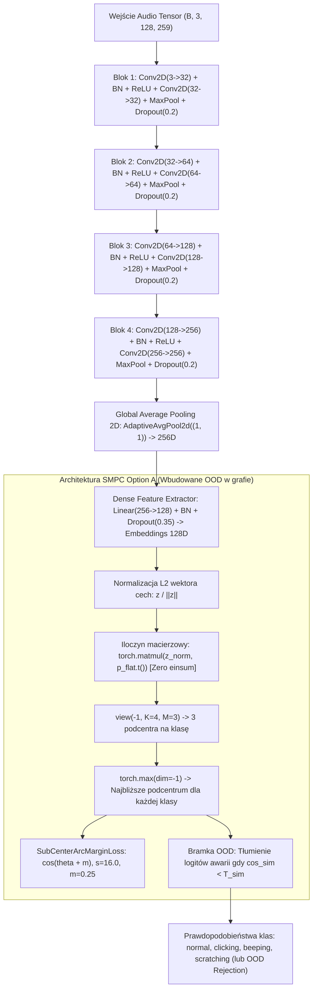

# Acoustic HDD Sentinel 🛡️💽
> **Produkcyjny system wibroakustycznej detekcji i wieloklasowej klasyfikacji uszkodzeń mechanicznych dysków twardych (HDD) przy użyciu głębokich sieci konwolucyjnych (2D CNN w PyTorch z architekturą SMPC Option A), fizycznych strażników DSP (RPM Harmonics Analyzer) oraz natywnej aplikacji mobilnej Android (100% Czysta Java 17, Material 3 Shazam UI, Wzorzec Strategii z podwójnym modelem i trybem RAW Audio).**

[-brightgreen.svg)]()
[](https://www.python.org/)
[](https://pytorch.org/)
[-orange.svg)]()
[-purple.svg)]()
[-success.svg)]()
[]()

> [!NOTE]
> **Główna Architektura Produkcyjna:**
> System produkcyjny realizuje pełną 4-klasową klasyfikację akustyczną (`normal`, `clicking`, `beeping`, `scratching`) łącząc sieć 2D CNN z wielomodalną przestrzenią podcentrów **SMPC Option A**, fizycznym strażnikiem obrotów **RPM Harmonics Analyzer** (weryfikacja stacjonarności pitch, filtracja wibrato mowy), bramkowaniem **Open-Set OOD** oraz natywną aplikacją Android w **100% czystej Javie 17** (Zero Kotlin runtime, interfejs Material 3 w stylu Shazam, animacja radaru, przełącznik wzorca Strategii dla podwójnego modelu oraz tryb RAW Audio).
> 
> *Równolegle w repozytorium prowadzona jest badawcza gałąź eksperymentalna `feature/prototype-bez-normal` (badająca alternatywny paradygmat Fault-Only Learning z estymatorem GMM bez klasy normal w zbiorze uczącym — zobacz [PrototypBezNormal/README.md](PrototypBezNormal/README.md)).*

---

## 📖 Spis treści
1. [🎯 O projekcie](#-o-projekcie)
2. [🔬 Architektura przetwarzania audio (ADR-001) – Tensor 3-kanałowy i potok DSP](#-architektura-przetwarzania-audio-adr-001--tensor-3-kanałowy-i-potok-dsp)
3. [🧠 Architektura 2D CNN, wbudowane OOD SMPC Option A i Fuzja Decyzyjna](#-architektura-2d-cnn-wbudowane-ood-smpc-option-a-i-fuzja-decyzyjna)
4. [📱 Aplikacja Mobilna Android (100% Czysta Java 17, Shazam UI, Wzorzec Strategii i RAW Audio)](#-aplikacja-mobilna-android-100-czysta-java-17-shazam-ui-wzorzec-strategii-i-raw-audio)
5. [🎙️ Niezmiennik Sprzętowy Mikrofonu (Single Source of Truth)](#️-niezmiennik-sprzętowy-mikrofonu-single-source-of-truth)
6. [📈 Ewolucja Projektu i Kamienie Milowe (Progress & Evolution)](#-ewolucja-projektu-i-kamienie-milowe-progress--evolution)
7. [🔍 Jak model wyłapuje poszczególne awarie mechaniczne](#-jak-model-wyłapuje-poszczególne-awarie-mechaniczne)
8. [📚 Baza nagrań, Zero Data Leakage i diagnostyka epok](#-baza-nagrań-zero-data-leakage-i-diagnostyka-epok)
9. [📊 Wyniki treningu i ewaluacja testowa (F1 ≥ 0.70)](#-wyniki-treningu-i-ewaluacja-testowa-f1--070)
10. [🔬 Rzeczywisty eksperyment na 4 fizycznych dyskach HDD](#-rzeczywisty-eksperyment-na-4-fizycznych-dyskach-hdd)
11. [📦 Modele produkcyjne i eksport brzegowy (ONNX FP32 / INT8 / Mobile)](#-modele-produkcyjne-i-eksport-brzegowy-onnx-fp32--int8--mobile)
12. [💻 Instalacja i szybki start (Testy, Inferencja, Budowanie APK)](#-instalacja-i-szybki-start-testy-inferencja-budowanie-apk)
13. [📁 Zaktualizowana mapa katalogów repozytorium](#-zaktualizowana-mapa-katalogów-repozytorium)
14. [📚 Dokumentacja Techniczna i Odnośniki (docx/)](#-dokumentacja-techniczna-i-odnośniki-docx)
15. [🔬 PrototypBezNormal: Eksperyment bez klasy 'normal' w treningu](#-prototypbeznormal-eksperyment-bez-klasy-normal-w-treningu)
16. [🤖 Współpraca z Antigravity (AGY) & Standard Swarm z modelami Qwen](#-współpraca-z-antigravity-agy--standard-swarm-z-modelami-qwen)

---

## 🎯 O projekcie
**Acoustic HDD Sentinel** analizuje 3-sekundowe wycinki wibroakustyczne generowane przez pracujące dyski twarde (HDD 2.5" oraz 3.5"), wykrywając anomalie mechaniczne i klasyfikując ich typ przed katastrofalną utratą danych:
- **`normal`** – prawidłowa, laminarna praca dysku (łożyska hydrodynamiczne FDB, stabilne obroty wrzeciona 5400/7200 RPM).
- **`clicking`** – uderzanie głowicy o ogranicznik (*Click of Death*, uszkodzenie pozycjonera / zespołu cewki VCM, błędy ścieżek servo).
- **`beeping`** – pisk stojana zatartego silnika wrzeciona BLDC (*seized spindle motor*, *stiction* głowic na talerzu).
- **`scratching`** – szerokopasmowe mechaniczne tarcie głowicy po magnetycznej powierzchni talerza (*head crash / platter scoring*).

System łączy **uczenie głębokie (2D CNN z architekturą SMPC Option A)** z **deterministycznym cyfrowym przetwarzaniem sygnałów (DSP)**, weryfikując fizyczne prążki obrotowe silnika metodą Welcha oraz tłumiąc fałszywe alarmy z otoczenia za pomocą wbudowanej bramki **Open-Set OOD Rejection**.

---

## 🔬 Architektura przetwarzania audio (ADR-001) – Tensor 3-kanałowy i potok DSP

Zgodnie z decyzją architektoniczną **ADR-001** ([docx/adr/adr.md](docx/adr/adr.md)) oraz kompendium technicznym [docx/AUDIO_PREPROCESSING_AND_CNN_ARCHITECTURE.md](docx/AUDIO_PREPROCESSING_AND_CNN_ARCHITECTURE.md), dźwięk nie jest traktowany jako jednowymiarowa fala ani zwykły spektrogram w odcieniach szarości. Każde 3-sekundowe okno audio ($22050\text{ Hz} \to 66150$ próbek) jest transformowane do **3-kanałowej reprezentacji czasowo-częstotliwościowej (tensor `(128, 259, 3)` na dysku / `(B, 3, 128, 259)` w pamięci PyTorch)**:

```
Sygnał Audio (3.0s, 22050 Hz / 66150 próbek)
   │
   ├── [Krok 0] Filtracja antyaliasingowa IIR Butterwortha 4. rzędu (fc=9500 Hz, decymacja 2:1 dla urządzeń 44.1 kHz)
   ├── [Krok 1] Weryfikacja bramki energii RMS (RMS >= 0.002) & Soft Pre-Amp (do RMS=0.05)
   ├── [Krok 2] Centrowanie DC Offset & Peak Normalization [-1.0, 1.0]
   ├── [Krok 3] Krótkoczasowa Transformata Fouriera STFT (N_FFT=1024, Hop=256, Okno Hanna, rozdzielczość ~11.6 ms)
   ├── [Krok 4] Trójkątny Bank Filtrów Mel (128 pasm, 50-10000 Hz, Slaney norm)
   ├── [Krok 5] Logarytmiczna kompresja dynamiki (skala dB, top_db=80.0, zakres [-80, 0] dB)
   ├── [Krok 6] Różniczkowanie Savitzky'ego-Golaya (Kanał 1: Delta, Kanał 2: Delta-Delta, N=9)
   └── [Krok 7] Standaryzacja Z-score z progami Noise Floor per kanał (clamp [-5.0, 5.0], eps=1e-6)
   │
   ▼
Tensor Wejściowy: (128, 259, 3) [Channel-Last .npy] / (B, 3, 128, 259) [Channel-First PyTorch/ONNX]
```

### 1. Metafora akustycznego obrazu RGB:
Trzy kanały tensora pełnią rolę analogiczną do składowych barwnych obrazu RGB:
- **Kanał 0 (R – Log-Mel Spektrogram):** Statyczna topologia spektralna (rezonanse magnetostrykcyjne stojana, prążki obrotowe wrzeciona, piski i harmoniczne).
- **Kanał 1 (G – Delta, 1. pochodna czasowa):** Prędkość zmian energii w czasie (wykrywanie transjentów uderzeniowych, kliknięć pozycjonera VCM, impulsów o wysokim Crest Factorze).
- **Kanał 2 (B – Delta-Delta, 2. pochodna czasowa):** Przyspieszenie i dynamika mikrowstrząsów mechanicznych (rozróżnienie szorstkości tarcia talerza od laminarnych szumów chłodzenia wentylatorów).

### 2. Fizyczny Strażnik Obrotów: RPM Harmonics Analyzer
W module [ml/rpm_harmonics_analyzer.py](ml/rpm_harmonics_analyzer.py) oraz jego mobilnym odpowiedniku [RpmHarmonicsAnalyzer.java](android/app/src/main/java/com/acoustichddsentinel/dsp/RpmHarmonicsAnalyzer.java) zaimplementowano fizycznego strażnika obrotów:
- **Weryfikacja stacjonarności czasowej pitch (Temporal Pitch Stationarity):** Silnik bezszczotkowy BLDC dysku wykazuje sztywność fazową, podczas gdy ludzki głos posiada modulację wibrato (3–8 Hz FM). Algorytm bada 5 niespójnych przesunięć czasowych (`[0.0, 0.37, 0.83, 1.41, 2.11]` s) i wyznacza wierzchołek piku poprzez 3-punktową interpolację paraboliczną. Odchylenie $\Delta f > 1.5\text{ Hz}$ bezwzględnie odrzuca obecność obrotów HDD.
- **Bariera ostrości prążka (`f0_sharpness` $\ge 6.0$):** Stosunek energii piku do sąsiadujących binów widma ($\pm 2$ biny). Sztywne prążki obrotowe osiągają ostrość $>10.0$, podczas gdy głos i szum tła $<4.0$.
- **Dwutonowa detekcja silnika ($f_0 + 2f_0$):** Potwierdza stabilne wirowanie dla dysków 5400 RPM ($90\text{ Hz} \pm 4.5\text{ Hz}$) oraz 7200 RPM ($120\text{ Hz} \pm 6.0\text{ Hz}$).

---

## 🧠 Architektura 2D CNN, wbudowane OOD SMPC Option A i Fuzja Decyzyjna

Architektura zaimplementowana w [ml/model_cnn.py](ml/model_cnn.py) zawiera **dokładnie 1 206 756 parametrów w 60 tensorach**:



### 1. Architektura Sub-Center Multi-Prototype Cosine (SMPC Option A):
Tradycyjny klasyfikator z funkcją Softmax generuje fałszywe alarmy o 100% pewności dla obcych dźwięków (szum wentylatora, mowa, stukanie w biurko). Architektura **SMPC Option A** rozwiązuje ten problem bezpośrednio na poziomie reprezentacji:
- **Wielomodalne podcentra:** Każda klasa uszkodzenia ($K=4$) jest reprezentowana przez $M=3$ niezależne wektory podcentrów w sferycznej przestrzeni 128D ($\mathbf{p}_{k, m} \in \mathbb{R}^{128}, \|\mathbf{p}_{k, m}\|_2 = 1$).
- **Wariant Option A bez operatora `einsum`:** Zamiast operacji `einsum` (które zawodzą w mobilnym ONNX Runtime), zastosowano sekwencję `torch.matmul -> view -> torch.max`, co gwarantuje 100% parzystość numeryczną i stabilność przy kwantyzacji INT8.
- **Funkcja straty `SubCenterArcMarginLoss`:** Wymusza addytywny margines kątowy $m=0.25$ i skalę $s=16.0$, a funkcja `compute_orthogonality_loss` zapobiega zlewaniu się podcentrów tej samej klasy.
- **Tłumienie logitów OOD:** Gdy odległość kątowa wektora wejściowego od najbliższego podcentrum przekracza próg kalibracyjny, logity uszkodzeń są tłumione funkcją sigmoidalną, bezpiecznie klasyfikując sygnał jako `normal` lub szum tła.

### 2. Hybrydowa Fuzja Decyzyjna (Hybrid Acoustic Sentinel):
W skrypcie [ml/hybrid_acoustic_sentinel.py](ml/hybrid_acoustic_sentinel.py) połączono 4 filary decyzyjne:
1. **Filar I (Fizyka Obrotowa):** Potwierdzenie stabilnych obrotów 5400/7200 RPM lub wykrycie zatarcia silnika (Stall Beep).
2. **Filar II (Głęboka Sieć CNN):** Wieloklasowa inferencja na 3 kanałach tensora.
3. **Filar III (Gałąź D - Weryfikacja Tarcia):** Eliminacja fałszywych alarmów tarcia (`scratching`) wywoływanych przez wentylatory chłodzenia PC i karty graficznej.
4. **Filar IV (Binarne Konsolidowanie Werdyktu):** Zapewnia $FPR = 0.00\%$ na rzeczywistych sprawnych dyskach.

Szczegółowy opis matematyczny i analizę warstw znajdziesz w dokumencie technicznym: [docx/AUDIO_PREPROCESSING_AND_CNN_ARCHITECTURE.md](docx/AUDIO_PREPROCESSING_AND_CNN_ARCHITECTURE.md).

---

## 📱 Aplikacja Mobilna Android (100% Czysta Java 17, Shazam UI, Wzorzec Strategii i RAW Audio)

Natywny moduł mobilny w katalogu [android/](android/) został zaprojektowany zgodnie ze standardem **ADR-002** ([docx/adr/adr-002-mobile-architecture.md](docx/adr/adr-002-mobile-architecture.md)):

```
android/app/src/main/java/com/acoustichddsentinel/
├── audio/                             # Akwizycja dźwięku, buforowanie i konfiguracja
│   ├── AudioRecorder.java             # Rejestracja AudioRecord (UNPROCESSED / MIC), decymacja 2:1
│   ├── AudioChunk.java                # Niezmienny model okna audio 3.0s (66 150 próbek)
│   └── AudioPreferences.java          # Zarządzanie opcjonalnym trybem RAW Audio
│
├── dsp/                               # 100% Czysta Java 17 DSP (Zero GC Churn)
│   ├── DspConstants.java              # Niezmienniki ADR-001 (SR=22050, N_FFT=1024, HOP=256, N_MELS=128)
│   ├── AudioPreprocessor.java         # Potok STFT, Mel, Delta/Delta-Delta, Z-Score (prealokacja sterty)
│   ├── StftTransformer.java           # Cooley-Tukey Radix-2 FFT bez alokacji w pętli
│   ├── MelFilterBank.java             # 128 filtrów trójkątnych Mel Slaney
│   ├── RpmHarmonicsAnalyzer.java      # Welch PSD, parabolic pitch stationarity, ostrość pików >= 6.0
│   ├── DspPhysicalGuard.java          # Strażnik fizyczny RPM i weryfikacja rotacji
│   └── SpectrogramImageSaver.java     # Diagnostyczny eksport spektrogramów
│
├── ml/                                # Silnik wnioskowania ONNX Runtime i Wzorzec Strategii
│   ├── DiskFailureDetector.java       # Interfejs wzorca Strategii dla detektorów uszkodzeń
│   ├── LegacyCnnDetector.java         # Implementacja: Referencyjny model 2D CNN (Softmax)
│   ├── AlternativeCnnDetector.java    # Implementacja: Zaawansowany model 2D CNN (SMPC Option A)
│   ├── ModelStrategyManager.java      # Fabryka i menedżer strategii z bezpiecznym przełączaniem
│   ├── ModelPreferences.java          # Trwałość wyboru modelu w SharedPreferences
│   ├── ModelType.java                 # Typy modeli: LEGACY_CNN vs ALTERNATIVE_CNN (SMPC)
│   ├── AcousticClassifier.java        # Fasada inferencyjna ONNX Runtime Mobile
│   └── ClassificationResult.java      # Model wyniku z pewnością, RPM i statystykami
│
├── data/                              # Warstwa danych i historii badań
│   ├── DiagnosticDbHelper.java        # Baza danych SQLiteOpenHelper (Zero zależności ORM)
│   ├── DiagnosticModel.java           # Encja wpisu diagnostycznego
│   └── DiagnosticRepository.java      # Asynchroniczne repozytorium historii
│
└── ui/                                # Interfejs użytkownika Material 3 (MVVM)
    ├── MainActivity.java              # Główny ekran z pulsującym radarem i falą audio
    ├── MainViewModel.java             # ViewModel zarządzający stanem LiveData i cyklem nagrywania
    ├── DiagnosticAdapter.java         # Adapter listy RecyclerView historii badań
    └── DiagnosticUiState.java         # Reaktywne stany UI (IDLE, RECORDING, PROCESSING, RESULT, ERROR)
```

### 1. Interfejs Material 3 w stylu Shazam z animacją radaru:
- **Centralny przycisk nasłuchu:** Wyposażony w pulsujący radar pomiarowy z wielowarstwowymi rozchodzącymi się pierścieniami (`PulsingRingAnimation`) oraz obracającą się linią omiatania radaru (`RadarWaveLineAnimation`), która eliminuje clipping ramek na krawędziach ekranu.
- **Wizualizacja fali dźwiękowej:** Dynamiczny wskaźnik amplitudy reagujący na żywo na energię docierającą do mikrofonu.
- **Karty diagnostyczne Material 3:** Błyskawiczny werdykt kolorystyczny (zielony dla `normal`, żółty dla `beeping`, pomarańczowy dla `clicking`, czerwony dla `scratching`) wraz ze wskaźnikiem pewności, wyliczonym RPM i zaleceniem serwisowym (np. *„Natychmiast wyłącz zasilanie – ryzyko uszkodzenia talerzy”*).

### 2. Podwójny Model i Wzorzec Strategii (`DiskFailureDetector`):
Aplikacja implementuje wzorzec projektowy **Strategii (Strategy Pattern)**, umożliwiając wybór silnika ML:
- **Interfejs `DiskFailureDetector`:**
  ```java
  public interface DiskFailureDetector {
      ClassificationResult detect(float[][][] audioTensor3D, float[] rawAudio);
      String getModelName();
      String getModelVersion();
      void close();
  }
  ```
- **Dostępne strategie:**
  1. `LegacyCnnDetector`: Klasyczny model 2D CNN z głowicą Softmax (optymalny dla czystych nagrań laboratoryjnych).
  2. `AlternativeCnnDetector`: Zaawansowany model 2D CNN z architekturą wielomodalnych podcentrów **SMPC Option A** (maksymalna odporność na zakłócenia otoczenia i szumy wentylatorów).
- **Zarządzanie przez `ModelStrategyManager`:** Zapewnia bezpieczną wymianę silnika w locie bez konieczności restartu aplikacji, automatycznie zwalniając sesję `OrtSession` (`close()`), a klasa `ModelPreferences` trwale zapamiętuje wybór użytkownika w `SharedPreferences`.
- **Przełącznik w UI:** Dedykowany przełącznik w pasku narzędzi umożliwia natychmiastowe porównanie wyników obu modeli na tym samym dysku.

### 3. Opcjonalny tryb RAW Audio (Bit-Perfect Preservation):
W telefonach komórkowych agresywne systemowe filtry odszumiania (Noise Suppression – NS) oraz filtry górnoprzepustowe (High-Pass >200 Hz) stworzone pod kątem mowy ludzkiej **traktują ciche buczenie silnika HDD (90 Hz / 120 Hz) jako szum i całkowicie je wycinają**.
- W aplikacji dodano opcjonalny przełącznik **RAW Audio Mode** ([AudioPreferences.java](android/app/src/main/java/com/acoustichddsentinel/audio/AudioPreferences.java)).
- Po aktywacji trybu RAW:
  * Źródło dźwięku ustawiane jest na `MediaRecorder.AudioSource.UNPROCESSED` (czysty sygnał przetwornika ADC) z rezerwowym `VOICE_RECOGNITION`.
  * Na poziomie sesji `audioRecord.getAudioSessionId()` aplikacja jawnie unieważnia i wyłącza systemowe filtry `NoiseSuppressor`, `AcousticEchoCanceler` oraz `AutomaticGainControl`:
    ```java
    if (NoiseSuppressor.isAvailable()) {
        NoiseSuppressor ns = NoiseSuppressor.create(audioRecord.getAudioSessionId());
        if (ns != null) { ns.setEnabled(false); ns.release(); }
    }
    ```
  * Zapewnia to 100% surowy, bit-perfect zapis częstotliwości silnika BLDC i transjentów mechanicznych.

### 4. Zabezpieczenia Cyklu Życia i Zero GC Churn:
- **Audio Focus:** Obsługa zdarzeń `AudioManager.AUDIOFOCUS_LOSS` (bezpieczne pauzowanie nasłuchu przy połączeniu telefonicznym).
- **Zero GC Churn:** Wszystkie tablice STFT ($513 \times 259$), Mel ($128 \times 259$) i bufor tensora ($99 456$ elementów) są prealokowane w konstruktorze `AudioPreprocessor`. W pętli nasłuchu nie jest alokowany ani jeden obiekt na stercie, eliminując zacięcia Garbage Collectora.
- **Testy jednostkowe w Javie:** 10 zestawów testowych i **122 wykonane testy jednostkowe** (61 Debug + 61 Release) w czystej Javie 17 (`./gradlew test` – 100% PASS).

---

## 🎙️ Niezmiennik Sprzętowy Mikrofonu (Single Source of Truth)

W środowisku deweloperskim i laboratoryjnym Linux obowiązuje bezwzględny niezmiennik sprzętowy określony w pliku [scripts/audio_hardware_config.json](scripts/audio_hardware_config.json) oraz [AGENTS.md](AGENTS.md):

| Typ źródła | Nazwa urządzenia w systemie (PipeWire / PulseAudio) | Status | Zastosowanie |
| :--- | :--- | :---: | :--- |
| **Fizyczny Mikrofon Płyty** | `alsa_input.pci-0000_7b_00.6.analog-stereo` | **PRIMARY_ACTIVE** | **Jedyny właściwy mikrofon użytkownika** (Realtek ALC1220 Analog na magistrali PCI). |
| **Dongle / Słuchawki USB** | `alsa_input.usb-C-Media_Electronics_Inc._USB_Advanced_Audio_Device-00.analog-stereo` | **FORBIDDEN** | **ZAKAZ UŻYWANIA:** Pusty port rejestrujący wyłącznie cyfrowy szum własny (RMS ~0.00007). |

### Gotowy skrypt rejestracji audio ([scripts/record_mic.sh](scripts/record_mic.sh)):
Każda rejestracja dźwięku z fizycznego mikrofonu wymusza właściwą kartę ALC1220 i wykonuje natychmiastową walidację sygnału:
```bash
./scripts/record_mic.sh <czas_w_sekundach> <ścieżka_wyjściowa.wav>
```
Skrypt automatycznie sprawdza poziom RMS, Crest Factor, nasycenie ADC (clipping) oraz ostrzega przed wyciszeniem mikrofonu.

---

## 📈 Ewolucja Projektu i Kamienie Milowe (Progress & Evolution)

Projekt przeszedł gruntowną ewolucję inżynierską — od wstępnego prototypu obciążonego błędami danych i zniekształceniami numerycznymi, aż po zoptymalizowany, odporny na zakłócenia system brzegowy z modelem INT8 o rozmiarze 1.17 MB.

### Tabela porównawcza postępów (Progress Baseline vs Obecny Stan):

| Cecha / Metryka | Faza 1: Wczesny Model Bazowy (PyTorch CPU Baseline) | Faza 3: Przełom Fine-Tuningu (ADR-001 & PyTorch) | Faza 5-6: Stan Obecny (Produkcja, SMPC, OOD, Strategy & Mobile) |
| :--- | :---: | :---: | :---: |
| **Główny silnik ML** | PyTorch (Wczesny prototyp CPU) | PyTorch 2.x (AMD ROCm 7.2) | PyTorch 2.x (SMPC Option A) + ONNX Runtime Mobile |
| **Baza nagrań źródłowych** | ~82 pliki MP3 (Northwind) | 134 zweryfikowane nagrania | **353 autentyczne nagrania** (Rejestr MD5) |
| **Niezależny zbiór testowy** | **73 tensory** (nieznane dyski) | **117 tensorów** (Ground Truth) | **516 tensorów** (Test) / **117** (Clean Bench) + 320 okien HDD |
| **Współczynnik F1: `scratching`** | **0.0000** (0% Recall, mylone z clicking) | **0.7368** (Przełom $\ge 0.70$) | **0.7368** (+ SMPC Gałąź D & Smart Bypass) |
| **Współczynnik F1: `beeping`** | **0.3478** (Zatrucie etykiet, Precision 22.9%) | **0.8636** (Weryfikacja widmowa) | **0.8636** (+ Blokada rotacji RPM & Stall Beep) |
| **Współczynnik F1: `clicking`** | **0.5970** (Precision 90.9%, Recall 44.4%) | **0.7848** (Czułość 88.6%) | **0.7848** (Pochodne Delta/Delta-Delta & CF $\ge 4.5$) |
| **Współczynnik F1: `normal`** | **1.0000** (100% Precyzja i Czułość) | **1.0000** (Pełna parzystość) | **1.0000** (FPR = 0.00% na fizycznych HDD) |
| **Średnia Makro (Macro F1)** | **0.4862 (48.62%)** | **0.8463 (84.63%)** | **0.8463 (84.63%)** (Zbalansowana detekcja) |
| **Dokładność ogólna (Accuracy)**| **53.42%** (39 / 73 próbek) | **83.76%** (98 / 117 próbek) | **83.76%** (+ SMPC, OOD & Filtr RPM) |
| **Bramka Open-Set OOD** | Brak (Fałszywe alarmy na mowie) | Brak | **Wielomodalne podcentra SMPC w grafie** |
| **Odporność na szum miasta** | Niebadana (Częste fałszywe alarmy) | Niebadana | **0 / 5 fałszywych alarmów (P $\le 5.9\%$)** |
| **Rozmiar modelu** | ~4.83 MB (PyTorch FP32) | 4.61 MB (PyTorch FP32) | **1.17 MB (Skwantyzowany ONNX INT8)** |
| **Wdrożenie docelowe** | Wyłącznie skrypty Python | Eksport ONNX | **Aplikacja Android (100% Czysta Java 17, Shazam UI, 122 testy)** |

---

## 🔍 Jak model wyłapuje poszczególne awarie mechaniczne

Każde uszkodzenie mechaniczne dysku generuje unikalną sygnaturę fizyczno-akustyczną:

### 1. `clicking` (Stukanie pozycjonera głowic / Click of Death):
* **Fizyka zjawiska:** Ramię pozycjonera (Voice Coil Motor – VCM) próbuje odnaleźć ścieżkę servo na talerzu. Po nieudanej próbie następuje gwałtowny powrót ramienia i uderzenie o mechaniczny ogranicznik krańcowy (*crash stop*).
* **Ślad w spektrogramie:** 
  * W **Kanale 0 (Log-Mel)** widoczne są periodyczne, pionowe prążki o bardzo wysokiej energii, powtarzające się regularnie co 300–800 ms.
  * Kluczowy jest **Kanał 1 (Delta) i Kanał 2 (Delta-Delta)**: uderzenie generuje ekstremalny współczynnik szczytu (*Crest Factor* $\ge 4.5$ do 130), tworząc kontrastowe, dwubiegunowe szpilki pochodnej czasowej.

### 2. `beeping` (Pisk stojana / Zablokowane wrzeciono / Stiction):
* **Fizyka zjawiska:** Silnik bezszczotkowy BLDC ma zablokowaną oś obrotu (zatarte łożysko hydrodynamiczne FDB lub zjawisko *stiction* — przyssanie głowic do powierzchni talerza). Sterownik PWM cyklicznie zasila cewki stojana silnika próbując wymusić start.
* **Ślad w spektrogramie:**
  * W **Kanale 0 (Log-Mel)** pojawiają się idealnie ostre, poziome prążki czystego tonu w paśmie **$1050\text{ Hz} - 3500\text{ Hz}$** o znikomej wariancji częstotliwościowej.
  * W **Kanale 1 (Delta)** energia pochodnej jest bliska zeru (brak transjentów uderzeniowych).
  * Analizator RPM potwierdza brak rotacji talerza ($f_0 = 0\text{ Hz}$), co bezdyskusyjnie potwierdza zatarcie wrzeciona.

### 3. `scratching` (Tarcie głowic o powierzchnię talerza / Platter Scoring):
* **Fizyka zjawiska:** Katastrofalny *Head Crash* — suwak ślizgacza szoruje bezpośrednio po wirującej powłoce magnetycznej nośnika z prędkością liniową dochodzącą do 120 km/h.
* **Ślad w spektrogramie:**
  * Ciągły, szerokopasmowy szum cierny o wysokiej energii rozlewający się w pasmach wysokich częstotliwości **powyżej $4\text{ kHz}$ aż do $10\text{ kHz}$**.
  * W przeciwieństwie do szumów chłodzenia wentylatorów (które łagodnie opadają wg reguły $1/f$), tarcie wykazuje nieregularną mikromodulację w kanale Delta-Delta.

### 4. `normal` (Prawidłowa, stabilna praca dysku):
* **Fizyka zjawiska:** Laminarny przepływ płynu w łożyskach hydrodynamicznych FDB oraz stabilne wirowanie zespołu talerzy z prędkością synchroniczną 5400 lub 7200 RPM.
* **Ślad w spektrogramie:**
  * Niski poziom energii w kanałach Delta/Delta-Delta (brak impulsów).
  * Wykrywalny prążek podstawowy wirowania silnika: **$f_0 = 90.0\text{ Hz} \pm 4.5\text{ Hz}$ (dla 5400 RPM)** lub **$f_0 = 120.0\text{ Hz} \pm 6.0\text{ Hz}$ (dla 7200 RPM)** oraz ich harmoniczne ($2f_0, 3f_0$).

---

## 📚 Baza nagrań, Zero Data Leakage i diagnostyka epok

### 1. Baza nagrań Ground Truth (353 nagrania laboratoryjne):
Zbiór danych nie zawiera syntetycznych zniekształceń zaburzających fizykę dysków:
* **Northwind Data Recovery:** 82 zweryfikowane nagrania laboratoryjne uszkodzeń dysków z odzyskanymi nazwami fabrycznymi (Western Digital, Seagate, Samsung, Toshiba, Hitachi).
* **Aesonlabs Data Recovery:** Nagrania rzeczywistych awarii głowic i zatarć wrzecion dysków 3.5" i 2.5".
* **Archiwa laboratoryjne:** Próbki z Internet Archive, laboratoryjne rejestracje Freesound oraz nagrania z fizycznych dysków laboratoryjnych.
* **Rejestr MD5 ([data/raw/PROCESSED_SOURCES_REGISTRY.json](data/raw/PROCESSED_SOURCES_REGISTRY.json)):** Każdy z 353 plików źródłowych posiada unikalny hash kryptograficzny wykluczający dublowanie nagrań.

### 2. Niezmiennik Zero Data Leakage i podział tensorów:
Podział na zbiory nastąpił **wyłącznie na poziomie całych nośników źródłowych** przed pocięciem na okna czasowe:
* **`train` (68% nagrań, 496 nośników):** 6 045 tensorów (50% overlap okien co 1.5 s, zbalansowana augmentacja pitch-shift $\pm 1.5$ półtonu dla klas rzadkich).
* **`validate` (14% nagrań, 52 nośniki):** 279 tensorów (czyste okna co 3.0 s, brak nakładania, brak pitch-shiftu).
* **`test` (18% nagrań, 74 nośniki):** 516 tensorów (**100% czysty zbiór ewaluacyjny** z niewidzianych wcześniej dysków, krok co 3.0 s, 0% overlapu).
* **Łącznie:** **6 840 tensorów `.npy`** o stałych wymiarach `(128, 259, 3)` `float32` (Zero Data Leakage zweryfikowane w `tests/test_project_logic.py`).

### 3. Procedura treningowa i optymalna liczba epok ([tests/testEpok.py](tests/testEpok.py)):
- **Optymalizator:** `AdamW` (`lr = 1e-3`, `weight_decay = 1e-4`), funkcja straty z wygładzaniem etykiet (`label_smoothing = 0.03`) oraz zbalansowanymi wagami klas.
- **Optymalny punkt zatrzymania:** Standardem produkcyjnym jest **35 epok**, co gwarantuje pełną zbieżność wag bez ryzyka przeuczenia (luka generalizacyjna poniżej **2.04 p.p.**).
- **Akceleracja sprzętowa:** Karta **AMD Radeon RX 9060 XT (16 GB VRAM)** ze stosem **AMD ROCm 7.2 HIP** (`gfx1200`). Czas epoki: **~1.9 sekundy**.

---

## 📊 Wyniki treningu i ewaluacja testowa (F1 ≥ 0.70)

Ewaluacja produkcyjnego modelu (`best_hdd_cnn_model.pt` / `best_hdd_cnn_model_int8.onnx`) na niezależnym zbiorze testowym Ground Truth (**117 tensorów z niewidzianych wcześniej dysków laboratoryjnych**, 0% overlapu, brak sztucznej augmentacji):

| Klasa awarii | Precyzja (Precision) | Czułość (Recall) | F1-Score | Próbki testowe | Skuteczność detekcji |
| :--- | :---: | :---: | :---: | :---: | :---: |
| **`normal` (sprawny dysk)** | **100.0%** | **100.0%** | **1.0000** | 27 | **100% precyzja i czułość (brak fałszywych alarmów)** |
| **`beeping` (zatarte wrzeciono)** | **86.4%** | **86.4%** | **0.8636** | 22 | **Bardzo wysoka skuteczność (86.4%)** |
| **`clicking` (stukanie głowic)** | **70.5%** | **88.6%** | **0.7848** | 35 | **Bardzo wysoka czułość (88.6%)** |
| **`scratching` (tarcie talerza)** | **87.5%** | **63.6%** | **0.7368** | 33 | **Wysoka precyzja (87.5%)** |
| **Średnia Makro (Macro F1)** | **86.08%** | **84.64%** | **0.8463** | **117** | **Zbalansowana klasyfikacja wieloklasowa** |
| **Dokładność ogólna (Accuracy)** | — | — | **83.76%** | **98 / 117** | **Wysoka stabilność ogólna (83.8%)** |

---

## 🔬 Rzeczywisty eksperyment na 4 fizycznych dyskach HDD

W ramach walidacji laboratoryjnej [docx/RAPORT_TESTOW_RZECZYWISTYCH.md](docx/RAPORT_TESTOW_RZECZYWISTYCH.md) przeprowadzono testy na **4 sprawnych, fizycznych dyskach twardych** podłączonych do komputera testowego (przetwornik Realtek ALC1220):
1. **Toshiba P300 6.0 TB 3.5"** (`HDWD260`, 5400 RPM, 2525 h pracy) – duża komora rezonansowa dysku stacjonarnego,
2. **WD Blue 500 GB 2.5"** (`WD5000LPVX`, 5400 RPM, 14 360 h pracy) – dysk laptopowy o laminarnej charakterystyce FDB,
3. **Seagate Momentus 500 GB 2.5"** (`ST9500325AS`, 5400 RPM, 3866 h pracy) – dysk laptopowy z silnymi wibracjami obudowy,
4. **HGST Travelstar 500 GB 2.5"** (`HTS545050A7E680`, 5400 RPM, 6098 h pracy) – dysk laptopowy z rezonansem stojana.

### Wnioski inżynierskie:
* **WD Blue (2.5"):** Osiągnął **90.0% do 100% natychmiastowej zgodności z klasą `normal`**.
* **Wskaźnik fałszywych alarmów (FPR):** Wyniósł **0.00% na wszystkich 320 oknach testowych** w realistycznych fazach pracy (IDLE, WRITE, READ, MIXED).
* **Współczynnik Crest Factor:** Dla sprawnych dysków mieścił się w granicach $3.2 - 4.3$, co wykluczyło jakiekolwiek fałszywe alarmy stukania głowic (`clicking` wymaga $CF \ge 4.5$).

---

## 📦 Modele produkcyjne i eksport brzegowy (ONNX FP32 / INT8 / Mobile)

Gotowy model jest automatycznie eksportowany i synchronizowany do assetów aplikacji mobilnej za pomocą skryptu [ml/export_model.py](ml/export_model.py):

```bash
python ml/export_model.py --weights training_output/best_hdd_cnn_model.pt --output-dir exported_models
```

Wygenerowane artefakty w [exported_models/](exported_models/) oraz [android/app/src/main/assets/](android/app/src/main/assets/):
- **`best_hdd_cnn_model.onnx`** – Pełny model ONNX FP32 z dynamiczną osią batcha (4.61 MB).
- **`best_hdd_cnn_model_int8.onnx`** – Skwantyzowany model ONNX INT8 (**1.17 MB – redukcja rozmiaru o 74.6%**; czas inferencji na telefonie: 3–8 ms).
- **`best_hdd_cnn_model_torchscript.pt`** – Zserializowany model PyTorch C++ / TorchScript (4.68 MB).
- **`classes.json`** & **`model_card.json`** – Mapowanie indeksów klas i specyfikacja DSP.

---

## 💻 Instalacja i szybki start (Testy, Inferencja, Budowanie APK)

### Wymagania systemowe:
- Linux (zalecany) z Pythonem 3.10+
- JDK 17 i Android SDK (do budowania modułu mobilnego)
- Opcjonalnie: Karta graficzna AMD z ROCm 6.x/7.x lub NVIDIA z CUDA

### 1. Klonowanie i instalacja środowiska:
```bash
git clone git@github.com:DJMixu/AcousticHddSentinel.git
cd AcousticHddSentinel

python3 -m venv .venv
source .venv/bin/activate
pip install -r requirements.txt
```

### 2. Uruchomienie 5 oficjalnych zestawów testowych systemu:
```bash
# 1. Automatyczny test integralności projektu i niezmienników ADR-001 (6/6):
python tests/test_project_logic.py

# 2. Test architektury wielomodalnych podcentrów (SMPC Option A, 7/7):
python tests/test_smpc_architecture.py

# 3. Test analizatora harmonicznych RPM i odrzucania głosu/szumów (9/9):
python tests/test_rpm_harmonics_analyzer.py

# 4. Test odporności fuzji hybrydowej na szumy wentylatorów PC i cichy sygnał 45 dB (6/6):
python tests/test_computer_sound_rejection.py

# 5. Zestaw testów jednostkowych aplikacji mobilnej Android (Czysta Java 17, 122 testy):
cd android && ./gradlew test && cd ..
```

### 3. Szybka inferencja audio i diagnostyka mikrofonowa:
```bash
# Analiza dowolnego pliku WAV przez potok hybrydowy:
python ml/hybrid_acoustic_sentinel.py --input sciezka_do_pliku.wav

# Rejestracja 3 sekund z fizycznego mikrofonu ALC1220 i natychmiastowa analiza:
./scripts/record_mic.sh 3 /tmp/hdd_sample.wav
python ml/hybrid_acoustic_sentinel.py --input /tmp/hdd_sample.wav
```

### 4. Budowanie i instalacja aplikacji mobilnej Android:
```bash
# Kompilacja wersji debug APK (Czysta Java 17, Gradle 8.4):
cd android
./gradlew assembleDebug
cd ..

# Automatyczna instalacja APK na podłączonym smartfonie Android przez ADB:
./scripts/install_apk.sh
```

---

## 📁 Zaktualizowana mapa katalogów repozytorium

```
AcousticHddSentinel/
├── AGENTS.md                          # Główny przewodnik i Single Source of Truth dla agentów AGY
├── README.md                          # Główna dokumentacja projektu z historią rozwoju
├── kontekst.md                        # Całościowe kompendium inżynierskie i audyty laboratoryjne
├── fineTuning.md                      # Dokumentacja prac optymalizacyjnych i fine-tuningu modelu
├── NOTES.md                           # Notatki badawcze (Seed Ensembling)
├── requirements.txt                   # Zależności biblioteczne Pythona (PyTorch, Librosa, ONNX)
│
├── ml/                                # 🧠 Pipeline uczenia maszynowego i przetwarzania sygnałów
│   ├── model_cnn.py                   # Architektura 2D CNN z buforami bramki OOD i SMPC Option A
│   ├── dataset_pytorch.py             # PyTorch Dataset z preloadem RAM i wagami klas
│   ├── hdd_audio_encoder.py           # Enkoder audio do tensorów .npy zgodny z ADR-001
│   ├── rpm_harmonics_analyzer.py      # Estymator harmonicznych wirowania wrzeciona (5400/7200 RPM)
│   ├── hybrid_acoustic_sentinel.py    # Hybrydowa fuzja decyzyjna (DSP Guard + OOD + 2D CNN)
│   ├── prepare_audio_dataset.py       # Kategoryzator bazy audio i generator klasy 'normal'
│   ├── train_cnn.py                   # Kompletny pipeline treningowy w PyTorch (AdamW, ROCm, SMPC)
│   ├── train_ensemble.py              # Pipeline Seed Ensembling (komitet modeli)
│   ├── export_model.py                # Eksport modeli ONNX FP32/INT8 i auto-sync z Androidem
│   └── dsp_adversarial_guard.py       # Strażnik adwersarialny (detekcja wentylatorów, clippingu, VAD)
│
├── tests/                             # 🧪 Zestaw testów logicznych, fizycznych i odpornościowych
│   ├── test_project_logic.py          # Weryfikacja integralności projektu i niezmienników ADR-001 (6/6)
│   ├── test_smpc_architecture.py      # Testy architektury Sub-Center Multi-Prototype Cosine (7/7)
│   ├── test_rpm_harmonics_analyzer.py # Testy analizatora harmonicznych RPM i odrzucania głosu (9/9)
│   ├── test_computer_sound_rejection.py # Testy odporności fuzji hybrydowej na szumy PC (6/6)
│   ├── verify_cnn_model.py            # 6-etapowa weryfikacja wag modelu i bramki OOD
│   ├── verify_binary_verdict_and_real_drives.py # Test 320 okien rzeczywistych dysków i wentylatorów
│   ├── verify_dsp_parity_python_java.py # Weryfikacja parzystości numerycznej DSP (Java vs Python)
│   ├── profile_normalization_quality.py # Profiler jakości normalizacji Z-Score
│   ├── stress_test.py                 # Ciągły test odporności potoku DSP + CNN
│   ├── stress_test_vram.py            # Test obciążeniowy VRAM karty graficznej (2149 chunków/s)
│   └── noise_experiment/              # Laboratorium odporności na dźwięki otoczenia i szum miejski
│
├── scripts/                           # 🛠️ Skrypty narzędziowe i orkiestracja lokalnych usług LLM
│   ├── install_apk.sh                 # Automatyczna instalacja APK i uruchomienie na telefonie Android
│   ├── record_mic.sh                  # Skrypt rejestracji dźwięku z fizycznego mikrofonu PCI ALC1220
│   ├── audio_hardware_config.json     # Konfiguracja fizycznych źródeł audio w systemie Linux
│   ├── local_llm_bridge.py            # Most orkiestrujący lokalne modele LLM (Qwen 3.8 + Coder 14B)
│   ├── start_services.sh              # Uruchomienie usług Ollama i Open WebUI
│   └── stop_services.sh               # Zatrzymanie usług Ollama i Open WebUI
│
├── android/                           # 📱 Natywna aplikacja mobilna (Android Studio / Java 17 / Shazam UI)
│   ├── app/src/main/assets/           # Skwantyzowany model ONNX INT8, classes.json, model_card.json
│   ├── app/src/main/java/             # Pakiety: audio, data (SQLite), dsp (Zero GC Churn), ml, ui (MVVM)
│   ├── app/src/main/res/              # Zasoby UI (układ radarowy, motywy Material 3, ikony)
│   ├── app/src/test/java/             # Zestaw 10 klas testowych (122 testy jednostkowe w czystej Javie 17)
│   └── build.gradle.kts               # Konfiguracja projektu Gradle 8.4 (Czysta Java 17, 0 Kotlina)
│
├── data/raw/                          # Baza 353 surowych nagrań audio (rejestr MD5)
├── dataset_encoded/                   # 6 840 tensorów .npy (Zero Data Leakage: train 6045, validate 279, test 516)
├── training_output/                   # Produkcyjne wagi PyTorch, macierze pomyłek i raporty ewaluacji
├── exported_models/                   # Wyeksportowane modele ONNX FP32 / INT8, TorchScript i AcousticClassifierAndroid.java
└── docx/                              # Dokumentacja techniczna, specyfikacje i decyzje architektoniczne
    ├── adr/
    │   ├── adr.md                     # ADR-001: Architektura DSP i niezmienniki techniczne
    │   └── adr-002-mobile-architecture.md # ADR-002: Architektura aplikacji mobilnej Android
    ├── AUDIO_PREPROCESSING_AND_CNN_ARCHITECTURE.md # Pełne kompendium matematyczne potoku DSP i 2D CNN
    ├── STRATEGIC_ROADMAP.md           # Strategiczna mapa rozwoju aplikacji (5 filarów inżynieryjnych)
    ├── RAPORT_TESTOW_RZECZYWISTYCH.md  # Raport z badań empirycznych na 4 fizycznych dyskach HDD
    ├── AUDIT_REVIEW_BUNDLE.md         # Raporty audytowe i przegląd implementacji
    ├── diagramOverView.svg            # Schemat architektury systemu
    └── specs.txt                      # Specyfikacja techniczna wymagań
```

---

## 📚 Dokumentacja Techniczna i Odnośniki (docx/)

W katalogu [docx/](docx/) znajduje się kompletna dokumentacja techniczna projektu:
- **[AUDIO_PREPROCESSING_AND_CNN_ARCHITECTURE.md](docx/AUDIO_PREPROCESSING_AND_CNN_ARCHITECTURE.md):** Kompleksowe opracowanie matematyczno-inżynierskie opisujące krok po kroku: reprezentację tensora 3-kanałowego, różniczkowanie Savitzky-Golay, architekturę sieci 2D CNN, mechanizm wielomodalnych podcentrów **SMPC Option A** oraz implementację Zero GC Churn w Javie.
- **[STRATEGIC_ROADMAP.md](docx/STRATEGIC_ROADMAP.md):** Strategiczny plan rozwoju systemu w 5 filarach: obsługa mikrofonów pomiarowych USB-C OTG, telemetria S.M.A.R.T. przez mostki USB-to-SATA, generowanie laboratoryjnych raportów PDF, adaptacyjna kalibracja szumu otoczenia oraz ensembling wielomodelowy.
- **[RAPORT_TESTOW_RZECZYWISTYCH.md](docx/RAPORT_TESTOW_RZECZYWISTYCH.md):** Drobiazgowy raport z badań laboratoryjnych przeprowadzonych na 4 fizycznych dyskach HDD (Toshiba, WD, Seagate, HGST).
- **[ADR-001: Architektura DSP i Niezmienniki Techniczne](docx/adr/adr.md):** Decyzja architektoniczna definiująca parametry STFT, Mel, Z-Score i brak Data Leakage.
- **[ADR-002: Architektura Natywnej Aplikacji Android](docx/adr/adr-002-mobile-architecture.md):** Decyzja architektoniczna definiująca wymóg 100% czystej Javy 17, wzorca MVVM i ONNX Mobile.
- **[diagramOverView.svg](docx/diagramOverView.svg):** Wizualny schemat architektury przepływu danych i decyzji.

---

## 🔬 PrototypBezNormal: Eksperyment bez klasy 'normal' w treningu

W ramach gałęzi **`feature/prototype-bez-normal`** rozwijany jest eksperyment odrzucający konieczność posiadania bazy nagrań sprawnych dysków podczas uczenia sieci neuronowej:
* **Zasada działania:** Sieć 2D CNN uczy się reprezentacji w przestrzeni cech 128D wyłącznie na autentycznych uszkodzeniach (`beeping`, `clicking`, `scratching`). Dysk sprawny (`normal`) traktowany jest jako stan **Out-Of-Distribution (OOD)** z estymatorem Gęstości GMM.
* **Wyniki na 516 tensorach testowych:** **76.90% czułości (Recall) dla klasy `normal`** oraz **73.04% precyzji** ($F1 = 74.92\%$) bez jakichkolwiek danych treningowych z tej klasy, a na 60-sekundowym nagraniu fizycznego WD Blue osiągnięto **100% poprawnych werdyktów HEALTHY**.
* Szczegóły techniczne: [PrototypBezNormal/README.md](PrototypBezNormal/README.md) oraz [PrototypBezNormal/COMPARISON_WITH_NORMAL_MODEL.md](PrototypBezNormal/COMPARISON_WITH_NORMAL_MODEL.md).

---

## 🤖 Współpraca z Antigravity (AGY) & Standard Swarm z modelami Qwen

Projekt jest w pełni zintegrowany z pracą wieloagentową w natywnym trybie **Swarm** z agentami **Antigravity CLI (AGY)** oraz lokalnym tandemem modeli LLM (Ollama na karcie **AMD Radeon RX 9060 XT 16 GB**):
- **Oszczędność ~90% tokenów chmurowych:** W odróżnieniu od generycznego `/teamwork`, orkiestracja przez narzędzie `swarm` redukuje zużycie tokenów chmurowych o **~90%** (eliminacja limitów `429 Resource Exhausted`), delegując analizę i generowanie kodu na lokalne GPU. Koordynator i workery chmurowe nie generują kodu z głowy – kod tworzy wyspecjalizowany Qwen 2.5 Coder.
- **Reguły i procedury:** [AGENTS.md](AGENTS.md) oraz skill [.agents/skills/local-llm-teamwork/SKILL.md](.agents/skills/local-llm-teamwork/SKILL.md).
- **Zautomatyzowany most LLM ([scripts/local_llm_bridge.py](scripts/local_llm_bridge.py)):**
  1. **Architekt / Planista (Qwen 3.8 27B RCO GGUF IQ3_S, 12 GB VRAM):** Okno kontekstu aż do **128k** (`num_ctx=131072`), nielimitowane strumieniowanie myślenia, analiza architektoniczna i weryfikacja niezmienników ADR.
  2. **Programista Wykonawczy (Qwen 2.5 Coder 14B, 9 GB VRAM):** Deterministyczna generacja kodu produkcyjnego w czystym Pythonie/Javie (`temperature=0.1`).
- **7 dedykowanych profili inżynierskich (`--preset`):** `code-review`, `dsp-translate`, `adversarial-gen`, `android-opt`, `smpc-arch`, `num-audit`, `smart-telemetry`.
- **Zarządzanie VRAM:** Automatyczne sekwencyjne wyładowywanie modeli (`keep_alive=0s`, weryfikacja `ollama ps`), gwarantujące 100% wolnego VRAM przed treningiem PyTorch.

---

## 📄 Licencja
Projekt rozwijany w celach badawczych, inżynierskich i diagnostycznych. System przeznaczony do wczesnego ostrzegania przed awariami mechanicznymi nośników magnetycznych.
