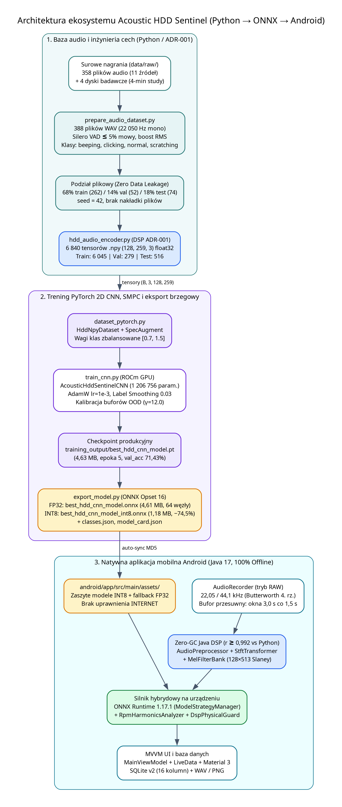
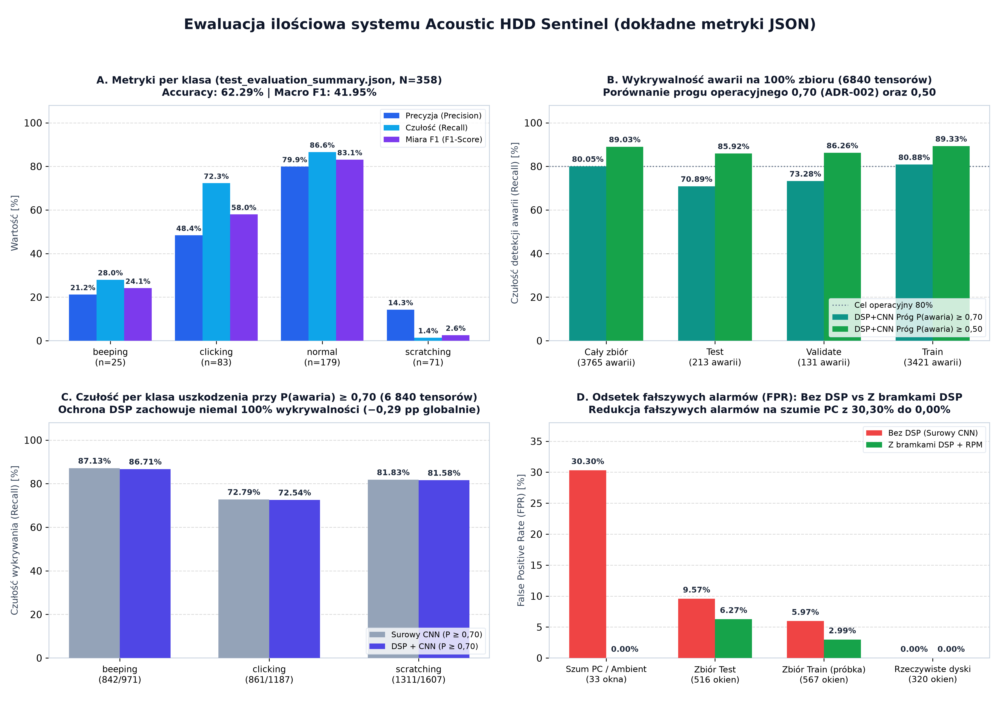

# Acoustic HDD Sentinel 🛡️💽

> **Produkcyjny system wibroakustycznej detekcji i wieloklasowej klasyfikacji uszkodzeń mechanicznych dysków twardych (HDD) łączący sieć 2D CNN w PyTorch (SMPC Option A / Open-Set OOD), deterministycznych strażników DSP (`RpmHarmonicsAnalyzer` i `DSPAdversarialGuard`) oraz natywną aplikację mobilną Android w 100% czystej Javie 17 (MVVM, Material 3 UI, Wzorzec Strategii i tryb RAW Audio).**


[](https://www.python.org/)
[](https://pytorch.org/)
-orange.svg)
-success.svg)

> [!NOTE]
> **Pełna dokumentacja techniczna (PDF & Markdown):**
> Kompletna specyfikacja matematyczna, opis warstw sieci, analiza parytetu Python–Java 17, wyniki testów i schematy architektoniczne znajdują się w **[docx/TECHNICAL_DOCUMENTATION.md](docx/TECHNICAL_DOCUMENTATION.md)** oraz w wersji publikacyjnej **[docx/TECHNICAL_DOCUMENTATION.pdf](docx/TECHNICAL_DOCUMENTATION.pdf)**.

---

## 📖 Spis treści
1. [O projekcie i taksonomia uszkodzeń](#-o-projekcie-i-taksonomia-uszkodzeń)
2. [Architektura systemu i potok DSP (ADR-001)](#-architektura-systemu-i-potok-dsp-adr-001)
3. [Model 2D CNN, SMPC Option A i Fuzja Hybrydowa](#-model-2d-cnn-smpc-option-a-i-fuzja-hybrydowa)
4. [Aplikacja Mobilna Android (Java 17, ADR-002)](#-aplikacja-mobilna-android-java-17-adr-002)
5. [Zbiór danych (Zero Data Leakage) i ewaluacja ilościowa](#-zbiór-danych-zero-data-leakage-i-ewaluacja-ilościowa)
6. [Instalacja, testy i szybki start](#-instalacja-testy-i-szybki-start)
7. [Struktura repozytorium GitHub i odnośniki](#-struktura-repozytorium-github-i-odnośniki)

---

## 🎯 O projekcie i taksonomia uszkodzeń

**Acoustic HDD Sentinel** diagnozuje dyski twarde (2.5" oraz 3.5") na podstawie 3-sekundowych okien audio ($22\,050\text{ Hz}$ mono, `66 150` próbek), klasyfikując cztery stany akustyczne zdefiniowane w [training_output/classes.json](training_output/classes.json):

| Indeks | Klasa | Zjawisko mechaniczne | Sygnatura w tensorze `(3, 128, 259)` |
|:---:|:---|:---|:---|
| `0` | **`beeping`** | Zatarte wrzeciono BLDC / *stiction* głowic | Wąskopasmowe piski stojana **`1050–3500 Hz`**, brak rotacji $f_0$ |
| `1` | **`clicking`** | Uderzenia pozycjonera VCM (*Click of Death*) | Krótkie transjenty o wysokim *Crest Factor* ($\ge 4.5$), silne impulsy w kanałach Delta |
| `2` | **`normal`** | Zdrowa praca łożysk FDB ($5400/7200/10\,000\text{ RPM}$) | Stabilny grzebień harmoniczny $k \cdot f_0$, niski *Crest Factor* (`3.2–4.3`) |
| `3` | **`scratching`** | Tarcie głowicy o powierzchnię talerza (*head crash*) | Ciągły szum szerokopasmowy sięgający **`4–10 kHz`** i mikromodulacja w Delta-Delta |

Operacyjne prawdopodobieństwo awarii wynosi $P(\text{fault}) = P(\text{beeping}) + P(\text{clicking}) + P(\text{scratching}) \ge 0.70$ (ADR-002).



---

## 🔬 Architektura systemu i potok DSP (ADR-001)

Zgodnie z [docx/adr/adr.md](docx/adr/adr.md) każde 3-sekundowe okno (`66 150` próbek, $f_s = 22\,050\text{ Hz}$) przechodzi przez deterministyczny potok w [ml/hdd_audio_encoder.py](ml/hdd_audio_encoder.py):

1. **Bramka ciszy (Silence Gate):** odrzucanie okien o $\text{RMS} < 0.002$ (z zachowaniem pierwszego pełnego okna jako zabezpieczenia awaryjnego).
2. **Normalizacja fali (`normalize_waveform_peak`):** usunięcie składowej stałej DC oraz skalowanie do $[-1.0, 1.0]$ (eliminujące `597.88×` rozrzut głośności mikrofonów w bazie danych).
3. **STFT & Bank Mel:** okno Hanna (`N_FFT = 1024`, `HOP_LENGTH = 256`, rozdzielczość $\approx 11.61\text{ ms}$), `128` filtrów trójkątnych Mel (`50–10 000 Hz`, normalizacja Slaney) oraz logarytmiczna kompresja mocy (`top_db = 80.0 dB`) $\to$ **Kanał 0 (Log-Mel)**.
4. **Pochodne czasowe Savitzky'ego-Golaya ($N_w = 9$):** **Kanał 1 (Delta)** uwypukla impulsy uderzeń głowic, a **Kanał 2 (Delta-Delta)** dynamikę przyspieszeń i tarcia.
5. **Standaryzacja Z-Score z podłogą wariancji (`normalize_tensor_zscore`):** niezależna normalizacja kanałowa z minimalnymi odchyleniami `channel_min_stds = [1.0, 0.15, 0.08]` oraz `MIN_STD = 1e-2` $\to$ tensor `float32` o stałym kształcie **`(128, 259, 3)`** (`(B, 3, 128, 259)` w PyTorch/ONNX).

---

## 🧠 Model 2D CNN, SMPC Option A i Fuzja Hybrydowa

### 1. Architektura `AcousticHddSentinelCNN` ([ml/model_cnn.py](ml/model_cnn.py))
- **4 bloki konwolucyjne** (`3 -> 32 -> 64 -> 128 -> 256` z `BatchNorm2d`, `ReLU`, `MaxPool2d(2,2)` i progresywnym `Dropout2d` `0.15/0.225/0.30`) $\to$ **Global Average Pooling** (`AdaptiveAvgPool2d((1,1))`) $\to$ projekcja `Linear(256 -> 128)` $\to$ głowica `Linear(128 -> 4)`.
- **Niezmiennik parametrów:** dokładnie **`1 206 756` parametrów trenowalnych**.
- **Wbudowana bramka Open-Set OOD / SMPC Option A:** nietrenowalne bufory prototypów awarii (`fault_prototypes`, `fault_thresholds = [0.4226, 0.3633, 0.4199]`, `gamma = 12.0`) wyliczające podobieństwo kosinusowe poprzez ONNX-safe `MatMul + view + ReduceMax` (zero `einsum`) oraz tłumienie logitów awarii poza rozkładem o maksymalnie `-9.21`.

### 2. Hybrydowa fuzja fizyczno-neuronowa ([ml/hybrid_acoustic_sentinel.py](ml/hybrid_acoustic_sentinel.py))
- **[ml/rpm_harmonics_analyzer.py](ml/rpm_harmonics_analyzer.py):** widmo Welcha (`nperseg=8192`), weryfikacja grzebienia harmonicznego `5400 / 7200 / 10000 RPM` (wraz z harmonicznymi stojana 2.5" `8x/9x/10x`), ostrość prążka $\ge 6.0$, test stacjonarności czasowej pitch w `5` przesunięciach ($\Delta f \le 1.5\text{ Hz}$ odrzucające mowę/wibrato) oraz detektor `stall_beep` w paśmie `1050–3500 Hz`.
- **[ml/dsp_adversarial_guard.py](ml/dsp_adversarial_guard.py):** wetowanie wentylatorów PC (`slope < -1.80`), pisku cewek (*coil whine*), metronomów, szumu miejskiego oraz przesterowań ADC z mechanizmem **Smart Clipping Bypass** chroniącym autentyczne zderzenia *Crash Stop*.

### 3. Eksport ONNX Opset 16 ([ml/export_model.py](ml/export_model.py))
- **`best_hdd_cnn_model.onnx` (FP32):** `4 833 479 B` (`4.61 MB`, `64` węzły grafu).
- **`best_hdd_cnn_model_int8.onnx` (Dynamic INT8):** `1 233 983 B` (`1.18 MB`, `121` węzłów grafu — **redukcja rozmiaru o `74.47%`**). Oba modele wraz z `classes.json` i `model_card.json` znajdują się w [android/app/src/main/assets/](android/app/src/main/assets/).

---

## 📱 Aplikacja Mobilna Android (Java 17, ADR-002)

Moduł [android/](android/) został zaimplementowany w **100% w czystej Javie 17 (0% Kotlin)** i działa **w pełni offline** (brak uprawnienia `INTERNET` w [AndroidManifest.xml](android/app/src/main/AndroidManifest.xml)):

- **30 klas Javy** w 5 pakietach (`audio`, `dsp`, `ml`, `data`, `ui`) + `AcousticSentinelApp`, kompilowanych pod `minSdk = 26`, `targetSdk = 34`, Gradle `8.4`, ONNX Runtime `1.17.1`, Material `1.11.0`, Lifecycle `2.7.0`.
- **Akwizycja RAW Audio (`AudioRecorder.java`):** kaskada źródeł `VOICE_RECOGNITION` $\to$ `UNPROCESSED` (`+18.06 dB`) $\to$ `MIC` (`+12.04 dB`), wyłączanie filtrów `NoiseSuppressor`, `AutomaticGainControl` i `AcousticEchoCanceler`, decymator IIR Butterwortha 4. rzędu (`fc = 9500 Hz`) dla urządzeń `44.1 kHz` oraz prealokowany bufor przesuwny `sampleBuffer` (`3.0–9.0 s`, do `5` okien co `1.5 s`).
- **Potok DSP Zero-GC (`AudioPreprocessor.java`, `StftTransformer.java`, `MelFilterBank.java`):** prealokacja wszystkich macierzy (`99 456` elementów float na wejście NCHW) oraz wysoka zgodność z Pythonem (`librosa 0.11.0` na sygnale `seed=42`): korelacja Pearsona **`r = 0.999215`** (Log-Mel), `r = 0.992679` (Delta) i `r = 0.993139` (Delta-Delta).
- **Wzorzec Strategii i fallback (`ModelStrategyManager.java`):** wybór między `LegacyCnnDetector` i `AlternativeCnnDetector`, automatyczny fallback z modelu `INT8` na `FP32` (np. gdy runtime bez jądra `ConvInteger(10)` na x86_64 JVM zgłosi `ORT_NOT_IMPLEMENTED`).
- **Persystencja i UI (`DiagnosticDbHelper.java`, `MainViewModel.java`, `MainActivity.java`):** lokalna baza SQLite v2 (`16` kolumn, migracja v1 $\to$ v2 bez utraty danych), animowany radar Material 3, wczesne zatrzymanie (*Early Stopping*) oraz eksport spektrogramów Inferno `259×128` i plików WAV.

---

## 📊 Zbiór danych (Zero Data Leakage) i ewaluacja ilościowa

- **Zbiór danych (podział na poziomie plików `68% / 14% / 18%`, zero wycieku danych):** `358` plików źródłowych w `data/raw/` (rejestr [data/raw/PROCESSED_SOURCES_REGISTRY.json](data/raw/PROCESSED_SOURCES_REGISTRY.json)) $\to$ `388` skategoryzowanych plików `.wav` (`262` train, `52` validate, `74` test) $\to$ **`6 840` tensorów `.npy`** `(128, 259, 3)` (`train: 6 045`, `validate: 279`, `test: 516`; `3 765` awarii + `3 075` normalnych).
- **Bieżący podział testowy (`N = 516` okien):**
  - `best_hdd_cnn_model_int8.onnx` (INT8): Accuracy **`71.32%`**, Weighted F1 **`71.20%`**, Macro F1 **`57.86%`** (`normal` F1 = `86.84%`, `clicking` = `54.55%`, `scratching` = `54.29%`, `beeping` = `35.77%`).
  - `best_hdd_cnn_model.onnx` (FP32) & `.pt`: Accuracy **`70.74%`**, Weighted F1 **`70.63%`**, Macro F1 **`57.13%`**.
- **Pełny zbiór (`6 840` tensorów, [training_output/full_dataset_fault_detection_summary.json](training_output/full_dataset_fault_detection_summary.json)):**
  - Czułość wykrywania awarii przy progu operacyjnym $P(\text{fault}) \ge 0.70$: **`80.05%`** (`beeping: 86.71%`, `scratching: 81.58%`, `clicking: 72.54%`); przy progu $\ge 0.50$: **`89.03%`**.
- **Wpływ bramek DSP i badanie rzeczywistych dysków ([training_output/evaluation_with_vs_without_dsp.json](training_output/evaluation_with_vs_without_dsp.json), [docx/RAPORT_TESTOW_RZECZYWISTYCH.md](docx/RAPORT_TESTOW_RZECZYWISTYCH.md)):**
  - **Szum wentylatorów PC / tła (`33` okna):** redukcja FPR z `30.30%` (surowy CNN) do **`0.00%`** (DSP + RPM).
  - **Zbiór testowy surowych nagrań (`516` okien):** redukcja FPR z `9.57%` do **`6.27%`**.
  - **4 sprawne dyski fizyczne (`320` okien — Toshiba P300, WD Blue, Seagate Momentus, HGST Travelstar):** **`0.00%` FPR** (Crest Factor `3.2–4.3`, maksymalna pewność surowych fałszywych alarmów `< 38%`).



---

## 💻 Instalacja, testy i szybki start

### 1. Konfiguracja środowiska Python
```bash
git clone git@github.com:DJMixu/AcousticHddSentinel.git
cd AcousticHddSentinel

python3 -m venv .venv
source .venv/bin/activate
pip install -r requirements.txt
```

### 2. Uruchomienie wszystkich oficjalnych zestawów testowych
```bash
# 1. Integralność projektu, AST, Zero Data Leakage i parzystość MD5 Androida (6/6 PASS)
python tests/test_project_logic.py

# 2. Architektura wielomodalnych podcentrów SMPC Option A (7/7 PASS)
python tests/test_smpc_architecture.py

# 3. Analizator harmonicznych obrotowych RPM i odrzucanie mowy (9/9 PASS)
python tests/test_rpm_harmonics_analyzer.py

# 4. Odporność fuzji hybrydowej na szumy wentylatorów PC i cichy sygnał 45 dB (6/6 PASS)
python tests/test_computer_sound_rejection.py

# 5. Audyt wykrywalności awarii na 100% zakodowanego zbioru (6 840 tensorów)
python tests/test_full_dataset_fault_detection_rate.py

# 6. Porównanie potoku aplikacji z DSP vs bez DSP (320 okien HDD + 33 okna tła PC)
python tests/evaluate_app_pipeline_on_dataset.py

# 7. Zestaw testów jednostkowych i integracyjnych Android Java 17 (17 klas, 92/92 PASS)
cd android && ./gradlew testDebugUnitTest --rerun-tasks --console=plain && cd ..
```

### 3. Regeneracja zbioru, trening, eksport i inferencja
```bash
# Przygotowanie bazy WAV i kodowanie tensorów .npy (wymaga lokalnych nagrań w data/raw/)
python ml/prepare_audio_dataset.py
python ml/hdd_audio_encoder.py

# Trening modelu PyTorch i eksport ONNX FP32/INT8 z auto-synchronizacją do Androida
python ml/train_cnn.py --epochs 35 --batch-size 32 --output-dir ./training_output
python ml/export_model.py --weights training_output/best_hdd_cnn_model.pt --output-dir exported_models

# Analiza pojedynczego pliku WAV lub nagrania z fizycznego mikrofonu ALC1220
./scripts/record_mic.sh 3 /tmp/hdd_sample.wav
python ml/hybrid_acoustic_sentinel.py --input /tmp/hdd_sample.wav
```

### 4. Budowanie i instalacja aplikacji Android
```bash
cd android && ./gradlew assembleDebug && cd ..
./scripts/install_apk.sh --build
```

---

## 📁 Struktura repozytorium GitHub i odnośniki

```
AcousticHddSentinel/
├── README.md                                  # Główny przewodnik projektu
├── requirements.txt                           # Zależności Pythona (PyTorch, Librosa, SciPy, NumPy)
├── ml/                                        # Pipeline ML, DSP (ADR-001), SMPC Option A, fuzja i eksport ONNX
├── tests/                                     # Oficjalne zestawy testowe, audyty parzystości i testy obciążeniowe
├── scripts/                                   # Skrypty nagrywania ALC1220, instalacji APK, LLM bridge i kuracji
├── android/                                   # Natywna aplikacja Android (100% Java 17, 30 klas, 17 klas testowych / 92 testy)
│   └── app/src/main/assets/                   # best_hdd_cnn_model_int8.onnx, best_hdd_cnn_model.onnx, classes.json, model_card.json
├── data/raw/PROCESSED_SOURCES_REGISTRY.json   # Rejestr pochodzenia i sum MD5 próbek źródłowych
├── training_output/                           # Raporty ewaluacyjne JSON/CSV/TXT i classes.json (wagi .pt generowane lokalnie)
├── exported_models/                           # Karta modelu model_card.json i classes.json (artefakty .onnx generowane lokalnie)
└── docx/                                      # Dokumentacja techniczna, ADR-y i diagramy
    ├── TECHNICAL_DOCUMENTATION.md             # Kompletna dokumentacja techniczna (Markdown)
    ├── TECHNICAL_DOCUMENTATION.pdf            # Dokumentacja techniczna (publikacja PDF XeLaTeX)
    ├── AUDIO_PREPROCESSING_AND_CNN_ARCHITECTURE.md # Szczegółowe kompendium matematyczne DSP i 2D CNN
    ├── RAPORT_TESTOW_RZECZYWISTYCH.md         # Raport z badań empirycznych na 4 fizycznych dyskach HDD
    ├── diagramOverView.svg                    # Schemat poglądowy systemu
    ├── adr/
    │   ├── adr.md                             # ADR-001: Niezmienniki potoku DSP i kodowania danych
    │   └── adr-002-mobile-architecture.md     # ADR-002: Architektura aplikacji mobilnej Android
    └── diagrams/                              # 6 diagramów architektonicznych i wykresów ewaluacyjnych (PNG 300 DPI)
```

### Kluczowe diagramy i dokumenty:
- **[docx/TECHNICAL_DOCUMENTATION.md](docx/TECHNICAL_DOCUMENTATION.md)** / **[docx/TECHNICAL_DOCUMENTATION.pdf](docx/TECHNICAL_DOCUMENTATION.pdf)** — pełna dokumentacja techniczna systemu.
- **[docx/adr/adr.md](docx/adr/adr.md)** — ADR-001 (specyfikacja potoku DSP i brak wycieku danych).
- **[docx/adr/adr-002-mobile-architecture.md](docx/adr/adr-002-mobile-architecture.md)** — ADR-002 (architektura aplikacji mobilnej).
- **[docx/AUDIO_PREPROCESSING_AND_CNN_ARCHITECTURE.md](docx/AUDIO_PREPROCESSING_AND_CNN_ARCHITECTURE.md)** — kompendium matematyczne tensorów 3-kanałowych i SMPC.
- **[docx/RAPORT_TESTOW_RZECZYWISTYCH.md](docx/RAPORT_TESTOW_RZECZYWISTYCH.md)** — raport z weryfikacji na 4 rzeczywistych dyskach twardych.
- Diagramy w [docx/diagrams/](docx/diagrams/): [fig1_system_architecture.png](docx/diagrams/fig1_system_architecture.png), [fig2_dsp_pipeline.png](docx/diagrams/fig2_dsp_pipeline.png), [fig3_cnn_smpc_architecture.png](docx/diagrams/fig3_cnn_smpc_architecture.png), [fig4_hybrid_decision_engine.png](docx/diagrams/fig4_hybrid_decision_engine.png), [fig5_android_mvvm_architecture.png](docx/diagrams/fig5_android_mvvm_architecture.png), [fig6_evaluation_metrics.png](docx/diagrams/fig6_evaluation_metrics.png).
