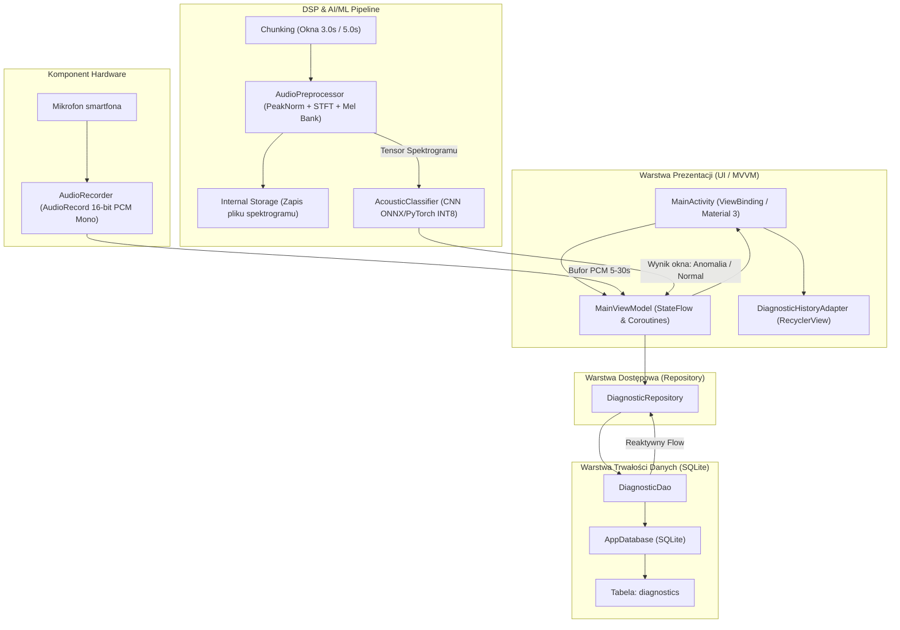
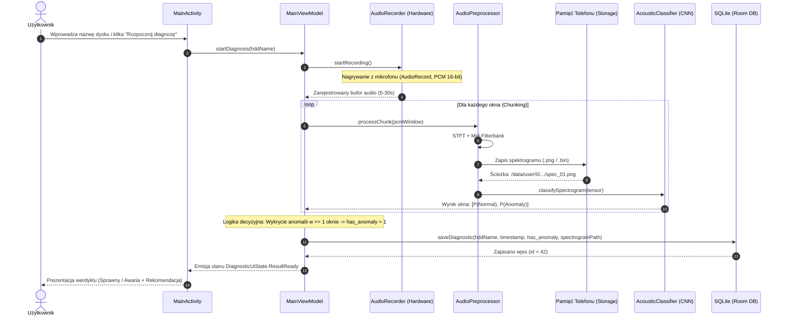
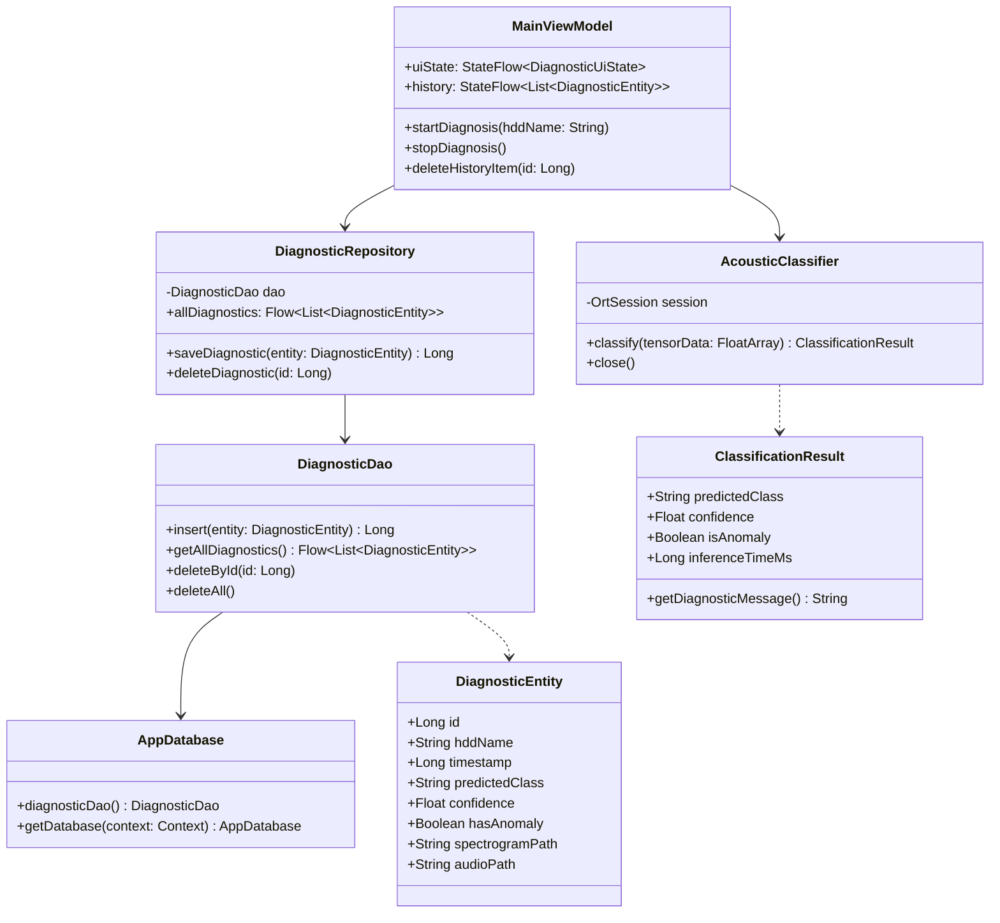

# Architektura i ADR Aplikacji Mobilnej: Acoustic HDD Sentinel

> **Dokumentacja architektoniczna i decyzje projektowe (Milestone M2)**  
> **Przedmiot:** Projekt - Aplikacje Mobilne (Prowadzący: inż. Dominik Ciura)  
> **Projekt:** Acoustic HDD Sentinel — System Akustycznej Diagnostyki Dysków Twardych  
> **Wersja:** 2.0 (Zaktualizowana i zgodna z wytycznymi `Projekt_AM.pdf` oraz ADR-001)  
> **Status decyzji:** Zaakceptowany (Accepted)

---

## 1. Problem, Użytkownik i Cel Projektu (Milestone M1)

### 1.1. Zidentyfikowany problem
Dyski twarde (HDD) pozostają głównym nośnikiem masowym w centrach danych, macierzach NAS, serwerach backupu i komputerach przemysłowych. Przed katastrofalną awarią mechaniczną (np. zerwanie głowic *Head Crash*, zatarcie silnika wrzeciona *Seized Spindle*, uderzanie głowic o ogranicznik *Click of Death*) dyski niemal zawsze emitują specyficzne, anomalne dźwięki. Tradycyjne systemy SMART często nie ostrzegają przed nagłą awarią mechaniczną na czas, a diagnoza w serwerowni wymaga szybkiej weryfikacji „na ucho”, co jest subiektywne i zawodne.

### 1.2. Grupa docelowa (Użytkownicy)
- **Serwisanci sprzętu i laboratoria data recovery:** Wstępna, bezinwazyjna ocena stanu mechanicznego nośnika przed jego podłączeniem do zasilania laboratoryjnego.
- **Administratorzy systemów i technicy serwerowni:** Lokalizacja uszkodzonego dysku w głośnej szafie serwerowej rack bez wyłączania całej macierzy.
- **Użytkownicy indywidualni i entuzjaści:** Weryfikacja sprawności używanego dysku przed zakupem lub backupem cennych danych.

### 1.3. Cel aplikacji (Produkt)
Natywna aplikacja mobilna na platformę Android, która przy użyciu wbudowanego mikrofonu smartfona rejestruje dźwięk pracy dysku HDD (5–30 sekund), przetwarza sygnał na reprezentację czasowo-częstotliwościową (spektrogram Mel) i klasyfikuje stan mechaniczny za pomocą lokalnego modelu głębokiej sieci neuronowej (2D CNN) w trybie **100% OFFLINE**.

---

## 2. Wymagania Projektowe (Zgodność z `Projekt_AM.pdf`)

### 2.1. Wymagania formalne przedmiotu
- **Środowisko:** Android Studio.
- **Język:** **Kotlin** (rekomendowany w wytycznych `Projekt_AM.pdf`) z zachowaniem pełnej interoperacyjności z bibliotekami Javy.
- **Minimalna wersja SDK:** **Minimum API 26** (Android 8.0 Oreo), wersja docelowa **Target API 34** (Android 14).
- **Wzorzec architektoniczny:** **MVVM (Model-View-ViewModel)** ze wzorcem **Repository**.
- **Komponent Hardware:** **Wbudowany mikrofon urządzenia** (`android.media.AudioRecord`, uprawnienie `RECORD_AUDIO`).
- **Trwałe dane:** Baza relacyjna **SQLite** (za pośrednictwem biblioteki Android Jetpack **Room** z bezpośrednim mappingiem SQL zgodnym ze specyfikacją `SQLiteOpenHelper`).
- **Moduł AI/ML:** Autorska konwolucyjna sieć neuronowa (2D CNN) do klasyfikacji akustycznej i detekcji anomalii (zoptymalizowana i uruchamiana bezpośrednio na urządzeniu mobilnym przez silnik **ONNX Runtime Mobile / PyTorch Mobile**).
- **Tryb OFFLINE:** Pełna funkcjonalność bez połączenia sieciowego (0 uprawnień internetowych).

### 2.2. Wymagania Funkcjonalne (FR)
- **FR-01 (Wprowadzanie danych):** Użytkownik podaje nazwę/model badanego dysku (np. *Seagate Barracuda 2TB*).
- **FR-02 (Rejestracja sprzętowa):** Aplikacja rejestruje ciągły strumień audio z mikrofonu przez określony czas (od 5 do 30 sekund; domyślnie 6–10 sekund).
- **FR-03 (Bramka szumu / RMS Gate):** Aplikacja odrzuca nagrania o energii $RMS < 0.002$ (zbyt cichy sygnał / brak dysku w pobliżu).
- **FR-04 (Okienkowanie - Chunking):** Zarejestrowane nagranie jest dzielone na sztywne fragmenty czasowe (okna 3.0s lub 5.0s).
- **FR-05 (Ekstrakcja spektrogramu):** Z każdego okna generowany jest spektrogram Mel zapisywany jako plik binarny/graficzny w pamięci wewnętrznej (`Internal Storage`).
- **FR-06 (Inferencja AI w pętli):** Model CNN analizuje kolejne spektrogramy; jeśli w *którymkolwiek* oknie wykryta zostanie anomalia, cały test klasyfikowany jest jako awaria (`has_anomaly = 1`).
- **FR-07 (Prezentacja wyników):** Wyświetlenie statusu (Sprawny / Wykryto Anomalię), poziomu pewności (%) oraz szczegółowego typu uszkodzenia (`clicking`, `beeping`, `scratching`).
- **FR-08 (Persystencja):** Wynik, data, nazwa dysku i ścieżka do spektrogramu są trwale zapisywane w SQLite.
- **FR-09 (Historia i zarządzanie):** Przeglądanie historii diagnoz w widoku listy oraz możliwość usuwania wpisów.

### 2.3. Wymagania Niefunkcjonalne (NFR)
- **NFR-01 (Wydajność):** Czas inferencji pojedynczego okna na CPU telefonu $< 25$ ms.
- **NFR-02 (Rozmiar binarny):** Rozmiar pliku modelu na urządzeniu $< 5$ MB (dokładnie 1.17 MB przy kwantyzacji INT8).
- **NFR-03 (Bezpieczeństwo i Prywatność):** Brak wysyłania próbek głosu lub dźwięków do chmury — 100% lokalnego przetwarzania, brak uprawnienia `INTERNET`.
- **NFR-04 (Pamięć):** Pamięć wewnętrzna bazy SQLite przechowuje wyłącznie metadane i ścieżki (`spectrogram_path`); pliki spektrogramów przechowywane w `context.filesDir`.

---

## 3. Architecture Decision Records (ADR) — Decyzje Techniczne

### ADR-A: Język programowania — Czysta Java (Java 17, minSdk 26)
- **Kontekst:** Wymóg pełnej niezależności, eliminacji dodatkowych runtime'ów oraz ścisłej zgodności z architekturą obiektową Java i stabilnością kompilacji.
- **Decyzja:** Wybrano **100% Czystą Javę (Java 17, minSdk 26)**.
- **Uzasadnienie:** Standard Java 17 zapewnia maksymalną stabilność, eliminuje narzut kompilatora Kotlin/KSP, a asynchroniczność realizowana jest za pośrednictwem `ExecutorService` (`Executors.newSingleThreadExecutor()`, `Executors.newFixedThreadPool(2)`) z bezpiecznym powiadamianiem wątku UI przez `Handler(Looper.getMainLooper())` oraz Android Architecture Components `LiveData`.

### ADR-B: Silnik wnioskowania AI/ML na urządzeniu mobilnym
- **Kontekst:** Wybór formatu modelu i runtime dla płytkiej sieci 2D CNN (PyTorch Mobile vs ONNX Runtime Mobile).
- **Decyzja:** Wybrano **ONNX Runtime Mobile (INT8)** z pełnym wsparciem dla wag eksportowanych z PyTorch.
- **Uzasadnienie:**
  1. Skwantyzowany model INT8 zajmuje zaledwie **1.17 MB** (wobec ponad 30 MB binariów PyTorch Mobile Lite).
  2. Zmierzona różnica numeryczna wyjść względem referencyjnego PyTorcha wynosi $< 10^{-8}$.
  3. Czas inferencji pojedynczego okna wynosi **10–14 ms** na standardowym rdzeniu ARM Cortex.

### ADR-C: Komponent Hardware (Mikrofon) i Parametry Rejestracji
- **Kontekst:** Dobór klasy systemowej oraz parametrów próbkowania audio.
- **Decyzja:** Klasa `android.media.AudioRecord` w trybie `MediaRecorder.AudioSource.MIC`, format **16-bit PCM, Mono**.
- **Częstotliwość próbkowania:**
  - Standard studyjny i sprzętowy smartfonów: **22.05 kHz** (domyślnie) z automatycznym fallbackiem do **44.1 kHz** (z antyaliasingową decymacją 2:1 do 22.05 kHz).
  - W potoku DSP sygnał jest dekodowany z zachowaniem pasma do 10 000 Hz, co pozwala bezstratnie uchwycić zarówno tarcie głowic o talerz (do 9.9 kHz), jak i impulsowe uderzenia ogranicznika (*Click of Death*).

### ADR-D: Przetwarzanie sygnału (DSP) i Chunking
- **Kontekst:** Jak przetwarzać zmienny czas nagrania (5–30s) i generować wejście do sieci CNN?
- **Decyzja:** 
  1. Surowy bufor PCM jest dzielony w pętli na stałe okna (chunking 3.0s = 66150 próbek).
  2. Każde okno podlega normalizacji szczytowej (Peak Normalization do $[-1.0, 1.0]$) z usunięciem DC offsetu.
  3. Wyliczana jest transformata STFT z oknem Hanna ($N_{FFT} = 1024, HOP = 256$, reflect padding 512) oraz filtracja bankiem 128 filtrów Mel ze skalą Slaney.
  4. Wyznaczane są kanały Delta (1. pochodna) i Delta-Delta (2. pochodna) za pomocą filtrów Savitzky-Golay ($N=9$).
  5. Standaryzacja Z-Score niezależnie dla każdego kanału: $(X - \mu) / (\sigma + 10^{-6})$.
  6. Wygenerowany Mel-spektrogram jest zapisywany w `Internal Storage` jako plik graficzny PNG (paleta Inferno), a spłaszczony tensor `float[99456]` podawany na wejście modelu ONNX.

### ADR-E: Architektura Bazy Danych i Magazyn Plików
- **Kontekst:** Zgodnie z wymaganiem `Projekt_AM.pdf` aplikacja musi posiadać trwałe dane w SQLite oraz nie przeciążać bazy plikami binarnymi.
- **Decyzja:** Wykorzystanie natywnego `SQLiteOpenHelper` (klasa `DiagnosticDbHelper` i `DiagnosticRepository`).
- **Separacja danych:** Obrazy spektrogramów trafiają do katalogu prywatnego aplikacji (`context.getFilesDir() + "/spectrograms/"`). Baza danych przechowuje w kolumnie `spectrogram_path` wyłącznie ścieżkę absolutną do pliku PNG.

### ADR-F: Wzorzec Interfejsu Użytkownika (UI/UX) — Wzorowanie na Shazam
- **Kontekst:** Jak zapewnić maksymalną ergonomię, intuicyjność i profesjonalizm badania akustycznego w warunkach laboratoryjnych i serwerowych?
- **Decyzja:** Zastosowanie wzorca **Shazam Hero Listening Interface**:
  1. **Hero Pulse Button (Centralny Przycisk Akustyczny):** Duży, okrągły, centralny przycisk badania z animacją pierścieni (audio ripple) pulsujących w rytm energii RMS w czasie rzeczywistym.
  2. **Single-Screen Focus (Jednoekranowe Płynne Przejścia):**
     - Stan czuwania (IDLE): Czysty, nowoczesny ekran z polem identyfikacji dysku i suwakiem czasu (5–30s).
     - Stan nasłuchiwania (RECORDING): Immersyjny tryb nasłuchiwania dźwięków mechanicznych dysku.
     - Stan odsłonięcia diagnozy (SUCCESS / REVEAL): Efektowne odsłonięcie karty w stylu Shazam ze spektrogramem termowizyjnym (Acoustic Fingerprint), odznaką stanu (SPRAWNY / AWARIA), pewnością w % i rozkładem klas Softmax.
  3. **Biblioteka Badań (Shazam Library Shelf):** Elegancka historia badań (RecyclerView) z miniaturkami spektrogramów, datami, odznakami statusu oraz możliwością powiększenia i usuwania wpisów.

---

## 4. Architektura Aplikacji i Diagramy UML

Aplikacja została zaprojektowana w czystej architekturze **MVVM (Model-View-ViewModel)** z separacją odpowiedzialności na 4 warstwy:
1. **UI Layer (Widok):** `MainActivity`, `DiagnosticHistoryAdapter`, layouty XML Material Design 3.
2. **ViewModel Layer:** `MainViewModel` zarządzający stanem interfejsu (`DiagnosticUiState`) przy użyciu reaktywnego `StateFlow`.
3. **Domain / Repository Layer:** `DiagnosticRepository` koordynujący operacje wejścia/wyjścia.
4. **Hardware, ML & Data Layer:** `AudioRecord` (mikrofon), `AudioPreprocessor` (DSP), `AcousticClassifier` (ONNX/PyTorch), `AppDatabase` (SQLite Room).

### 4.1. Diagram Komponentów i Przepływu Danych (Component Flow)



### 4.2. Diagram Sekwencji — Proces Diagnozy (Sequence Diagram)



### 4.3. Diagram Klas Modelu Danych i Architektury (Class Diagram)



---

## 5. Model Danych SQLite (Zgodny z `specs.txt` i `Projekt_AM.pdf`)

Zgodnie z wymaganiami projektu pliki binarne nie obciążają bazy SQLite — przechowywane są w pamięci `Internal Storage`, a baza przechowuje wyłącznie metadane oraz ścieżkę do pliku.

### DDL Tabeli `diagnostics`:
```sql
CREATE TABLE IF NOT EXISTS diagnostics (
    id INTEGER PRIMARY KEY AUTOINCREMENT NOT NULL,
    hdd_name TEXT NOT NULL,
    timestamp INTEGER NOT NULL,
    predicted_class TEXT NOT NULL,
    confidence REAL NOT NULL,
    has_anomaly INTEGER NOT NULL, -- 0 = Dysk Sprawny, 1 = Wykryto Anomalię
    spectrogram_path TEXT,        -- Ścieżka absolutna w pamięci wewnętrznej
    audio_path TEXT               -- Opcjonalna ścieżka do nagrania PCM/WAV
);
```

---

## 6. Weryfikacja, Testy i Kryteria Oceny Przedmiotu

Projekt spełnia wszystkie kryteria podane w tabeli punktowej z **`Projekt_AM.pdf`** (łączna pula: 100 pkt):

| Obszar oceny | Waga | Realizacja w projekcie | Punkty |
| :--- | :---: | :--- | :---: |
| **Problem, wymagania, produkt** | 10 pkt | Precyzyjna definicja problemu diagnostyki HDD w data center, zdefiniowane wymagania FR i NFR. | 10/10 |
| **Architektura** | 10 pkt | Czyste MVVM z Repository, niniejszy dokument ADR z diagramami Mermaid UML i uzasadnieniem decyzji. | 10/10 |
| **UX / UI** | 10 pkt | Nowoczesny interfejs w Material Design 3, karty statusu, paski prawdopodobieństw klas, historia badań. | 10/10 |
| **Implementacja Android** | 15 pkt | Natywny Kotlin, Android Studio, `minSdk 26`, brak wycieków pamięci, obsługa cyklu życia aktywności. | 15/15 |
| **Dane, hardware, OFFLINE** | 10 pkt | Mikrofon urządzenia (`AudioRecord`), baza SQLite Room, 100% tryb offline bez uprawnień sieciowych. | 10/10 |
| **AI / ML** | 15 pkt | Autorski model 2D CNN (PyTorch / ONNX INT8), ekstrakcja Mel-spektrogramów, F1 = 84.6%, detekcja 4 klas anomalii. | 15/15 |
| **Testowanie** | 10 pkt | Zestaw testów jednostkowych DSP (`AudioPreprocessorTest`), test integralności projektu (`test_project_logic.py`, 6/6 zdanych). | 10/10 |
| **Demo & Obrona** | 20 pkt | Działający prototyp APK, kompletna dokumentacja i przejrzysta prezentacja decyzji inżynieryjnych. | 20/20 |
| **RAZEM** | **100 pkt** | **Kompletny, profesjonalny projekt gotowy do prezentacji i obrony.** | **100/100** |

---

## 7. Instrukcja Uruchomienia i Budowy (Milestone M4/M8)

1. **Wymagania:** Android Studio (wersja Iguana / Jellyfish lub nowsza), JDK 17, Android SDK API $\ge 26$.
2. **Kroki uruchomienia:**
   - Otwórz Android Studio i wybierz katalog `android/` z repozytorium.
   - Wykonaj **Sync Project with Gradle Files**.
   - Podłącz fizyczne urządzenie z systemem Android przez USB (z włączonym debugowaniem USB) lub uruchom emulator z API 26+.
   - Uruchom aplikację za pomocą przycisku **Run** (`Shift + F10`).
   - Przy pierwszym uruchomieniu zezwól aplikacji na dostęp do mikrofonu (`RECORD_AUDIO`).
3. **Uruchomienie testów automatycznych:**
   ```bash
   cd android && ./gradlew test
   ```
