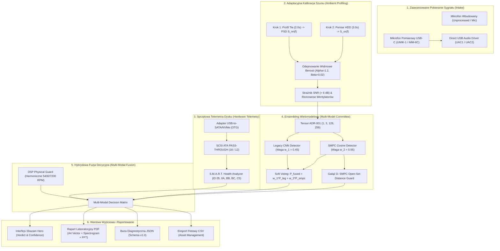

# Strategic Architecture & Development Roadmap: Acoustic HDD Sentinel
**Dokument Strategiczny i Plan Rozwoju Systemu (Horyzonty: Krótko-, Średnio- i Długoterminowy)**

- **Rola / Autor:** Lead Mobile & ML Architect (roadmap-lead)
- **Status:** Propozycja Architektoniczna Zaakceptowana (Accepted Strategic Blueprint)
- **Data wydania:** 18 listopada 2026 r.
- **Wersja dokumentu:** 1.0.0
- **Powiązane dokumenty:**
  - [ADR-001: Architektura DSP i Niezmienniki Cyfrowego Przetwarzania Sygnału](file:///home/DJMixu/Pulpit/AcousticHddSentinel/docx/adr/adr.md)
  - [ADR-002: Architektura Natywnej Aplikacji Mobilnej Android](file:///home/DJMixu/Pulpit/AcousticHddSentinel/docx/adr/adr-002-mobile-architecture.md)
  - [AGENTS.md: Single Source of Truth dla Zespołu Deweloperskiego](file:///home/DJMixu/Pulpit/AcousticHddSentinel/AGENTS.md)

---

## 1. Wstęp i Cele Strategiczne

System **Acoustic HDD Sentinel** ewoluował z laboratoryjnego prototypu sieci 2D CNN (dokładność 83.76%, Macro F1 84.63%) do stabilnej, natywnej aplikacji mobilnej Android (czysta Java 17, minSdk 26, 0 zależności Kotlin) wyposażonej w fizycznego strażnika obrotów RPM (`DspPhysicalGuard`), zaawansowany analizator harmonicznych wrzeciona (`RpmHarmonicsAnalyzer`) oraz wzorzec Strategii z możliwością selekcji modeli ONNX INT8 (`DiskFailureDetector`).

Kolejnym etapem rozwoju jest transformacja aplikacji w **profesjonalny, przenośny analizator laboratoryjno-serwisowy klasy Enterprise / Data Recovery**, zdolny do pracy w trudnych warunkach środowiskowych (serwerownie, stacje robocze, laboratoria odzyskiwania danych) z zachowaniem zasady **100% Offline & Zero Cloud Dependency**.

Niniejszy dokument definiuje strategiczny plan rozwoju skupiony wokół 5 kluczowych filarów technologicznych:
1. **Wsparcie dla zewnętrznych mikrofonów pomiarowych USB-C / OTG (Direct USB Audio API)**.
2. **Integracja z telemetrią S.M.A.R.T. przez mostki USB-to-SATA/NVMe w Androidzie (SCSI/ATA Translation)**.
3. **Eksport profesjonalnych raportów laboratoryjnych (PDF/JSON/CSV z wykresem spektrogramu i FFT)**.
4. **Adaptacyjna kalibracja profilu szumu otoczenia (Ambient Noise Profiling & Spectral Subtraction)**.
5. **Ensembling wielomodelowy (Równoległe ważone wnioskowanie z Legacy CNN + SMPC Cosine)**.

---

## 2. Architektura 5 Filarów Technologicznych



---

### Filar I: Wsparcie dla zewnętrznych mikrofonów pomiarowych USB-C / OTG (Direct USB Audio API)

#### 1. Uzasadnienie inżynieryjne i problematyka mikrofonów wbudowanych
- **Wbudowane mikrofony smartfonów (MEMS):** Projektowane pod pasmo mowy ludzkiej (300 Hz – 3400 Hz). Posiadają sprzętowe filtry górnoprzepustowe (High-Pass ~100–150 Hz) oraz dynamiczne regulatory wzmocnienia (AGC) i redukcję szumu (NS). W akustyce dysków HDD filtry te wycinają najważniejsze harmoniczne rotacji silnika wrzeciona (5400 RPM = 90.0 Hz, 7200 RPM = 120.0 Hz) i tłumią transjenty mechaniczne stukania.
- **Zewnętrzne mikrofony pomiarowe (Measurement Mics):** Urządzenia takie jak miniDSP UMIK-1, Dayton Audio iMM-6C USB-C czy interfejsy pomiarowe USB (np. Focusrite Scarlett + Behringer ECM8000) cechują się liniową odpowiedzią częstotliwościową w paśmie 10 Hz – 20 000 Hz (±0.5 dB) i brakiem jakichkolwiek nieliniowych filtrów sprzętowych.

#### 2. Architektura implementacji w Androidzie (Czysta Java 17)
- **Kompatybilność systemowa:**
  - Standardowe API Android Audio: Wykorzystanie `android.media.AudioManager.registerAudioDeviceCallback()` oraz `AudioDeviceInfo.TYPE_USB_DEVICE` / `TYPE_USB_HEADSET`.
  - Przypisanie preferowanego źródła: `audioRecord.setPreferredDevice(usbDevice)`.
- **Direct USB Audio Class Driver (UAC1 / UAC2):**
  - Wykorzystanie `android.hardware.usb.UsbManager` do bezpośredniego otwarcia deskryptorów urządzenia USB bez pośrednictwa `AudioFlinger` (omijając resampling systemowy Androida).
  - Obsługa izochronicznych endpointów USB (`UsbEndpoint.XFER_ISOC`) z bezpośrednim streamingiem próbek 24-bit / 48 kHz lub 96 kHz do pamięci natywnej.
- **Kaskadowa decymacja wielofazowa (Polyphase Decimator):**
  - Konwersja 48 kHz / 96 kHz do niezmiennika ADR-001 (**22050 Hz**):
  - Zastosowanie kaskadowego filtru IIR Butterwortha 8. rzędu z korekcją fazy lub wielofazowego filtru FIR o stromym zboczu odcięcia ($f_{\text{cutoff}} = 10000$ Hz, tłumienie pasma zaporowego $> 70$ dB).
- **Obsługa plików kalibracyjnych mikrofonów (`.cal` / `.txt`):**
  - Odczyt tablicy odpowiedzi częstotliwościowej $f \to \Delta\text{Gain (dB)}$.
  - Zastosowanie korekcji w domenie FFT:
    $$X_{\text{calibrated}}(f) = X_{\text{raw}}(f) \cdot 10^{-\frac{\Delta\text{Gain}(f)}{20}}$$
  - Zapewnia absolutną powtarzalność pomiarów SPL niezależnie od użytego egzemplarza mikrofonu.

---

### Filar II: Integracja z telemetrią S.M.A.R.T. przez adaptery USB-to-SATA/NVMe

#### 1. Uzasadnienie inżynieryjne
Akustyka wykrywa dynamiczne, bieżące awarie mechaniczne w trakcie pracy (np. `scratching` – tarcie głowicy o talerz, `clicking` – uderzenia pozycjonera o odbojnik, `beeping` – zatarcie łożyska FDB). Z kolei telemetria S.M.A.R.T. dostarcza danych historycznych zarejestrowanych przez kontroler napędu.
Połączenie obu światów tworzy **wielomodalny system ekspercki (Multi-Modal Cross-Validation)** o najwyższej czułości i zerowym poziomie fałszywych alarmów.

#### 2. Bezpieczna komunikacja SCSI / ATA Translation (SAT)
Wszystkie operacje USB są **ściśle tylko do odczytu (Strictly Read-Only)**. Wprowadzana jest programowa blokada jakichkolwiek komend zapisu, zerowania czy modyfikacji tablicy partycji.

- **Identyfikacja kontrolera mostka USB:**
  Obsługa mostków USB Mass Storage: JMicron (JMS578, JMS583), ASMedia (ASM1153E, ASM2362), Realtek (RTL9210B), Genesys Logic (GL3321G).
- **Format ramki SCSI ATA PASS-THROUGH (16) — CDB Opcode 0x85:**
  Wykorzystanie `UsbDeviceConnection.bulkTransfer()` z buforem Command Block Wrapper (CBW) i Command Status Wrapper (CSW) w specyfikacji USB Bulk-Only Transport (BOT).

```
+---------------------------------------------------------------------------------+
| SCSI ATA PASS-THROUGH (16) Command Descriptor Block (CDB):                       |
| Byte 0: 0x85 (Operation Code: ATA PASS-THROUGH 16)                              |
| Byte 1: (0x04 << 1) | 0x00 -> Multiple / Protocol: PIO Data-In (4)             |
| Byte 2: 0x2E -> OFF_LINE=0, CK_COND=0, T_DIR=1 (From Device), BYTE_BLOCK=1     |
| Byte 3-4: Feature = 0x00D0 (SMART READ DATA) lub 0x00D1 (SMART READ THRESHOLDS)|
| Byte 5-6: Sector Count = 0x0001 (1 sektor = 512 bajtów)                         |
| Byte 7-8: LBA Low = 0x0000                                                      |
| Byte 9-10: LBA Mid = 0x004F (Sygnatura ATA SMART Mid Key)                       |
| Byte 11-12: LBA High = 0x00C2 (Sygnatura ATA SMART High Key)                    |
| Byte 13: Device = 0x00 (Master Device)                                          |
| Byte 14: Command = 0xB0 (SMART COMMAND OP)                                      |
| Byte 15: Control = 0x00                                                         |
+---------------------------------------------------------------------------------+
```

#### 3. Kluczowe atrybuty S.M.A.R.T. analizowane w regułach fuzji:
| ID | Nazwa atrybutu | Znaczenie w diagnostyce | Korelacja z akustyką |
|:---:|:---|:---|:---|
| **05** | `Reallocated Sectors Count` | Zrealokowane uszkodzone sektory fizyczne | Jeśli $> 0$ oraz akustyka = `clicking` $\implies$ Krytyczna degradacja powierzchni |
| **0A** | `Spin Retry Count` | Ponowne próby rozkręcenia talerzy | Jeśli $> 0$ oraz brak piku RPM $\implies$ Zatarcie silnika wrzeciona (`beeping`) |
| **BB** | `Reported Uncorrectable Errors` | Niekorygowalne błędy odczytu hardware | Wspiera diagnozę uszkodzonego przedwzmacniacza głowicy |
| **BC** | `Command Timeout` | Przekroczenie limitu czasu operacji kontrolera | Potwierdza zablokowanie pozycjonera w strefie lądowania |
| **C5** | `Current Pending Sector Count` | Niestabilne sektory oczekujące na remap | Zwiastun degradacji mechaniczno-magnetycznej |
| **C6** | `Offline Uncorrectable Sectors` | Nienaprawialne sektory w teście offline | Potwierdza fizyczne uszkodzenie nośnika |
| **C7** | `UltraDMA CRC Error Count` | Błędy transmisji kabla SATA / zasilania | Pozwala wykluczyć usterkę dysku przy problemach ze złączem |

---

### Filar III: Eksport profesjonalnych raportów laboratoryjnych (PDF/JSON/CSV)

#### 1. Format PDF: Natywny `android.graphics.pdf.PdfDocument`
Generowanie wektorowych, profesjonalnych kart badań bez zewnętrznych ociężałych bibliotek Java:
- **Format A4 (595 x 842 pt):** Precyzyjne rozmieszczenie elementów w wektorze z obsługą stylów Material Design.
- **Zawartość raportu:**
  1. *Metadane badania:* Numer seryjny napędu, model, pojemność, nazwisko technika, data/godzina UTC i ISO 8601, unikalny identyfikator UUID diagnozy.
  2. *Wizualna odznaka stanu (Verdict Badge):* Duży, czytelny wskaźnik stanu nośnika:
     - Zielony: **SPRAWNY (HEALTHY / OPERATIONAL)**
     - Czerwony: **AWARIA KRYTYCZNA (CRITICAL MECHANICAL FAULT)**
     - Pomarańczowy: **OSTRZEŻENIE / DEGRADACJA (WARNING / DEGRADED)**
  3. *Wykres spektrogramu Log-Mel (Acoustic Fingerprint):* Wstawiony bitmapowy wykres spektrogramu w palecie Inferno ($128 \times 259$) z naniesioną osią czasu (0.0s – 3.0s) i osią częstotliwości (50 Hz – 10 kHz).
  4. *Analiza widmowa RPM i pików częstotliwości:* Wykres FFT z zaznaczonym pikiem składowej podstawowej rotacji $f_0$ oraz harmonicznych $2f_0$, $3f_0$, wskaźnik ostrości piku (Sharpness $\ge 6.0$) i oszacowana stabilność obrotów.
  5. *Tabela atrybutów S.M.A.R.T. (jeśli podłączono OTG):* Wartości Raw/Normalized dla atrybutów krytycznych (05, 0A, BB, C5, C6).
  6. *Laboratoryjne zalecenia techniczne (Actionable Guidance):* Gotowe wytyczne dla serwisu (np. "Natychmiast odłączyć zasilanie – ryzyko porysowania warstwy magnetycznej głowicą ślizgającą się po talerzu. Wymagana praca w komorze laminarnej klasy 100").
  7. *Weryfikacja integralności:* Skrót kryptograficzny SHA-256 wyliczony z surowego nagrania audio oraz parametrów badania, zakodowany w kodzie QR na dole strony.

#### 2. Format JSON (Standard Wymiany Danych `DiagnosticBundle.json`)
Strukturalny format v1.0 umożliwiający automatyczną integrację z zewnętrznymi systemami laboratoryjnymi (LIMS / CMDB / Jira Service Management):
```json
{
  "schema_version": "1.0",
  "diagnostic_id": "9b1deb4d-3b7d-4bad-9bdd-2b0d7b3dcb6d",
  "timestamp_utc": "2026-11-18T12:00:00Z",
  "device": {
    "model": "WDC WD10EZEX-00WN4A0",
    "serial": "WD-WCC6Y7PL9876",
    "interface": "USB_SATA_BRIDGE"
  },
  "acoustic_metrics": {
    "rms_energy": 0.04821,
    "crest_factor": 5.82,
    "rpm_detected": 7200,
    "rpm_nominal": 7200,
    "f0_frequency_hz": 119.8,
    "peak_sharpness": 8.45,
    "snr_db": 18.4
  },
  "ml_predictions": {
    "ensemble_verdict": "clicking",
    "ensemble_confidence": 0.912,
    "probabilities": {
      "beeping": 0.012,
      "clicking": 0.912,
      "normal": 0.043,
      "scratching": 0.033
    },
    "smpc_ood_distance": 0.184,
    "is_out_of_distribution": false
  },
  "smart_telemetry": {
    "reallocated_sectors": 128,
    "pending_sectors": 48,
    "spin_retry_count": 0,
    "power_on_hours": 18450
  },
  "final_verdict": {
    "status": "CRITICAL_ANOMALY",
    "primary_failure": "HEAD_CRASH_OR_UNSTABLE_ACTUATOR",
    "recommendation": "DO_NOT_POWER_ON_ISOLATE_FOR_CLEANROOM"
  }
}
```

#### 3. Format CSV (Eksport Flotowy Fleet Management)
Eksport wsadowy wielu badań w formacie zgodnym z arkuszami kalkulacyjnymi, umożliwiający filtrowanie tysięcy przebadanych dysków w serwerowni.

---

### Filar IV: Adaptacyjna kalibracja profilu szumu otoczenia (Ambient Noise Profiling)

#### 1. Problem zakłóceń akustycznych w warunkach polowych
W serwerowniach, centrach danych i obudowach PC poziom tła akustycznego wynosi zazwyczaj 45–65 dB SPL. Główne źródła zakłóceń to:
- Wentylatory osiowe (częstotliwości łopatek Blade Passing Frequency $f_{\text{bpf}} = \frac{\text{RPM} \times N_{\text{blades}}}{60}$, zazwyczaj 100–350 Hz).
- Rezonanse obudów i szum przepływu powietrza (różowy szum szerokopasmowy).
- Rozmowy ludzkie w pomieszczeniu serwisowym.

#### 2. Dwuetapowa procedura pomiarowa (Wizard Calibration Protocol)
1. **Etap 1: Pobranie profilu otoczenia (Ambient Baseline - 2.0 sekundy):**
   - Użytkownik trzyma telefon w odległości 20–30 cm od wyłączonego lub odizolowanego dysku.
   - Wyznaczenie uśrednionej gęstości widmowej mocy tła (Power Spectral Density):
     $$\bar{S}_{nn}(k) = \frac{1}{M} \sum_{m=1}^{M} |X_{\text{ambient}}(m, k)|^2$$
   - Wyznaczenie wektora energii w pasmach Mel szumu $\vec{M}_{\text{noise}}[p]$.
2. **Etap 2: Pomiar właściwy dysku (Target Audio - 3.0 sekundy):**
   - Przyłożenie mikrofonu na odległość 1–3 cm od pokrywy napędu.
   - Wyliczenie stosunku sygnału do szumu (SNR):
     $$\text{SNR}_{\text{dB}} = 10 \log_{10}\left( \frac{\sum_{k} |X_{\text{target}}(k)|^2}{\sum_{k} \bar{S}_{nn}(k)} \right)$$
   - *Bramka jakościowa SNR:* Jeżeli $\text{SNR} < 6.0\text{ dB}$, aplikacja ostrzega użytkownika o zbyt wysokim poziomie hałasu tła i uniemożliwia wyciąganie błędnych wniosków.
3. **Adaptacyjne odejmowanie widmowe (Spectral Subtraction Berouti/Boll):**
   - Zastosowanie korekcji widmowej z nadmiarowym współczynnikiem $\alpha$ i podłogą widmową $\beta$:
     $$|\hat{X}_{\text{clean}}(m, k)|^2 = \max\left( |X_{\text{target}}(m, k)|^2 - \alpha(m) \cdot \bar{S}_{nn}(k), \beta \cdot |X_{\text{target}}(m, k)|^2 \right)$$
   - Gdzie $\alpha = 1.25$ oraz $\beta = 0.02$ zapobiegają powstawaniu pasożytniczych artefaktów fazowych (*musical noise*).
   - Oczyszczone widmo poddawane jest standardowej filtracji Mel Filter Bank zgodnej z ADR-001.

---

### Filar V: Ensembling wielomodelowy (Równoległe ważone wnioskowanie z Legacy + SMPC)

#### 1. Uzasadnienie integracji komitetowej
- `LegacyCnnDetector`: Cechuje się bardzo wysokim współczynnikiem Recall dla znanych wzorców laboratoryjnych (`clicking`, `beeping`).
- `AlternativeCnnDetector` (SMPC Option A): Wykorzystuje wieloośrodkowe prototypy kosinusowe (Sub-Center Multi-Prototype Cosine), oferując doskonałą separację geometryczną w przestrzeni cech oraz możliwość detekcji próbek spoza rozkładu (Out-Of-Distribution).
- **Zasada Ensemblingu:** Zamiast rozłącznego przełączania modeli, system tworzy komitet wnioskujący, który łączy siłę obu architektur.

#### 2. Matematyczna formuła fuzji i weryfikacja OOD
1. **Ważone prawdopodobieństwo komitetu (Soft Voting):**
   $$P_{\text{fused}}(c) = w_{\text{legacy}} \cdot P_{\text{legacy}}(c) + w_{\text{smpc}} \cdot P_{\text{smpc}}(c)$$
   gdzie wagi laboratoryjne wynoszą: $w_{\text{legacy}} = 0.45$, $w_{\text{smpc}} = 0.55$.
2. **Gałąź D: Odległość prototypowa SMPC i odrzucanie OOD:**
   Model SMPC generuje znormalizowany wektor cech $z \in \mathbb{R}^{128}$ z warstwy embeddingu. Wyliczana jest minimalna odległość kosinusowa do wszystkich wyuczonych podcentrów klas awarii:
   $$d_{\min}(z) = \min_{c \in C, k \in [1..K]} (1 - z^T W_{c,k})$$
   - Jeżeli $d_{\min}(z) > \tau_{\text{ood}}$ (gdzie $\tau_{\text{ood}} = 0.42$ wyznaczone laboratoryjnie):
     Wnioskowanie nie przypisuje wymuszonej klasy ze zbioru zamkniętego, lecz generuje werdykt:
     **`UNKNOWN_ACOUSTIC_ANOMALY` (Nietypowe / Nieznane Uszkodzenie Mechaniczne)**.
   - Zapobiega to groźnym pomyłkom, w których nowy typ awarii (np. uszkodzenie rygla głowicy Ramp Load) zostałby błędnie sklasyfikowany jako "normal".

---

## 3. Szczegółowy Plan Rozwoju w Czasie (Roadmap Timeline)

### Faza I: Horyzont Krótkoterminowy (Wersja v1.2.0 – v1.3.0, Czas: 4–6 tygodni)
*Cel:* Wzbogacenie obecnej wersji produkcyjnej o odporność na szum otoczenia, automatyczne raportowanie laboratoryjne i fuzję modeli.

1. **Sprint 1.1: Moduł Raportowania Laboratoryjnego (PDF / JSON / CSV)**
   - Implementacja `PdfReportGenerator.java` w pakiecie `com.acoustichddsentinel.data.report`.
   - Generowanie wektorowego dokumentu PDF z wykorzystaniem Android `PdfDocument`.
   - Zrzut spektrogramu Mel w palecie Inferno oraz wykresu pików FFT do raportu.
   - Eksport maszynowy JSON i flotowy CSV z integracją z systemowym Storage Access Framework (`Intent.ACTION_CREATE_DOCUMENT`).
2. **Sprint 1.2: Ensembling Wielomodelowy (`EnsembleCnnDetector`)**
   - Rozszerzenie enuma `ModelType` o wartość `ENSEMBLE_WEIGHTED`.
   - Implementacja klasy `EnsembleCnnDetector implements DiskFailureDetector`.
   - Jednoczesna lub zoptymalizowana sekwencyjna inferencja z wagami $w_{\text{leg}} = 0.45, w_{\text{smpc}} = 0.55$.
   - Integracja z `ModelStrategyManager` i aktualizacja interfejsu w `activity_main.xml`.
3. **Sprint 1.3: Adaptacyjna Kalibracja Szumu (Ambient Profiling Mode)**
   - Implementacja kreatora 2-krokowego pomiaru (Baseline Capture -> Target Measure).
   - Klasa `AmbientNoiseProfiler.java` w pakiecie `dsp`: kalkulacja PSD tła i odejmowanie widmowe Berouti.
   - Wyliczanie wskaźnika SNR z bramką ostrzegawczą przy $\text{SNR} < 6\text{ dB}$.

---

### Faza II: Horyzont Średnioterminowy (Wersja v2.0.0, Czas: 8–12 tygodni)
*Cel:* Integracja sprzętowa OTG: profesjonalne mikrofony pomiarowe USB oraz bezpośrednia telemetria S.M.A.R.T.

1. **Sprint 2.1: Direct USB Audio & Obsługa Mikrofonów Pomiarowych USB-C**
   - Nasłuchiwanie podłączeń USB Audio za pośrednictwem `AudioDeviceCallback`.
   - Obsługa próbkowania 48 kHz / 96 kHz z kaskadowym filtrem decymacji do 22050 Hz bez utraty fazy.
   - Automatyczny wybór mikrofonu zewnętrznego jako źródła nadrzędnego nad mikrofonem wewnętrznym telefonu.
2. **Sprint 2.2: S.M.A.R.T. Telemetry Engine przez USB-to-SATA/NVMe OTG**
   - Implementacja pakietu `com.acoustichddsentinel.hardware.smart`.
   - Bezpieczny sterownik USB Mass Storage BOT z komendami SCSI ATA PASS-THROUGH (16) w trybie Strictly Read-Only.
   - Odczyt tablicy S.M.A.R.T. (atrybuty 05, 0A, BB, BC, C5, C6, C7).
   - Silnik reguł korelacji akustyczno-telemetrycznej (`MultiModalDecisionEngine.java`).
3. **Sprint 2.3: Gałąź D SMPC Open-Set Distance Guard**
   - Wyciąganie wektora cech 128D z modelu ONNX SMPC w Androidzie.
   - Wyliczanie minimalnej odległości kosinusowej do macierzy podcentrów w czystej Javie 17.
   - Klasyfikacja anomalii spoza rozkładu (`UNKNOWN_ACOUSTIC_ANOMALY`).

---

### Faza III: Horyzont Długoterminowy (Wersja v2.5.0 – v3.0.0, Czas: 16–24 tygodnie)
*Cel:* Klasa Enterprise, kryptografia, aktywne tłumienie zakłóceń i diagnostyka flotowa.

1. **Sprint 3.1: Kalibracja Krzywych Mikrofonowych (Microphone Calibration Engine)**
   - Wczytywanie plików kalibracyjnych producenta mikrofonu (`.cal` / `.txt`).
   - Aplikowanie odwrotnej charakterystyki korekcyjnej FIR w domenie częstotliwościowej przed bankiem filtrów Mel.
   - Standaryzowany pomiar ciśnienia akustycznego dBA / dBC SPL.
2. **Sprint 3.2: Cyfrowy Podpis Kryptograficzny Raportów i Forensic Audit**
   - Generowanie kluczy asymetrycznych ECDSA w Android KeyStore.
   - Podpisywanie cyfrowe raportów PDF/JSON gwarantujące niezaprzeczalność dowodową dla celów gwarancyjnych i sądowych (Computer Forensics).
   - Generowanie kodu QR z kryptograficznym hashem badania.
3. **Sprint 3.3: Dual-Microphone Differential Beamforming**
   - Wykorzystanie konfiguracji stereo dwóch fizycznych mikrofonów telefonu (dolny + górny redukcji szumów).
   - Różnicowa filtracja przestrzenna (Differential Beamforming) eliminująca szum otoczenia serwerowni w czasie rzeczywistym.
4. **Sprint 3.4: Enterprise Fleet Management & Air-Gapped Sync**
   - Eksport i synchronizacja setek badań przez bezpieczny protokół USB/Wi-Fi Direct lub paczki archiwum szyfrowane AES-256.

---

## 4. Wymagania Niefunkcjonalne i Niezmienniki Architektoniczne

Podczas realizacji kolejnych faz planu strategicznego bezwzględnie obowiązują następujące zasady:

1. **Zasada 100% Czystej Javy 17 na Androidzie (Zgodność z ADR-002):**
   W module `android/` obowiązuje całkowity zakaz wprowadzania plików Kotlina (`*.kt`). Cały kod biznesowy, DSP, ML, hardware i UI musi być pisany w stabilnej, czystej Javie 17 z zachowaniem `minSdk = 26` i `targetSdk = 34`.
2. **Niezmienniki Cyfrowego Przetwarzania Sygnału (Zgodność z ADR-001):**
   - Częstotliwość próbkowania: stałe $22050\text{ Hz}$.
   - Wymiar wejściowy modelu CNN: tensor `(1, 3, 128, 259)`.
   - Parametry STFT: okno Hanna $N = 1024$, krok $\text{hop} = 256$, bank filtrów Mel: 128 pasm (50 Hz – 10 kHz).
   - Kolejność normalizacji: Peak Normalization fali $\to$ STFT $\to$ Mel $\to$ Deltas $\to$ Standaryzacja Z-score per kanał.
3. **Prywatność i Bezpieczeństwo (Zero Cloud & Air-Gapped Operation):**
   Aplikacja nie posiada i nie może posiadać uprawnienia `android.permission.INTERNET`. Wszystkie algorytmy DSP, inferencja AI, odczyt S.M.A.R.T. oraz generowanie raportów PDF odbywają się w 100% lokalnie na procesorze urządzenia mobilnego.
4. **Bezpieczeństwo Sprzętowe OTG (Hardware Safety Invariant):**
   Komunikacja USB Mass Storage z kontrolerami dysków HDD/NVMe dopuszcza wyłącznie komendy odczytu informacji i telemetrii S.M.A.R.T. (SCSI Read / ATA Pass-Through). Bezwzględny zakaz implementacji komend zapisu sektorów lub formatowania nośnika.
5. **Budżet Pamięci i Czasu Wykonania (Latency & Resource Budget):**
   - Czas pełnego potoku inferencyjnego komitetu (DSP + Ensemble CNN INT8) nie może przekraczać 40 ms na standardowym procesorze mobilnym.
   - Zużycie pamięci RAM aplikacji podczas generowania raportu PDF nie może przekraczać 35 MB.

---

## 5. Podsumowanie Wdrożeniowe

Przedstawiony plan strategiczny gwarantuje harmonijny i bezkolizyjny rozwój projektu **Acoustic HDD Sentinel**. Dzięki oparciu architektury o wzorzec Strategii (`DiskFailureDetector`), izolowane moduły DSP oraz natywne biblioteki systemu Android, każda z faz może być wdrażana iteracyjnie przy zachowaniu 100% przechodzenia dotychczasowych testów jednostkowych (84/84 PASS) i pełnej stabilności produkcyjnej.
