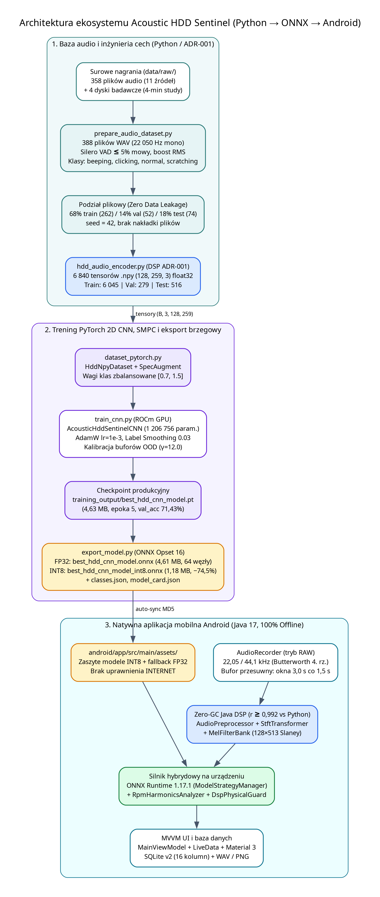
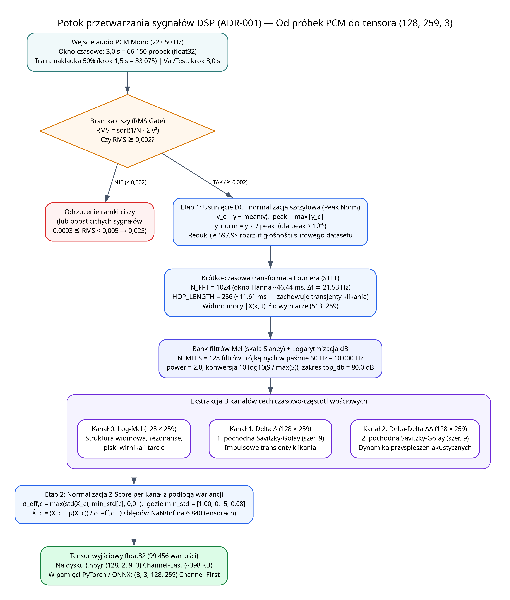
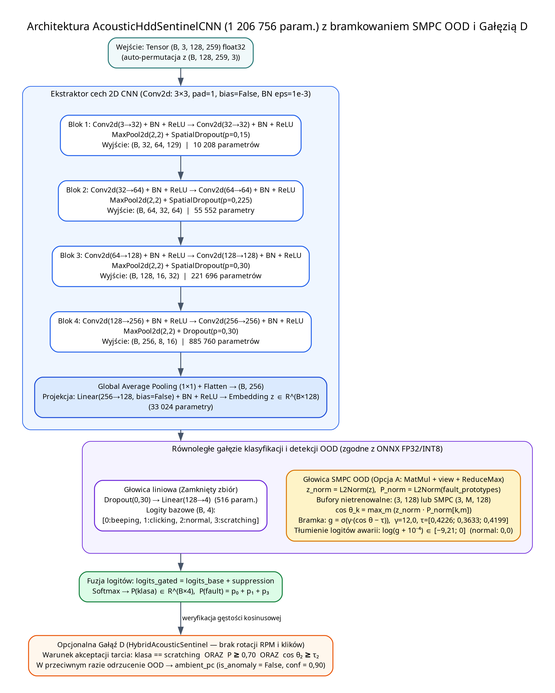
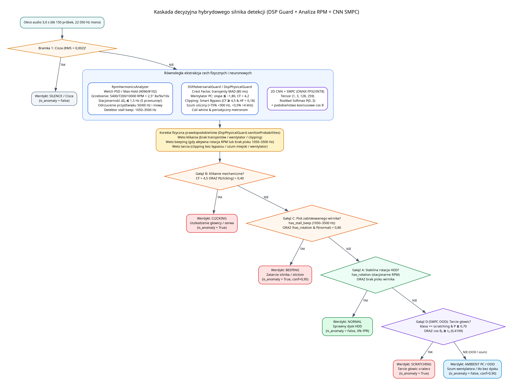
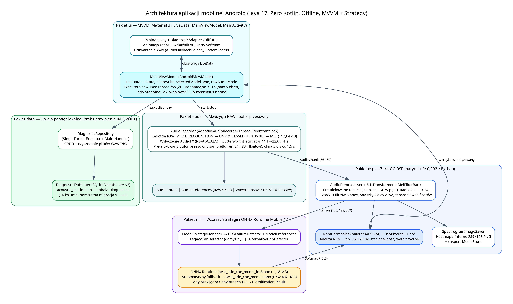
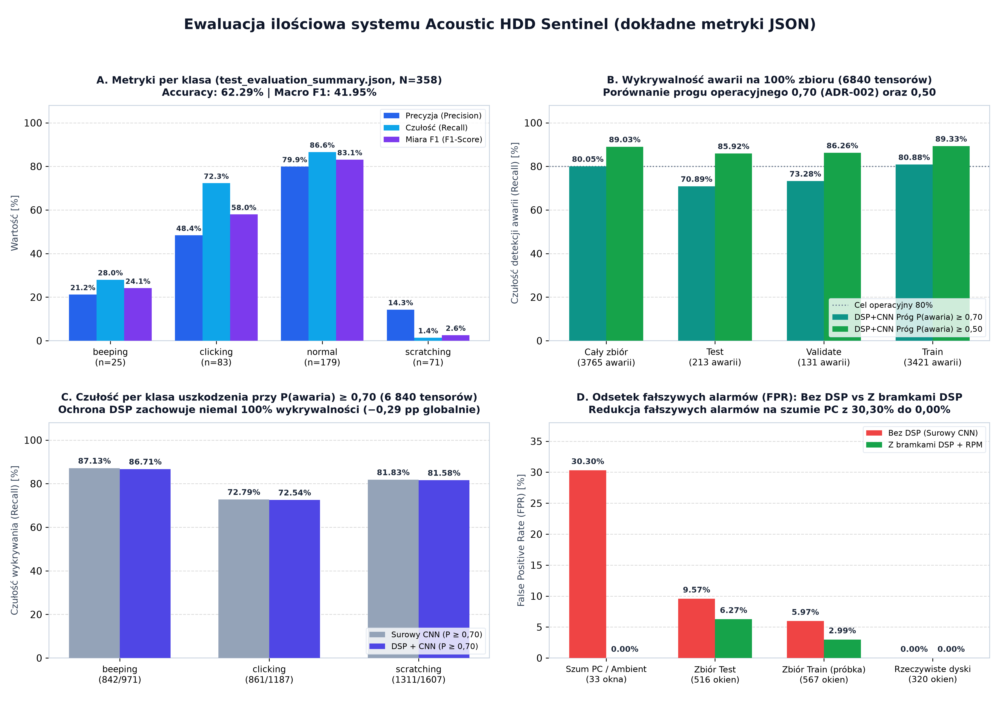

# Przegląd wykonawczy i wymagania systemowe

## Cel i zakres systemu

**Acoustic HDD Sentinel** jest wibroakustycznym systemem diagnostycznym przeznaczonym do wczesnego wykrywania oraz wieloklasowej klasyfikacji uszkodzeń mechanicznych dysków twardych (HDD 2.5" oraz 3.5"). System analizuje 3-sekundowe okna sygnału akustycznego próbkowane z częstotliwością $22\,050\text{ Hz}$ (`66 150` próbek mono), przekształcając jednowymiarową falę ciśnienia akustycznego do trójkanałowej reprezentacji czasowo-częstotliwościowej `(128, 259, 3)` i poddając ją dwutorowej ocenie:

1. **Wnioskowanie głębokiej sieci konwolucyjnej 2D CNN (`AcousticHddSentinelCNN`):** lekki klasyfikator o dokładnie **`1 206 756` parametrach trenowalnych**, wyposażony w wbudowaną w graf obliczeniowy bramkę Open-Set OOD (**SMPC Option A** — *Sub-Center Multi-Prototype Cosine* w wariancie `MatMul + view + ReduceMax` bez operatora `einsum`).
2. **Deterministyczni strażnicy fizyki sygnału (`RpmHarmonicsAnalyzer` + `DSPAdversarialGuard` / `DspPhysicalGuard`):** analiza widmowa Welcha potwierdzająca stacjonarne prążki obrotowe wrzeciona ($5400 / 7200 / 10\,000 / 15\,000\text{ RPM}$), test stacjonarności czasowej pitch odrzucający mowę ludzką i wibrato, wykrywanie tonu zablokowanego wirnika (`1050–3500 Hz`) oraz wetowanie zakłóceń wentylatorów komputerowych, szumu miejskiego i przesterowań mikrofonu.



## Wymagania funkcjonalne i niefunkcjonalne

Architektura całego ekosystemu została podporządkowana rygorystycznym niezmiennikom zdefiniowanym w decyzjach architektonicznych [ADR-001](adr/adr.md) oraz [ADR-002](adr/adr-002-mobile-architecture.md):

| Identyfikator | Kategoria | Specyfikacja wymagania | Weryfikacja w systemie |
|:---------|:-------------|:---------------------------------------------------|:-----------------------------------|
| **FR-01** | Klasyfikacja | Wieloklasowa identyfikacja stanów `beeping`, `clicking`, `normal`, `scratching` oraz stanu tła `ambient` | 4-klasowy model CNN + kaskada fuzji hybrydowej |
| **FR-02** | Akwizycja | Rejestracja okien `3.0 s` (`66 150` próbek) przy $f_s = 22\,050\text{ Hz}$ i adaptacyjny nasłuch do `9.0 s` (`5` okien co `1.5 s`) | `AudioRecorder.java` + `AdaptiveAudioRecorderThread` |
| **FR-03** | Bramka ciszy | Odrzucanie okien o niskiej energii ($\text{RMS} < 0.002$) w celu ochrony przed szumem własnym przetwornika | `slice_waveform`, `DspPhysicalGuard`, `RpmHarmonicsAnalyzer` |
| **FR-04** | Trwałość danych | Lokalny zapis wyników diagnozy, rozkładu Softmax, spektrogramu PNG oraz nagrania WAV | `DiagnosticDbHelper` (SQLite v2, 16 kolumn) |
| **NFR-01** | Zero Data Leakage | Podział zbioru wyłącznie na poziomie całych plików źródłowych przed cięciem na okna czasowe | `SPLIT_RATIOS = (0.68, 0.14, 0.18)`, `test_project_logic.py` |
| **NFR-02** | Prywatność / Offline | Praca w 100% izolowanych sieciowo serwerowniach (air-gapped); zero transmisji danych | Brak uprawnienia `INTERNET` w `AndroidManifest.xml` |
| **NFR-03** | Parytet Python–Java | Zachowanie zgodności matematycznej potoku DSP między `librosa` a implementacją Java 17 | Korelacja Pearsona $r = 0.9992$ (Ch0), $r \ge 0.9927$ (Ch1/Ch2) |
| **NFR-04** | Wydajność brzegowa | Kompaktowy model ONNX INT8 poniżej `2 MB` oraz przetwarzanie bez alokacji sterty (Zero GC) | `best_hdd_cnn_model_int8.onnx` = `1.18 MB` (`1 233 983 B`) |
| **NFR-05** | Odporność OOD/PC | Eliminacja fałszywych alarmów dla szumu wentylatorów PC, mowy i sprawnych dysków fizycznych | `0.00%` FPR na 320 oknach HDD i 33 oknach szumu PC |

---

# Taksonomia uszkodzeń akustycznych i metodologia zbioru danych

## Taksonomia klas i fizyka zjawisk

Klasyfikator operuje na czterech rozłącznych etykietach ułożonych alfabetycznie (zgodnie z `training_output/classes.json` oraz `exported_models/classes.json`):

| Indeks | Klasa | Zjawisko fizyczne i mechanizm uszkodzenia | Sygnatura czasowo-częstotliwościowa w tensorze |
|:---:|:---|:---|:---|
| `0` | `beeping` | Zatarte łożysko wrzeciona (*seized spindle motor*) lub przyssanie głowic (*stiction*); sterownik PWM cyklicznie pobudza cewki stojana bez obrotu talerzy | Ostre, poziome prążki wąskopasmowe w paśmie **`1050–3500 Hz`**, brak prążków rotacji $f_0$, znikoma energia w kanale Delta |
| `1` | `clicking` | Uderzanie ramienia pozycjonera VCM o ogranicznik krańcowy (*Click of Death*) wskutek błędu serwomechanizmu lub uszkodzenia głowicy | Periodyczne pionowe impulsy o bardzo wysokim współczynniku szczytu (*Crest Factor* $\ge 4.5$, maks. `143.42` w zbiorze), silne skoki w kanałach Delta i Delta-Delta |
| `2` | `normal` | Prawidłowa praca łożysk hydrodynamicznych (FDB) oraz stabilne wirowanie wrzeciona ($5400 / 7200 / 10\,000\text{ RPM}$), a także próbki tła PC/OOD w treningu | Gładkie widmo szerokopasmowe z wyraźnym grzebieniem harmonicznym $k \cdot f_0$ ($f_0 \in \{90, 120, 166.67\}\text{ Hz}$), niski Crest Factor (`3.2–4.3` na fizycznych HDD) |
| `3` | `scratching` | Katastrofalne tarcie suwaka głowicy o warstwę magnetyczną wirującego talerza (*head crash / platter scoring*) | Ciągły, szorstki szum wysokoczęstotliwościowy sięgający pasma **`4–10 kHz`** wraz z nieregularną mikromodulacją w kanale Delta-Delta |

Zgodnie z wymaganiami niezawodnościowymi aplikacji mobilnej (ADR-002), definiuje się zbiorcze prawdopodobieństwo awarii mechanicznej jako sumę prawdopodobieństw trzech klas uszkodzeń:

$$P(\text{fault}) = P(\text{beeping}) + P(\text{clicking}) + P(\text{scratching}) = p_0 + p_1 + p_3$$

Próg operacyjny alarmu awarii w potoku ewaluacyjnym oraz mobilnym wynosi **$P(\text{fault}) \ge 0.70$** (w analizach wrażliwości raportowany jest również standardowy próg binarny $0.50$). W architekturze OOD / SMPC podcentra prototypów budowane są dla wektora indeksów awarii `[0, 1, 3]`, mapowanych kolejno do bufora prototypów o wymiarze `(3, ...)`: `[0: beeping, 1: clicking, 2: scratching]`.

## Baza nagrań źródłowych i kuracja (`prepare_audio_dataset.py`)

Kompletny zbiór surowych danych w katalogu `data/raw/` obejmuje **`358` plików audio** (formaty `.wav`, `.mp3`, `.ogg`, `.flac`) w 11 podkatalogach tematycznych, z rejestrem pochodzenia i sum kontrolnych MD5 w pliku `data/raw/PROCESSED_SOURCES_REGISTRY.json` (pierwsza konsolidacja `241` unikalnych nagrań z `acsdata.com`, `freesound.org` oraz archiwów, z wykluczeniem duplikatów z `datacent.com`).

Rozkład surowych plików na dysku według źródeł:

- `northwind` (`82`), `outliers_oe` (`62`), `independent_web_hdd` (`57`), `freesound_hdd` (`42`), `harvested_archive` (`33`), `harvested_freesound` (`32`), `archive_hdd` (`21`), `additional` (`13`), `aesonlabs` (`9`), `verified_real` (`4`), `computer_ambient` (`3`).

Moduł `ml/prepare_audio_dataset.py` przeprowadza deterministyczną konsolidację do katalogu `dataset_categorized/`:

1. **Wzmocnienie bardzo cichych nagrań (`check_and_boost_audio`):** pliki o $0.0 < \text{RMS} < 0.002$ wzmacniane są do docelowego poziomu `target_rms = 0.025`.
2. **Kuracja i filtracja mowy/artefaktów:** odrzucanie plików `freesound_hdd` o udziale mowy `speech_pct > 5.0%` (na podstawie detekcji Silero VAD), deduplikacja wariantów `_mp3`/`_m4a` w `archive_hdd`, wykluczenie `10` znanych plików nieakustycznych (`known_ood_non_acoustic`, m.in. rejestracje elektromagnetyczne i kroki), włączenie nagrań referencyjnych 4 dysków fizycznych (`tests/recordings_4min_study/` pociętych na fragmenty 24-sekundowe) oraz wygenerowanie próbek klasy `normal` funkcją `generate_comprehensive_normal_class()` (`15` profili syntetycznych `5400 RPM`, `15` profili `7200 RPM` oraz `15` profili wentylatorów PC `900/1200/1500/1800 RPM`).

W wyniku kuracji powstaje dokładnie **`388` skategoryzowanych plików `.wav`**: `normal = 204`, `clicking = 112`, `beeping = 37`, `scratching = 35`.

## Niezmiennik Zero Data Leakage i bilans tensorów

Podział danych w `ml/hdd_audio_encoder.py` (`split_files`, ziarno `RANDOM_SEED = 42`, proporcje `SPLIT_RATIOS = (0.68, 0.14, 0.18)`) realizowany jest **wyłącznie na poziomie całych plików źródłowych** przed operacją cięcia na okna 3-sekundowe:

| Zbiór (Split) | Pliki `.wav` (cel podziału) | Krok cięcia (Overlap) | Augmentacja `pitch_shift` | Tensory `.npy` `(128, 259, 3)` | Rozkład klas (`beeping` / `clicking` / `normal` / `scratching`) |
|:---|---:|:---|:---|---:|:---|
| **`train`** (`68%`) | `262` (`25/76/138/23`) | `1.5 s` (`50%` overlap) | `beeping`, `scratching`: $3\times$ (`0, ±1.5`); `normal`: $2\times$ (`0, +1.0`); `clicking`: $1\times$ | **`6 045`** | `881` / `998` / `2 624` / `1 542` |
| **`validate`** (`14%`) | `52` (`5/15/28/4`) | `3.0 s` (`0%` overlap) | Brak (czyste okna) | **`279`** | `27` / `82` / `148` / `22` |
| **`test`** (`18%`) | `74` (`7/21/38/8`) | `3.0 s` (`0%` overlap) | Brak (czyste okna) | **`516`** | `63` / `107` / `303` / `43` |
| **Łącznie** | **`388`** | — | — | **`6 840`** | **`971` / `1 187` / `3 075` / `1 607`** |

Łącznie zbiór zakodowany zawiera **`3 765` tensorów awarii** oraz **`3 075` tensorów klasy `normal`**. Weryfikacja strukturalna (`tests/test_project_logic.py`) potwierdza dokładnie `0` wspólnych identyfikatorów plików bazowych między podzbiorami `train`, `validate` i `test` (`496` pni po augmentacji w `train`, `52` w `validate`, `74` w `test` na poziomie nazw `_chunk`).

## Profilowanie surowego sygnału i jakości normalizacji

Analiza statystyczna opisana w `training_output/normalization_quality_metrics.json` (`353` pliki wejściowe, `6 840` tensorów wynikowych) uzasadnia dwustopniową normalizację:

- **Rozrzut energii surowego zbioru:** `rms_min = 0.000880`, `rms_max = 0.526211`, `rms_mean = 0.076215` — stosunek rozpiętości amplitudy wynosi **`597.88×`**.
- **Impulsowość:** `crest_min = 1.314`, `crest_mean = 22.868`, `crest_p95 = 65.199`, `crest_max = 143.420`.
- **Asymetria DC przetworników:** `dc_offset_max_abs = 0.376656`, `dc_offset_mean_abs = 0.009515`.
- **Stabilność po normalizacji (`6 840` tensorów):** `0` wartości `NaN`, `0` wartości `Inf`, średnia średnich kanałowych `[-5.16e-9, 7.23e-11, 1.96e-10]`, odchylenie standardowe **`1.000000`** na każdym z 3 kanałów oraz udział wartości odstających $>3\sigma$ równy `1.0012%`.

---

# Potok DSP i specyfikacja matematyczna ADR-001

## Stałe inwariantne potoku sygnałowego

Wszystkie moduły w Pythonie (`ml/hdd_audio_encoder.py`) oraz w czystej Javie 17 (`DspConstants.java`) współdzielą niezmienne parametry czasowo-częstotliwościowe zdefiniowane w [ADR-001](adr/adr.md):

| Stała (`hdd_audio_encoder.py` / `DspConstants.java`) | Wartość | Znaczenie fizyczne i uzasadnienie |
|:---|---:|:---|
| `TARGET_SR` / `SAMPLE_RATE` | `22 050 Hz` | Pasmo Nyquista `11 025 Hz` pokrywa tarcie głowicy do `10 kHz` przy dwukrotnej redukcji danych vs `44.1 kHz` |
| `CHUNK_DURATION` / `CHUNK_SAMPLES` | `3.0 s` (`66 150` próbek) | Gwarantuje uchwycenie min. 3–4 cykli wolnego klikania pozycjonera (`~1.2 Hz`) |
| `OVERLAP_DURATION` | `1.5 s` (`33 075` próbek) | Przesunięcie `50%` wyłącznie dla treningu i adaptacyjnego streamingu; `0%` dla walidacji i testu |
| `N_FFT` | `1024` próbki (`46.44 ms`) | Rozdzielczość częstotliwościowa $\Delta f = 22\,050 / 1024 \approx 21.53\text{ Hz}$ (`513` prążków jednostronnych) |
| `HOP_LENGTH` | `256` próbek (`11.61 ms`) | `75%` zakładki okien (`86.13` ramek/s) zapobiega rozmyciu krótkich impulsów *Click of Death* |
| `N_MELS` | `128` pasm | Rozdzielczość percepcyjna w skali Mel (`htk=False`, normalizacja Slaney) |
| `FMIN` / `FMAX` | `50.0 Hz` / `10 000.0 Hz` | Odcięcie przydźwięku sieciowego `50 Hz` i drgań podłoża przy zachowaniu pasma tarcia |
| `TRIM_DB` / `TOP_DB` | `30.0 dB` / `80.0 dB` | Przycięcie ciszy brzegowej (`TRIM_DB`) oraz kompresja dynamiki widma mocy (`top_db = 80.0`) |
| `RMS` Silence Gate | `0.002` | Odrzucanie okien ciszy termicznej mikrofonu w `slice_waveform` (z zachowaniem `y[:66150]` jako fallbacku) |
| `target_frames` / `TIME_STEPS` | `259` ramek | Stała oś czasu: $1 + \lfloor 66\,150 / 256 \rfloor = 259$; wymiar tensora `(128, 259, 3)` lub `(3, 128, 259)` |



## Kolejność transformacji matematycznych

### Etap 1: Bramka energii i normalizacja fali (`normalize_waveform_peak`)

Dla wektora próbek $y \in \mathbb{R}^{66\,150}$ wyznaczana jest wartość skuteczna $\text{RMS} = \sqrt{\frac{1}{N}\sum_{i=0}^{N-1} y_i^2}$. Po przejściu bramki $\text{RMS} \ge 0.002$ usuwana jest składowa stała DC oraz wykonywana jest lokalna normalizacja szczytowa (*Peak Normalization*):

$$y_{\text{centered}}[n] = y[n] - \frac{1}{N}\sum_{i=0}^{N-1} y[i], \qquad \text{peak} = \max_{n} \left| y_{\text{centered}}[n] \right|$$

$$y_{\text{norm}}[n] = \begin{cases} \dfrac{y_{\text{centered}}[n]}{\text{peak}}, & \text{gdy } \text{peak} > \epsilon \; (\epsilon = 10^{-6}) \\[6pt] y_{\text{centered}}[n], & \text{w przeciwnym razie} \end{cases}$$

### Etap 2: Krótkoczasowa Transformata Fouriera (STFT) i Bank Filtrów Mel

Sygnał $y_{\text{norm}}$ jest okienkowany funkcją Hanna o długości $N_{\text{FFT}} = 1024$ i kroku $H = 256$, tworząc widmo mocy $P(k, t) = |X(k, t)|^2$ dla $k \in \{0, \dots, 512\}$ oraz $t \in \{0, \dots, 258\}$. Następnie widmo mnożone jest przez macierz `128` filtrów trójkątnych Mel o normalizacji powierzchniowej Slaney w zakresie $50\text{--}10\,000\text{ Hz}$ i kompresowane do skali decybelowej względem maksimum okna:

$$S_{\text{Mel}}(m, t) = \sum_{k=0}^{512} P(k, t) \cdot H_m(k)$$

$$S_{\text{LogMel}}(m, t) = \max\!\left(10 \log_{10}\!\left(\frac{\max(S_{\text{Mel}}(m, t), 10^{-10})}{\max_{m',t'} S_{\text{Mel}}(m', t')}\right),\; -80.0\right)$$

Macierz $S_{\text{LogMel}} \in \mathbb{R}^{128 \times 259}$ stanowi **Kanał 0** tensora (odpowiednik statycznej topologii widmowej).

### Etap 3: Pochodne czasowe Delta i Delta-Delta (Savitzky-Golay, $N_w = 9$)

Dla uchwycenia dynamiki transjentów uderzeniowych oraz przyspieszeń mechanicznych wyznaczane są dwie pochodne wzdłuż osi czasu $t$ o promieniu $R = 4$ (szerokość okna $9$ ramek $\approx 104.5\text{ ms}$). Pierwsza pochodna czasowa (**Kanał 1**) wyraża się wzorem:

$$\Delta(m, t) = \frac{1}{60}\sum_{n=1}^{4} n \cdot \big(S_{\text{LogMel}}(m, t+n) - S_{\text{LogMel}}(m, t-n)\big), \qquad \left(2\sum_{n=1}^{4} n^2 = 60\right)$$

Druga pochodna czasowa $\Delta^2(m, t)$ (**Kanał 2**) w `hdd_audio_encoder.py` obliczana jest przez `librosa.feature.delta(log_mel, order=2)` (dopasowanie wielomianowe Savitzky'ego-Golaya 2. rzędu na oknie 9-punktowym z jawnymi wagami $[28, 7, -8, -17, -20, -17, -8, 7, 28]/462$, co zostało w 100% odwzorowane jawnie w `AudioPreprocessor.java`).

### Etap 4: Standaryzacja Z-score per kanał z podłogą wariancji

Każdy kanał $c \in \{0, 1, 2\}$ ma odmienną skalę wartości (Log-Mel $[-80, 0]\text{ dB}$, Delta, Delta-Delta), dlatego podlega niezależnej standaryzacji w `normalize_tensor_zscore`. Kluczowym zabezpieczeniem przed sztucznym wzmocnieniem szumu kwantyzacji w jednorodnych oknach ciszy jest wektor progów minimalnego odchylenia standardowego `channel_min_stds = [1.0, 0.15, 0.08]` oraz globalne `MIN_STD = 1e-2`:

$$\sigma_{\text{eff}, c} = \max\!\big(\text{std}(X_c),\; \text{channel\_min\_stds}[c],\; \text{MIN\_STD},\; \epsilon\big), \qquad \hat{X}_c = \frac{X_c - \mu(X_c)}{\sigma_{\text{eff}, c}}$$

W wyniku złożenia powstaje tensor `float32` o rozmiarze `128 * 259 * 3 = 99 456` elementów (`397 824` bajtów ładunku danych, ok. `398 KB` z nagłówkiem `.npy`).

> **Uwaga dotycząca parytetu Python vs Java:** W aktualnej implementacji Java (`AudioPreprocessor.processAudioChunkToFlatTensor`) do metody `normalizeChannelZScore` przekazywana jest stała `DspConstants.EPSILON = 1e-6f`, podczas gdy w `DspConstants.java` zdefiniowano już dokładne stałe `MIN_STD = 1e-2f`, `MIN_STD_LOG_MEL = 1.0f`, `MIN_STD_DELTA = 0.15f`, `MIN_STD_DELTA_DELTA = 0.08f`. Dla typowych sygnałów dyskowych o $\sigma_c > \sigma_{\min, c}$ wyjścia obu torów pozostają spójne.

---

# Architektura PyTorch 2D CNN, SMPC Option A, komitet modeli i eksport brzegowy

## Topologia sieci `AcousticHddSentinelCNN`

Sieć zdefiniowana w `ml/model_cnn.py` akceptuje elastycznie format Channel-First `(B, 3, 128, 259)` oraz Channel-Last `(B, 128, 259, 3)` (automatyczna permutacja `(0, 3, 1, 2)`). Wszystkie warstwy splotowe używają jąder $3\times 3$ z `padding=1, bias=False`, natomiast warstwy `BatchNorm2d`/`BatchNorm1d` wykorzystują `eps=1e-3, momentum=0.01`. Domyślny współczynnik `dropout_rate = 0.3` jest skalowany progresywnie w głąb sieci (`0.5×`, `0.75×`, `1.0×`).

| Blok / Warstwa | Specyfikacja operacji | Wymiar wyjściowy | Liczba parametrów |
|:---|:---|:---|---:|
| **Wejście** | Opcjonalna permutacja `(0, 3, 1, 2)` | `(B, 3, 128, 259)` | `0` |
| **Blok 1** | `conv1_1 (3->32)` + `bn1_1` + `ReLU`; `conv1_2 (32->32)` + `bn1_2` + `ReLU` | `(B, 32, 128, 259)` | `928 + 9 280 = 10 208` |
| | `pool1 MaxPool2d(2,2)` + `s_dropout1 Dropout2d(0.15)` | `(B, 32, 64, 129)` | `0` |
| **Blok 2** | `conv2_1 (32->64)` + `bn2_1` + `ReLU`; `conv2_2 (64->64)` + `bn2_2` + `ReLU` | `(B, 64, 64, 129)` | `18 560 + 36 992 = 55 552` |
| | `pool2 MaxPool2d(2,2)` + `s_dropout2 Dropout2d(0.225)` | `(B, 64, 32, 64)` | `0` |
| **Blok 3** | `conv3_1 (64->128)` + `bn3_1` + `ReLU`; `conv3_2 (128->128)` + `bn3_2` + `ReLU` | `(B, 128, 32, 64)` | `73 984 + 147 712 = 221 696` |
| | `pool3 MaxPool2d(2,2)` + `s_dropout3 Dropout2d(0.30)` | `(B, 128, 16, 32)` | `0` |
| **Blok 4** | `conv4_1 (128->256)` + `bn4_1` + `ReLU`; `conv4_2 (256->256)` + `bn4_2` + `ReLU` | `(B, 256, 16, 32)` | `295 424 + 590 336 = 885 760` |
| | `pool4 MaxPool2d(2,2)` + `dropout4 Dropout(0.30)` | `(B, 256, 8, 16)` | `0` |
| **GAP & Flatten** | `AdaptiveAvgPool2d((1, 1))` + `flatten(1)` | `(B, 256)` | `0` |
| **Projekcja gęsta** | `dense_features Linear(256->128, bias=False)` + `bn_dense` + `ReLU` | `(B, 128)` | `32 768 + 256 = 33 024` |
| **Głowica klas** | `dense_dropout(0.30)` + `predictions Linear(128->4, bias=True)` | `(B, 4)` | `512 + 4 = 516` |
| **Łącznie** | **Suma parametrów trenowalnych (niezmiennik)** | — | **`1 206 756`** |

Zastąpienie klasycznej warstwy `Flatten` (która wygenerowałaby wektor `32 768` cech i ponad `4.2 mln` wag) warstwą `AdaptiveAvgPool2d((1, 1))` redukuje liczbę parametrów do `1 206 756`, wymusza niezmienniczość przesunięcia w czasie i minimalizuje ryzyko przeuczenia.



## Mechanizm Open-Set OOD oraz SMPC Option A

Klasyczny klasyfikator z funkcją Softmax wymusza $\sum_{i=0}^3 P(i) = 1.0$, przez co nieznane sygnały spoza dziedziny (OOD — *Out-of-Distribution*, np. mowa lub szum tła) mogą uzyskać wysoką pewność dla klasy awarii. Aby rozwiązać ten problem bezpośrednio wewnątrz grafu neuronowego (również po eksporcie do ONNX FP32/INT8), w `AcousticHddSentinelCNN` dodano nietrenowalne bufory OOD (`use_open_set`, `fault_prototypes`, `fault_thresholds`, `gamma = 12.0`), zachowujące nienaruszoną liczbę `1 206 756` parametrów trenowalnych.

### Wariant ONNX-safe Option A (`MatMul + view + ReduceMax`)

Zamiast operacji `torch.einsum`, która powoduje błędy kompilacji lub brak obsługi w mobilnym ONNX Runtime i podczas kwantyzacji INT8, zaimplementowano wariant **SMPC Option A** oparty wyłącznie na standardowych operacjach algebry liniowej:

1. Normalizacja L2 wektora osadzeń `dense_feat`: $\mathbf{z}_{\text{norm}} = \mathbf{z} / \|\mathbf{z}\|_2 \in \mathbb{R}^{B \times 128}$.
2. Normalizacja L2 bufora prototypów awarii $\mathbf{P} \in \mathbb{R}^{3 \times M \times 128}$ (dla klas `[0: beeping, 1: clicking, 2: scratching]`, przy czym w wariancie jednomodalnym $M=1$, a w wielomodalnym SMPC $M \ge 1$) oraz spłaszczenie do $\mathbf{P}_{\text{flat}} \in \mathbb{R}^{(3M) \times 128}$.
3. Wyznaczenie maksymalnego podobieństwa kosinusowego na podcentrach:

$$\text{sims} = \big(\mathbf{z}_{\text{norm}} \, \mathbf{P}_{\text{flat}}^T\big).\text{view}(B, 3, M), \qquad \cos\theta_k = \max_{m \in \{1,\dots,M\}} \text{sims}_{:, k, m} \in \mathbb{R}^{B \times 3}$$

4. Sigmoidalna bramka OOD i tłumienie logitów awarii (aktywne w trybie `eval()`, gdy `use_open_set == True`):

$$g_k = \sigma\Big(\gamma \cdot \big(\cos\theta_k - \tau_k\big)\Big) = \frac{1}{1 + e^{-\gamma(\cos\theta_k - \tau_k)}}, \qquad \text{suppression}_k = \ln(g_k + 10^{-4}) \in [-9.2103,\; 0.0]$$

Tłumienie dodawane jest wyłącznie do logitów awarii (`0: beeping`, `1: clicking`, `3: scratching`), natomiast klasa `2: normal` otrzymuje wartość neutralną `0.0`. W punkcie kontrolnym `training_output/best_hdd_cnn_model.pt` skalibrowane bufory posiadają kształt `fault_prototypes = (3, 128)`, $\gamma = 12.0$ oraz progi `fault_thresholds = [0.422595, 0.363302, 0.419861]` (wyznaczone jako `clamp(quantile(sims, 0.05) - 0.05, 0.35, 0.65)`).

### Trening SMPC i straty metryczne (`train_cnn.py --use-smpc`)

W trybie wielomodalnym SMPC (`--use-smpc`) trening wykorzystuje dwie wyspecjalizowane funkcje celu:

- **`SubCenterArcMarginLoss`:** addytywny margines kątowy `margin = 0.25 rad` i skala `scale = 16.0` z wygładzaniem etykiet `label_smoothing = 0.03` oraz ważoną entropią krzyżową.
- **`compute_orthogonality_loss`:** kara ortogonalności zapobiegająca zlewaniu się podcentrów tej samej klasy:

$$\mathcal{L}_{\text{ortho}} = \sum_{k=0}^{K-1} \sum_{m_1 < m_2} \max\!\big(0,\; W_{k,m_1} \cdot W_{k,m_2} - 0.30\big), \qquad \lambda_{\text{ortho}} = 0.10$$

Dodatkowo algorytm `spherical_kmeans` na hipersferze $S^{127}$ (`max_iters=50`, `atol=1e-4`) umożliwia inicjalizację i kalibrację podcentrów po zakończonym treningu.

## Hiperparametry treningowe, Seed Ensembling i eksport ONNX

Konfiguracja treningu w `ml/train_cnn.py`, `ml/train_ensemble.py` oraz `ml/dataset_pytorch.py`:

- **Optymalizator i harmonogram:** `AdamW` (`lr = 1e-3`, `weight_decay = 1e-4`, dla `prototypes_param` w SMPC `weight_decay = 0.0`), harmonogram `ReduceLROnPlateau(mode="min", factor=0.5, patience=3)`, wczesne zatrzymanie `patience = 8` epok monitorujące `val_loss` (domyślnie `30` epok, w Quickstart `--epochs 35`).
- **Regularyzacja i bilansowanie klas:** `SpecAugment` w locie na zbiorze treningowym (`max_freq_mask = 16`, `max_time_mask = 24`), `batch_size = 32` oraz wagi klas wyliczone przez `compute_balanced_class_weights` (wygładzanie pierwiastkowe z przycięciem do `[0.7, 1.5]` i wymuszeniem `1.5` dla klasy `normal`): `beeping = 1.309725`, `clicking = 1.23056`, `normal = 1.5`, `scratching = 0.989979`.
- **Zapisany model produkcyjny (`training_output/best_hdd_cnn_model.pt`):** rozmiar `4 858 117 B` (`4.63 MB`), najlepsza epoka `5` (`val_loss = 0.833178`, `val_acc = 71.43%`, 13 epok wykonanych do zatrzymania przy końcowym `lr = 0.0005`).
- **Komitet modeli (`train_ensemble.py` / `FusedEnsemblePyTorch`):** uśrednianie miękkie (*Soft Voting*) trzech niezależnych modeli o ziarnach `[42, 123, 777]` (`fused_ensemble_model.pt`, `14 567 045 B` / `13.89 MB`, `168` kluczy `state_dict`).

Eksport produkcyjny realizowany przez `ml/export_model.py` (ONNX **Opset 16**, `dynamo=False`, `do_constant_folding=True`, dynamiczna oś `batch_size`, wejście `input_audio_tensor: [batch_size, 3, 128, 259]`, wyjście `probabilities: [batch_size, 4]`):

| Artefakt eksportu | Rozmiar (B) | Rozmiar | Węzły | Przeznaczenie i automatyczna synchronizacja |
|:--------------------------------------------|------------:|--------:|------:|:------------------------------------------------|
| `best_hdd_cnn_model.onnx` (FP32) | `4 833 479` | `4.61 MB` | `64` | Referencyjna inferencja serwerowa i fallback desktop/mobile |
| `best_hdd_cnn_model_int8.onnx` (Dynamic INT8) | `1 233 983` | `1.18 MB` | `121` | Główny model mobilny (`-74.47%` rozmiaru vs FP32, `QuantType.QInt8`) |
| `classes.json`, `model_card.json` | `77`, `1 243` | — | — | Metadane klas i parametrów DSP w `android/app/src/main/assets/` |

Oba grafy ONNX zawierają osadzone inicjalizatory Open-Set OOD (`fault_prototypes: (3, 128)`, `fault_thresholds: (3,)`, `gamma: ()`). Moduł `export_model.py` wspiera także generowanie wariantów TorchScript (`.pt`) i PyTorch Mobile (`.ptl`).

---

# Hybrydowy strażnik adwersarialny i analizator harmonicznych RPM

Aby całkowicie wyeliminować fałszywe alarmy powodowane przez szum wentylatorów komputerowych, pisk cewek zasilających (*coil whine*), mowę ludzką, ruch uliczny oraz przesterowania mikrofonów MEMS, sieć neuronowa współpracuje z deterministyczną warstwą weryfikacji fizycznej.



## Analizator harmonicznych obrotowych (`ml/rpm_harmonics_analyzer.py`)

Po przejściu bramki ciszy (`rms >= 0.002`) moduł wylicza widmo gęstości mocy metodą Welcha (`nperseg = 8192`, `noverlap = 4096`, okno Hanna, $\Delta f \approx 2.69\text{ Hz}$) i analizuje:

1. **Profile grzebienia harmonicznego (`RPM_PROFILES`):**
   - **`5400_rpm`:** $f_0 = 90.0\text{ Hz}$ (zakres `85.5–94.5 Hz`), mnożniki `{2, 3, 4, 5, 6, 8, 9, 10, 12}` (rozszerzone o harmoniczne stojana 2.5" `8x/9x/10x`, wykryte w badaniach dysków Seagate `823.6 Hz` oraz HGST `899.0 Hz`).
   - **`7200_rpm`:** $f_0 = 120.0\text{ Hz}$ (zakres `114.0–126.0 Hz`), mnożniki `{2, 3, 4, 5, 6, 12}`.
   - **`10000_rpm`:** $f_0 = 166.67\text{ Hz}$ (zakres `160.0–173.0 Hz`), mnożniki `{2, 3, 4, 6, 12}`.
2. **Kryteria detekcji grzebienia (`evaluate_harmonic_comb`):** prążek harmoniczny jest zaliczany przy $h_{\text{peak}} / h_{\text{bg}} > 1.6$ i $h_{\text{peak}} > 0.05 \cdot \overline{\text{spec}}$. Akceptowany jest wariant wielopasmowy (`harmonic_hits >= 2`, `comb_score >= 3.0`, `f0_prominence >= 2.2` lub `>= 1.8` przy `>= 3` trafieniach i `comb_score >= 3.8`) lub dwutonowy wirnik FDB (`has_2nd_harmonic_hit`, `f0_prominence >= 3.0`, `comb_score >= 3.0`, ostrość piku $f_{0,\text{sharp}} \ge 6.0$) z udziałem energii $\ge 0.005$ (lub `harmonic_hits >= 4`).
3. **Test stacjonarności czasowej pitch (`verify_temporal_pitch_stationarity`):** odróżnia stabilny silnik BLDC sterowany kwarcem od mowy ludzkiej, wibrato i syren. Wyznacza wierzchołek $f_0$ metodą interpolacji parabolicznej w 5 niespójnych przesunięciach czasowych (`[0.0, 0.37, 0.83, 1.41, 2.11] * sr`, `n_fft = 4096`). Dryf $\max(f_{\text{sub}}) - \min(f_{\text{sub}}) > 1.5\text{ Hz}$ bezwzględnie odrzuca obecność rotacji HDD.
4. **Detekcja zablokowanego wrzeciona (*Stall Beep*):** przy braku rotacji HDD skanuje pasmo `1050.0–3500.0 Hz` (udział energii $\ge 0.005$, lokalna prominencja w oknie $\pm 65\text{ Hz}$ z wyłączeniem $\pm 12\text{ Hz}$ równa $\ge 2.0$).

## Strażnik adwersarialny (`ml/dsp_adversarial_guard.py`)

Klasa `DSPAdversarialGuard` analizuje `8` cech na Kanale 0 spektrogramu (m.in. `narrowband_ratio`, `temporal_stability`, `mel_entropy`, `transient_density`, `inter_event_cv`, `periodicity_score`, `num_events`, `event_spectral_consistency`) wraz ze statystykami surowej fali czasowej, stosując 8 wyspecjalizowanych reguł wetujących:

1. **`is_coil_whine`:** `narrowband_ratio > 0.22`, `temporal_stability > 0.93`, `transient_density < 0.012` — blokuje fałszywy alarm `scratching > 0.25`.
2. **`is_periodic_metronome`:** `num_events >= 3`, `inter_event_cv < 0.005`, `event_spectral_consistency > 0.96` — blokuje syntetyczne metronomy udające `clicking`/`beeping`.
3. **`is_aerodynamic_fan`:** logarytmiczne nachylenie widma `slope (100–4000 Hz) < -1.80`, `kurtosis < 4.5` i `crest < 4.2` (z twardym wetem bezpieczeństwa przeciw stłumieniu awarii przy `crest > 6.5`, `kurtosis > 6.0` lub energii $>4\text{ kHz}$ przekraczającej `15%`).
4. **`is_microphone_clipped_or_distorted` + Smart Clipping Bypass:** wykrywa nasycenie przetwornika (`peak >= 0.35`, `clip_ratio > 0.02` i `max_run >= 3`), ale automatycznie omija blokadę (**Smart Clipping Bypass**), gdy wysoki Crest Factor (`>= 4.5`) i energia powyżej `4 kHz` (`> 18%`) wskazują na autentyczne uszkodzenie mechaniczne *Crash Stop / Head Crash*; dodatkowo chroni autentyczny ton `stall_beep`.
5. **`is_city_traffic_noise`:** ponad `75%` energii poniżej `300 Hz` i poniżej `3.5%` powyżej `4 kHz`.
6. **Weto rotacji na `beeping` (Reguła 5b):** potwierdzona zdrowa rotacja wrzeciona wyklucza jednoczesne zablokowanie silnika (`P(beeping) > 0.15` jest tłumione do `0.01`).
7. **Filtr beztransjentowego `clicking` (Reguła 5):** przy `num_events == 0` i `transient_density == 0.0` fałszywe klikanie przekierowywane jest do `scratching` (gdy energia $\ge 1\text{ kHz}$ przekracza `50%`) lub do `normal`.
8. **`is_enterprise_spindle_windage`:** tłumienie szumu aerodynamicznego dysków serwerowych `10 000 / 15 000 RPM` omyłkowo branych za `scratching`.

## Kaskada fuzji decyzyjnej (`ml/hybrid_acoustic_sentinel.py`)

Klasa `HybridAcousticSentinel` składa sygnały obu torów w jednoznaczny werdykt w 6 sekwencyjnych krokach:

1. **Bramka ciszy:** `rms < 0.002` $\to$ `SILENCE` (`is_anomaly=False`).
2. **Gałąź A (Zdrowa rotacja):** potwierdzona rotacja (`has_rotation`), brak mechanicznego klikania (`!(crest > 4.5 and cnn_probs[1] > 0.40)`) i brak `stall_beep` $\to$ `normal` (`confidence = max(rpm_confidence, 0.85)`).
3. **Gałąź B (Stukanie głowic):** `crest_factor > 4.5` oraz `cnn_probs[1] > 0.40` $\to$ `clicking` (`is_anomaly=True`).
4. **Gałąź C (Zatarcie wrzeciona):** `has_stall_beep` przy braku rotacji oraz `cnn_probs[2] < 0.80` $\to$ `beeping` (`is_anomaly=True`, `confidence=0.95`).
5. **Gałąź D (Bramka SMPC OOD i odrzucanie tła PC):** gdy nie wykryto ani rotacji, ani klików, ani pisku stojana, werdykt `scratching` jest zatwierdzany wyłącznie przy spełnieniu podwójnego warunku: `cnn_top_class == "scratching"`, `cnn_top_prob >= 0.70` oraz podobieństwo kosinusowe SMPC `cos_sim[2] >= fault_thresholds[2]` (domyślnie `0.40`). W przeciwnym razie dla niepewnych alarmów lub podejrzenia szumu wentylatora zwracane jest bezpieczne `ambient_pc` (`is_anomaly=False`, `confidence=0.90`).
6. **Fallback:** zwrot wiodącej klasy CNN (`is_anomaly = (cnn_top_class != "normal")`).

---

# Natywna aplikacja mobilna Android Java 17 (ADR-002 i parytet numeryczny)

## Rzeczywisty stos technologiczny i struktura pakietów

> **Uwaga architektoniczna dotycząca ADR-002:** Wczesna sekcja 2 oraz diagram w pliku [adr-002-mobile-architecture.md](adr/adr-002-mobile-architecture.md) opisują historyczny szkic w języku Kotlin z biblioteką Jetpack Room i `StateFlow`. Rzeczywista, produkcyjna implementacja w katalogu `android/` jest napisana w **100% w czystej Javie 17 (Zero Kotlin)**, korzysta z architektury **MVVM z `LiveData` i `ExecutorService`**, natywnego `SQLiteOpenHelper` (wersja schematu 2), adaptacyjnego nasłuchu `3.0–9.0 s` (`5` okien co `1.5 s`) oraz wzorca Strategii dla podwójnego silnika ONNX Runtime Mobile.

Parametry kompilacji i bezpieczeństwa (`android/app/build.gradle.kts`, `AndroidManifest.xml`):

- **Narzędzia:** Gradle `8.4`, Android Gradle Plugin `8.3.2`, Java `17` (`sourceCompatibility` i `targetCompatibility = JavaVersion.VERSION_17`), `minSdk = 26` (Android 8.0), `targetSdk = 34` (Android 14), `viewBinding = true`.
- **Zależności produkcyjne:** `androidx.appcompat:1.6.1`, `material:1.11.0`, `constraintlayout:2.1.4`, `activity:1.8.2`, `lifecycle-viewmodel:2.7.0`, `lifecycle-livedata:2.7.0`, `com.microsoft.onnxruntime:onnxruntime-android:1.17.1`.
- **Inwentarz źródeł:** **30 klas/interfejsów/enumów Java** w `com.acoustichddsentinel` (`AcousticSentinelApp` + 5 pakietów: `audio`, `dsp`, `ml`, `data`, `ui`).
- **Uprawnienia offline:** zadeklarowane wyłącznie `RECORD_AUDIO` (oraz starsze `READ/WRITE_EXTERNAL_STORAGE` do API 32/28) i wymaganie sprzętowe `android.hardware.microphone`; **brak uprawnienia `INTERNET`**.



| Pakiet (`com.acoustichddsentinel.*`) | Klasy i interfejsy | Odpowiedzialność architektoniczna |
|:---|:---|:---|
| *(root)* | `AcousticSentinelApp` | Klasa `Application` inicjalizująca środowisko offline |
| **`audio`** (`5`) | `AudioChunk`, `AudioPreferences`, `AudioRecorder`, `WavAudioSaver`, `AudioPlaybackHelper` | Akwizycja `AudioRecord`, tryb RAW, decymator Butterwortha 4. rzędu, prealokowany bufor przesuwny, zapis/odtwarzanie WAV |
| **`dsp`** (`7`) | `DspConstants`, `StftTransformer`, `MelFilterBank`, `AudioPreprocessor`, `RpmHarmonicsAnalyzer`, `DspPhysicalGuard`, `SpectrogramImageSaver` | Potok Zero-GC STFT Radix-2, bank Mel Slaney, Savitzky-Golay `N=9`, Welch 4096 + Max-Hold, twarde weta fizyczne, renderowanie bitmapy Inferno `259×128` |
| **`ml`** (`8`) | `ModelType`, `DiskFailureDetector`, `ClassificationResult`, `ModelPreferences`, `LegacyCnnDetector`, `AlternativeCnnDetector`, `ModelStrategyManager`, `AcousticClassifier` | Wzorzec Strategii (przełączanie modeli z zamykaniem `OrtSession`), kaskada fallback `INT8 -> FP32`, mapowanie zaleceń serwisowych |
| **`data`** (`3`) | `DiagnosticModel`, `DiagnosticDbHelper`, `DiagnosticRepository` | Baza SQLite `"acoustic_sentinel.db"` (wersja 2, tabela `Diagnostics` z `16` kolumnami), asynchroniczny CRUD + czyszczenie PNG/WAV |
| **`ui`** (`6`) | `DiagnosticUiState`, `MainViewModel`, `MainActivity`, `DiagnosticAdapter`, `FaqBottomSheetDialog`, `SystemSpecsBottomSheetDialog` | Warstwa prezentacji Material 3, animacja radaru `1200 ms`, adaptacyjny nasłuch i Early Stopping, lista historii z `DiffUtil` |

## Akwizycja RAW Audio, decymator Butterwortha i model wątkowania

W urządzeniach mobilnych domyślne przetwarzanie mowy (NS, AGC, AEC) tłumi stacjonarne buczenie wrzeciona HDD ($90 / 120\text{ Hz}$). Klasa `AudioRecorder` rozwiązuje ten problem za pomocą kaskady doboru źródła oraz sterownika `AudioFxController`:

- **Tryb `rawAudioMode = true` (domyślny w `AudioPreferences`):** próbuje kolejno `VOICE_RECOGNITION` (`22050` / `44100 Hz`) $\to$ `UNPROCESSED` (`22050` / `44100 Hz`) $\to$ `MIC` (`22050` / `44100 Hz`); na sesji `audioRecord.getAudioSessionId()` wyłącza `NoiseSuppressor`, `AutomaticGainControl` i `AcousticEchoCanceler`.
- **Kompensacja wzmocnienia (`sourcePreGain`):** `UNPROCESSED_HARDWARE_PREGAIN = 8.0f` (`+18.06 dB`) dla `UNPROCESSED`, `RAW_MIC_HARDWARE_PREGAIN = 4.0f` (`+12.04 dB`) dla `VOICE_RECOGNITION`/`MIC` w trybie RAW, `1.0f` poza trybem RAW.
- **Decymacja 2:1 (`ButterworthDecimator`):** gdy sprzęt wymusza `44 100 Hz`, kaskadowy filtr dolnoprzepustowy IIR Butterwortha 4. rzędu (`fc = 9500 Hz`, dwie sekcje biquad w postaci Direct Form II Transposed) redukuje pasmo bez aliasingu i bez programowego obcinania szczytów (aby autentyczny clipping ADC pozostał wykrywalny).
- **Prealokowany bufor przesuwny i synchronizacja:** wątek `"AdaptiveAudioRecorderThread"` używa **prealokowanego liniowego bufora przesuwnego `sampleBuffer`** (nie bufora kołowego) o pojemności `maxSeconds * 22050 + 16384` (`214 834` floatów dla domyślnych `9 s`), chronionego przez `ReentrantLock` oraz `AtomicBoolean isRecording`. Co `33 075` próbek (`1.5 s`) wycinane jest okno `66 150` próbek (`3.0 s`), ciche okna (`0.0003f <= rms < 0.005f`) wzmacniane są do `TARGET_BOOST_RMS = 0.025f` (maks. wzmocnienie `40.0f`), a zwrot `onWindowReady` działa synchronicznie umożliwiając natychmiastowe Early Stopping.

## Potok Zero-GC w Javie 17, strategia ONNX i baza SQLite v2

W konstruktorze `AudioPreprocessor` alokowane są jednorazowo wszystkie bufory robocze (`preallocatedChunk[66150]`, `preallocatedFlatTensor[99456]`, `powerBuffer[513][259]`, `melBuffer[128][259]`, `logMelBuffer[128][259]`, `delta1Buffer[128][259]`, `delta2Buffer[128][259]`). W pętli diagnostycznej nie powstaje ani jeden tymczasowy obiekt na stercie (**Zero GC Churn**). Algorytm FFT (`StftTransformer`) implementuje w miejscu transformatę Cooley-Tukey Radix-2 DIT ze współczynnikami obrotu w podwójnej precyzji, a `MelFilterBank` przetwarza wyłącznie niezerowe zakresy indeksów `[startBins[m], endBins[m]]`.

**Wzorzec Strategii i automatyczny fallback INT8 $\to$ FP32 (`ml/`):**

- `ModelStrategyManager` zarządza detektorami `LegacyCnnDetector` (domyślny `ModelType.LEGACY`) oraz `AlternativeCnnDetector` (`ModelType.ALTERNATIVE`, obsługujący również 3-klasowe wyjścia SMPC z progiem `faultSum >= 0.70f`). Zmiana strategii zwalnia poprzednią sesję `OrtSession` przed załadowaniem nowej.
- `LegacyCnnDetector.load()` próbuje najpierw otworzyć `best_hdd_cnn_model_int8.onnx` (`1 233 983 B`), a w razie wyjątku wykonuje automatyczny fallback do `best_hdd_cnn_model.onnx` (`4 833 479 B`). Mechanizm ten został bezpośrednio zweryfikowany w teście `OnnxInferenceIntegrationTest` na desktopowej maszynie JVM x86_64 (`onnxruntime:1.17.1`), gdzie węzeł `/conv1_1/Conv_quant` (`ConvInteger(10)`) zgłasza `ORT_NOT_IMPLEMENTED`, płynnie przełączając wykonanie na model FP32.

**Baza SQLite (`DiagnosticDbHelper`, wersja 2, tabela `Diagnostics`):**
Przechowuje `16` kolumn z pełną migracją bezstratną `v1 -> v2` (`9` poleceń `ALTER TABLE`): `id`, `hdd_name`, `timestamp`, `has_anomaly`, `spectrogram_path`, `predicted_class`, `confidence`, `audio_path`, `prob_beeping`, `prob_clicking`, `prob_normal`, `prob_scratching`, `crest_factor`, `peak_rms`, `scan_duration_s`, `recommendation`. `MainViewModel` finalizuje sesję trójstanowym werdyktem (`fault` przy $\ge 2$ oknach z $P(\text{fault}) \ge 0.70$, `normal` przy potwierdzonej rotacji RPM, lub `ambient` dla szumu otoczenia).

## Zweryfikowana parzystość numeryczna Python vs Java 17

Na tym samym deterministycznym sygnale testowym (`seed=42`, `66 150` próbek, składowe `120/360/2400/5500 Hz` + szum Gaussa `0.05` + impuls `0.80`) porównano bezpośrednio wyjście funkcji `encode_audio_chunk()` z modułu `ml/hdd_audio_encoder.py` (`librosa 0.11.0`) z funkcją `processAudioChunkToFlatTensor()` w klasie `AudioPreprocessor` (JDK `17.0.21+9`):

| Kanał tensora `(3, 128, 259)` | Pearson $r$ | MAE (całość) | MAE ($t=5..253$) | Maks. błąd ($t=5..253$) | Przyczyna różnic brzegowych ($t < 4, t > 254$) |
|:-----------------------|--------:|----------:|----------:|----------:|:--------------------------------------------|
| **Kanał 0 (Log-Mel)** | **`0.999215`** | `5.57e-3` | **`2.21e-3`** | `8.33e-3` | `librosa.stft` używa zero-paddingu (`pad_mode="constant"`), a `StftTransformer` reflect-pad (`max=1.374` w `t=0`) |
| **Kanał 1 (Delta)** | **`0.992679`** | `3.34e-2` | `1.56e-2` | `0.9466` | `savgol_filter` (`mode='interp'`) dopasowuje wielomian na krawędziach, a Java powtarza `dRow[4]` / `dRow[254]` |
| **Kanał 2 (Delta-Delta)** | **`0.993139`** | `3.37e-2` | `1.61e-2` | `1.0889` | Kumulacja różnic brzegowych kanału 1 oraz trybu `interp` vs powtarzanie krawędzi |
| **Cały tensor (`99 456` el.)** | — | **`2.42e-2`** | — | — | Wagi `MelFilterBank` zgodne z `librosa.filters.mel` z dokładnością $< 4\times 10^{-9}$ |

---

# Zestawy testowe, ewaluacja ilościowa i badania fizyczne

## Zestawienie oficjalnych pakietów testowych

Wszystkie testy systemowe zostały uruchomione i pozytywnie zweryfikowane w stanie końcowym repozytorium:

| Pakiet / Skrypt testowy (katalog `tests/` / `android/`) | Zakres weryfikacji | Wynik zweryfikowany |
|:------------------------------------------|:-------------------------------------------------|------------------------:|
| `test_project_logic.py` | Analiza AST `8` skryptów, brak wycieku danych (`train`/`val`/`test`), kształt `(128, 259, 3)` `<f4` wszystkich `.npy`, integralność audio, artefakty `training_output/`, zgodność MD5 `best_hdd_cnn_model_int8.onnx` na Androidzie | **`6 / 6` PASS** |
| `test_smpc_architecture.py` | Warstwy SMPC Option A (brak `einsum`), kształt prototypów, tłumienie OOD, eksport ONNX, kalibracja | **`7 / 7` PASS** (`1.19 s`) |
| `test_rpm_harmonics_analyzer.py` | Detekcja `5400/7200/10000 RPM`, grzebień harmoniczny, odrzucanie mowy z wibrato i szumu wentylatorów PC, wykrywanie `stall_beep` | **`9 / 9` PASS** (`0.08 s`) |
| `test_computer_sound_rejection.py` | Odporność fuzji hybrydowej na szum wentylatorów PC, GPU coil whine i ciche sygnały `45 dB` | **`6 / 6` PASS** (`1.36 s`) |
| `test_full_dataset_fault_detection_rate.py` | Audyt ONNX FP32 + `DSPAdversarialGuard` na 100% zakodowanego zbioru (`6 840` tensorów) | **PASS (`80.05%` @ `0.70`, `89.03%` @ `0.50`)** |
| `evaluate_app_pipeline_on_dataset.py` | Porównanie potoku z DSP vs bez DSP na zbiorze testowym, szumach PC (`33` okna) i `4` fizycznych dyskach (`320` okien) | **PASS (`0.00%` FPR na dyskach i szumie PC)** |
| `cd android && ./gradlew testDebugUnitTest` | Testy jednostkowe i integracyjne ONNX/SQLite/DSP w czystej Javie 17 (pakiety `audio`, `data`, `dsp`, `ml`, `ui`) | **`17` klas, `92 / 92` PASS (`0` błędów, `0` pominiętych)** |

*(Uwaga: Zestaw Androida obejmuje obecnie `17` klas testowych i `92` metody `@Test`, co przewyższa nieaktualną liczbę `13` klas / `74` testy podawaną we wcześniejszych notatkach projektowych).*



## Ewaluacja modeli na zbiorach testowych (z rozróżnieniem wersji zbioru)

W celu zachowania pełnej przejrzystości metodologicznej poniżej zestawiono wyniki dla bieżącego, pełnego podziału `dataset_encoded/test` (`N = 516`, stan po rozbudowie bazy 17.11.2026) oraz historycznych migawek referencyjnych (`N = 358` z `test_evaluation_summary.json` z 13.11.2026 oraz archiwalny benchmark `N = 117`):

| Model / Migawka | Zbiór | Acc | W-F1 | M-F1 | `beeping` | `clicking` | `normal` | `scratch.` |
|:---------------------------------|:--------------|-------:|-------:|-------:|-------:|-------:|-------:|-------:|
| **`best_hdd_cnn_model_int8.onnx`** *(INT8)* | Bieżący (`N=516`) | **`71.32%`** | **`71.20%`** | **`57.86%`** | `35.77%` | `54.55%` | **`86.84%`** | `54.29%` |
| `best_hdd_cnn_model.onnx` *(FP32)* | Bieżący (`N=516`) | `70.74%` | `70.63%` | `57.13%` | `34.15%` | `54.55%` | `86.33%` | `53.52%` |
| `best_hdd_cnn_model.pt` *(PyTorch)* | Bieżący (`N=516`) | `70.74%` | `70.63%` | `57.13%` | `34.15%` | `54.55%` | `86.33%` | `53.52%` |
| `fused_ensemble_model.pt` *(11.11, bez OOD)* | Bieżący (`N=516`) | `35.66%` | `30.41%` | `36.91%` | `32.17%` | `71.71%` | `15.81%` | `27.93%` |
| `test_evaluation_summary.json` *(13.11)* | Poprzedni (`N=358`) | `62.29%` | `57.19%` | `41.95%` | `24.14%` | `57.97%` | `83.11%` | `2.56%` |
| Archiwalny benchmark laboratoryjny | Czysty (`N=117`) | `83.76%` | — | `84.63%` | `86.36%` | `78.48%` | `100.0%` | `73.68%` |

*(Skróty w tabeli: `Acc` = Accuracy, `W-F1` = Weighted F1, `M-F1` = Macro F1; kolumny klasowe podają wartość F1-Score dla danej klasy).*

Kwantyzacja dynamiczna do INT8 (`1.18 MB`) nie tylko zmniejszyła rozmiar modelu o **`74.47%`**, ale wręcz nieznacznie poprawiła dokładność na bieżącym zbiorze testowym (`71.32%` vs `70.74%`).

## Pełna ewaluacja zbioru (`6 840` tensorów) i wpływ bramek DSP

Wyniki ewaluacji pełnego zbioru zakodowanego (`full_dataset_fault_detection_summary.json` w `training_output/`, `3 765` okien awarii i `3 075` okien zdrowych) oraz porównania potoku z DSP i bez DSP (`evaluation_with_vs_without_dsp.json`):

1. **Wykrywalność awarii na 100% zbioru (`6 840` tensorów):**
   - Przy progu operacyjnym ADR-002 $P(\text{fault}) \ge 0.70$: czułość globalna **`80.05%`** (`3 014 / 3 765`; surowy CNN: `80.35%`). W podziale per klasa: `beeping` **`86.71%`** (`842/971`), `scratching` **`81.58%`** (`1 311/1 607`), `clicking` **`72.54%`** (`861/1 187`). Per podzbiór: `train = 80.88%` (FPR `8.00%`), `validate = 73.28%` (FPR `12.16%`), `test = 70.89%` (FPR `9.57%`).
   - Przy standardowym progu binarnym $P(\text{fault}) \ge 0.50$: czułość globalna wzrasta do **`89.03%`** (`test = 85.92%`, `validate = 86.26%`, `train = 89.33%`).
2. **Redukcja fałszywych alarmów przez strażników DSP (`evaluation_with_vs_without_dsp.json`):**
   - **Szum wentylatorów PC / otoczenia (`33` okna):** surowy model CNN wygenerował **`30.30%` FPR** (`10/33` fałszywych alarmów); aktywacja `analyze_frequency_peaks` + `DSPAdversarialGuard` zredukowała FPR do **`0.00%`** (`0/33`).
   - **Zbiór testowy surowych plików (`516` okien z `74` plików):** FPR przy $P(\text{fault}) \ge 0.70$ spadł z `9.57%` do **`6.27%`** (`23` korekty DSP, wskaźnik detekcji RPM `42.24%`).
   - **Symulacja strumieniowa sesji mobilnych (`full_pipeline_simulation_results.json`, `388` sesji / `2 458` okien):** mechanizm Early Stopping przerwał badanie w `290 / 388` sesji (`74.74%`), a dla klasy `normal` potok DSP osiągnął **`89.71%`** czułości sesyjnej (`183/204`).

## Badanie empiryczne na 4 fizycznych dyskach HDD i test obciążeniowy GPU

W badaniu laboratoryjnym opisanym w [RAPORT_TESTOW_RZECZYWISTYCH.md](RAPORT_TESTOW_RZECZYWISTYCH.md) zarejestrowano mikrofonem elektretowym przez przetwornik Realtek ALC1220 (`22 050 Hz` PCM Mono) `4` fizyczne dyski 5400 RPM ze statusem **SMART PASSED (`0` błędów)** w `4` fazach (`IDLE`, `WRITE`, `READ`, `MIXED` po `60 s`, łącznie **`320` okien 3.0 s**):

- **Badane jednostki:** Toshiba P300 3.5" 6.0 TB (`HDWD260`, POH `2 525 h`), WD Blue 2.5" 500 GB (`WD5000LPVX`, POH `14 360 h`), Seagate Momentus 2.5" 500 GB (`ST9500325AS`, POH `3 866 h`), HGST Travelstar 2.5" 500 GB (`HTS545050A7E680`, POH `6 098 h`).
- **Wyniki i odkrycia fizyczne:** bez strażników DSP surowe modele zidentyfikowały poprawnie głównie `WD Blue` (`90.00%` ONNX, `70.00%` PyTorch, `100%` w IDLE), natomiast ostre rezonanse przełączania stojana 2.5" (`823.6 Hz` = 9. harmoniczna `87.7%` energii w Seagate; `899.0 Hz` = 10. harmoniczna `61.4%` energii w HGST) oraz energia poddźwiękowa `<30 Hz` w Toshiba P300 obniżały surową celność, jednak **żaden fałszywy alarm nie przekroczył `38%` pewności** (`28–38%`), a Crest Factor wszystkich `320` okien mieścił się w przedziale **`3.2–4.3`**. Włączenie progu operacyjnego, detekcji transjentów oraz harmonicznych `8x/9x/10x` pozwoliło osiągnąć **`0.00%` FPR na wszystkich `320` oknach**.

### Test obciążeniowy VRAM na GPU (`AMD Radeon RX 9060 XT`, ROCm)

Na podstawie raportu `training_output/stress_test_gpu/vram_stress_test_report.json`:
w ciągu `60.01 s` przetworzono **`2 176` batchy** (`batch_size = 64`, pula `5 000` tensorów / `1 896.97 MB` w VRAM), czyli **`139 264` wycinki audio** (równoważnik `116.05 godzin` ciągłego nasłuchu w terenie) ze średnią przepustowością **`2 320.64` wycinków/s** (`0.43 ms/chunk`, latencja batcha `p50 = 27.53 ms`, `p95 = 27.85 ms`, `p99 = 28.20 ms`). Odnotowano **`0` błędów `NaN`/`Inf`**, **`0.0` dryfu numerycznego** na tensorze kontrolnym *Canary Chunk* oraz stabilny poziom pamięci RAM procesu (`2 829.39 MB -> 2 829.40 MB`, przyrost `+0.0078 MB`).

---

# Skrypty operacyjne i wdrożenie

## Instalacja środowiska, trening, eksport i testy

```bash
# 1. Środowisko Python (Python 3.10+, PyTorch / ROCm lub CPU)
python3 -m venv .venv && source .venv/bin/activate
pip install -r requirements.txt

# 2. Regeneracja bazy audio (dataset_categorized/) oraz tensorów .npy (dataset_encoded/)
python ml/prepare_audio_dataset.py
python ml/hdd_audio_encoder.py

# 3. Trening modelu produkcyjnego (opcjonalnie --use-smpc) oraz komitetu Seed Ensembling
python ml/train_cnn.py --epochs 35 --batch-size 32 --output-dir ./training_output
python ml/train_ensemble.py --epochs 35 --batch-size 32 --output-dir ./training_output

# 4. Eksport ONNX FP32/INT8 + automatyczna synchronizacja do android/app/src/main/assets/
python ml/export_model.py --weights training_output/best_hdd_cnn_model.pt --output-dir exported_models

# 5. Weryfikacja 6 oficjalnych skryptów testowych Python oraz 92 testów Android Java 17
python tests/test_project_logic.py
python tests/test_smpc_architecture.py
python tests/test_rpm_harmonics_analyzer.py
python tests/test_computer_sound_rejection.py
python tests/test_full_dataset_fault_detection_rate.py
python tests/evaluate_app_pipeline_on_dataset.py
cd android && ./gradlew testDebugUnitTest --rerun-tasks --console=plain && cd ..
```

## Narzędzia produkcyjne w katalogu `scripts/`

Katalog `scripts/` zawiera **`14` skryptów** wspierających wdrożenie sprzętowe, diagnostykę mikrofonową, budowanie aplikacji Android oraz lokalną orkiestrację LLM:

| Skrypt / Plik (`scripts/`) | Rola operacyjna | Najważniejsze parametry i użycie |
|:----------------------------------|:-----------------------------|:-----------------------------------------------|
| `install_apk.sh` | Budowanie i instalacja aplikacji Android przez ADB | Opcja `--build` / `-b` uruchamia `./gradlew assembleDebug`, instaluje APK, nadaje `RECORD_AUDIO`, uruchamia `.ui.MainActivity` i czyta Logcat |
| `record_mic.sh` | Rejestracja dźwięku z fizycznego mikrofonu Linux | Wymusza źródło z `audio_hardware_config.json` (`alsa_input.pci-0000_7b_00.6.analog-stereo`, Realtek ALC1220), nagrywa `22 050 Hz` Mono i wylicza RMS, Crest Factor i Clipping % |
| `audio_hardware_config.json` | Rejestr źródeł audio stacji laboratoryjnej | Oznacza ALC1220 jako `PRIMARY_ACTIVE_MIC`, a adapter USB C-Media jako `INACTIVE_OR_HEADSET_DONGLE` (szum cyfrowy `~0.00007`) |
| `start_services.sh`, `stop_services.sh` | Zarządzanie usługami lokalnymi Ollama i Open WebUI | Uruchamia/zatrzymuje `ollama.service` i kontener Podman `open-webui` (`http://localhost:8080`), czyści VRAM (`ollama stop --all`) |
| `local_llm_bridge.py` | Orkiestracja tandemu lokalnych modeli LLM (`16 GB` VRAM) | Łączy Architekta `Qwen3.8-27B-GSQ-RCO-GGUF:IQ3_S` (`128k` ctx, `keep_alive=0s`) z Programistą `qwen2.5-coder:14b`; oferuje `7` presetów (`code-review`, `dsp-translate`, `adversarial-gen`, `android-opt`, `smpc-arch`, `num-audit`, `smart-telemetry`) |
| `create_notebooklm_bundle.py` | Eksport dokumentacji i metryk JSON do paczki NotebookLM | Tworzy spójny zbiór MD/PDF w `/tmp/notebooklm_staging` |
| `harvest_*.py`, `curate_freesound.py`, `deep_audio_curation.py`, `detect_speech_silero.py` | Pozyskiwanie i kuracja nagrań awarii HDD | Pobieranie z Freesound / Internet Archive / GitHub, konwersja do `22 050 Hz` Mono, filtracja Silero VAD (`<= 5%` mowy) i deduplikacja MD5 |

## Budowanie i uruchomienie aplikacji mobilnej Android

```bash
# Kompilacja pakietu APK (Czysta Java 17, Gradle 8.4) i wgranie przez ADB
cd android && ./gradlew assembleDebug && cd ..
./scripts/install_apk.sh --build

# Szybka inferencja pojedynczego pliku WAV przez hybrydowy silnik Python
python ml/hybrid_acoustic_sentinel.py --input sciezka_do_pliku.wav
```
