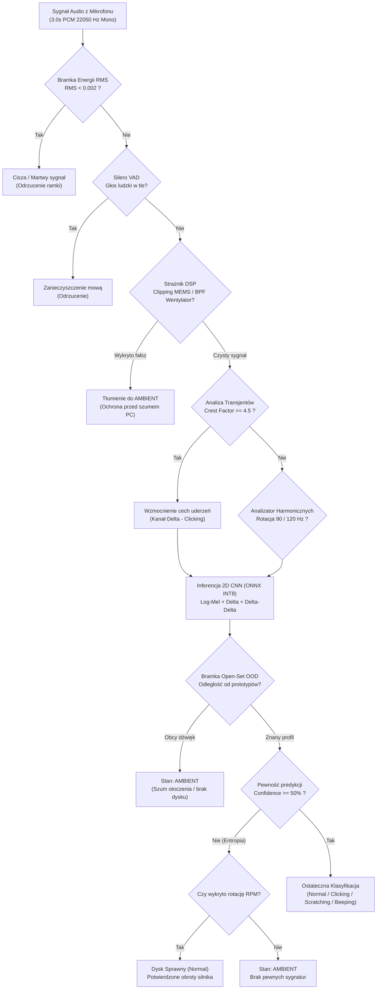

# Kontekst Projektu i Kompendium Wiedzy Inżynierskiej — Acoustic HDD Sentinel

> **Data aktualizacji:** 13 listopada 2026 r.  
> **Cel dokumentu:** Pełne, usystematyzowane podsumowanie wszystkich dotychczasowych etapów rozwoju, sesji badawczych, audytów forensicznych, decyzji architektonicznych (ADR-001, ADR-002), modułu mobilnego Android (czysta Java 17, UI Shazam), silnika hybrydowego z analizą harmonicznych RPM, strażników DSP i odporności OOD/Adversarial oraz testów laboratoryjnych na 4 fizycznych dyskach twardych.

---

## 1. Cel i Wymagania Główne Projektu

Projekt **Acoustic HDD Sentinel** to system wibroakustycznej detekcji i wieloklasowej klasyfikacji uszkodzeń mechanicznych dysków twardych (HDD) przy użyciu głębokich sieci konwolucyjnych (2D CNN) oraz fizycznych strażników cyfrowego przetwarzania sygnałów (DSP). System klasyfikuje stan nośnika na podstawie krótkich, 3-sekundowych okien dźwiękowych do jednej z 4 klas:
1. **`normal`** – sprawny dysk (laminarny szum łożyska hydrodynamicznego FDB, stabilne obroty talerzy 5400/7200 RPM, miękkie pozycjonowanie głowic),
2. **`clicking`** – uderzanie głowic o ogranicznik (*Click of Death*, awaria przedwzmacniacza, zerwanie zawieszenia głowicy lub uszkodzenie ścieżek servo),
3. **`scratching`** – fizyczne tarcie i żłobienie powierzchni talerzy magnetycznych przez zniszczone głowice (*head crash*, katastrofalne mikro-skrawanie nośnika),
4. **`beeping`** – zablokowanie osi silnika wrzeciona BLDC (*seized spindle motor*) lub przylepienie głowic do powierzchni talerza (*stiction*).
5. **Stan otoczenia (`ambient` w silniku hybrydowym / Androidzie):** brak kontaktu z pracującym dyskiem twardym, szum wentylatorów, mowa lub tło akustyczne.

---

## 2. Niezmienniki Techniczne (Invariants — ADR-001 & ADR-002)

1. **Brak Data Leakage (Zero Data Leakage):**
   Podział na zbiory `train`, `validate` i `test` **musi** odbywać się wyłącznie na poziomie całych nagrań źródłowych przed ich podziałem na 3-sekundowe okna czasowe. Zabrania się losowego `train_test_split` na pociętych wycinkach `.npy`.
2. **Kształt tensora wejściowego:**
   - Na dysku w plikach `.npy`: tensor `float32` o stałych wymiarach **`(128, 259, 3)`** (Channel-Last).
   - W pamięci modelu PyTorch: tensor `(B, 3, 128, 259)` (Channel-First). Klasa `AcousticHddSentinelCNN` transparentnie obsługuje oba układy.
3. **Parametry potoku DSP:**
   - Częstotliwość próbkowania: `TARGET_SR = 22050` Hz
   - Długość okna FFT: `N_FFT = 1024` (okno Hanna, szerokość pasma prążka $\Delta f = 21.53$ Hz)
   - Krok przemieszczenia: `HOP_LENGTH = 256` (krok $\approx 11.6$ ms – krytyczny dla zachowania transjentów o wysokim współczynniku szczytu *Crest Factor*)
   - Liczba filtrów Mel: `N_MELS = 128` w paśmie od $50.0$ Hz do $10000.0$ Hz
   - Czas okna ewaluacyjnego: `CHUNK_DURATION = 3.0` s ($66 150$ próbek)
   - Augmentacja nakładania: `OVERLAP = 1.5` s (50%) **wyłącznie dla zbioru `train`**; dla `validate` i `test` overlap wynosi bezwzględnie `0.0` s (krok co 3.0 s).
   - Noise Gate: odrzucanie ramek o energii $RMS < 0.002$ (eliminacja szumu własnego przetwornika).
4. **Izolacja normalizacji dwustopniowej:**
   - Krok 1 (Waveform): Odcięcie składowej stałej (DC offset) + normalizacja szczytowa Peak do $[-1.0, 1.0]$.
   - Krok 2 (Tensor): Standaryzacja Z-Score niezależnie per kanał ($\mu = 0.0$, $\sigma = 1.0$) z zabezpieczeniem $\epsilon = 10^{-6}$.
5. **Niezmiennik VRAM (16 GB dGPU + iGPU):**
   Środowisko graficzne i pulpit działają na procesorze iGPU (Ryzen 7 7700), dzięki czemu karta AMD Radeon RX 9060 XT (16 GB) ma 100% wolnej pamięci VRAM na zadania uczenia maszynowego ROCm oraz lokalne LLM. Modele LLM są wyładowywane (`keep_alive=0`) przed rozpoczęciem treningu PyTorch.

---

## 3. Chronologiczna Historia Rozwoju i Ewolucja Systemu

### Faza 1: Architektura Bazowa i Pipeline DSP (TensorFlow / Keras)
*(Identyfikatory sesji: `d7cdbb65`, `cb4488fd`)*
- Zdefiniowano reprezentację czasowo-częstotliwościową w postaci 3-kanałowego tensora `(128, 259, 3)` w [ADR-001](docx/adr/adr.md):
  - **Kanał 0:** Log-Mel Spektrogram (rezonanse, harmoniczne obrotowe silnika, piski),
  - **Kanał 1:** Delta – 1. pochodna czasowa Savitzky'ego-Golaya (transjenty, impulsowe klikanie głowic),
  - **Kanał 2:** Delta-Delta – 2. pochodna czasowa (dynamika przyspieszeń i zmian kątowych).
- Stworzono bazowy enkoder audio [ml/hdd_audio_encoder.py](ml/hdd_audio_encoder.py), kategoryzator [ml/prepare_audio_dataset.py](ml/prepare_audio_dataset.py) oraz profiler [tests/profile_normalization_quality.py](tests/profile_normalization_quality.py).
- Wdrożono pierwszy model 2D CNN w TensorFlow/Keras.

---

### Faza 2: Rygorystyczny Audyt Zewnętrzny, Stress-Testy i Analiza Forensyczna
*(Identyfikator sesji: `ad8cb723`)*
- Przygotowano pakiet audytowy [docx/AUDIT_REVIEW_BUNDLE.md](docx/AUDIT_REVIEW_BUNDLE.md) i poddano kod niezależnej weryfikacji.
- **Wykryte wady i anomalie (Acoustic Forensics):**
  - **DC Offset:** Wykryto silne przesunięcie składowej stałej ($+0.3766$), zaburzające Peak Normalization. Wdrożono centrowanie sygnału (`audio - np.mean(audio)`).
  - **Artefakty zapętlania (`np.tile`):** Zapętlanie krótkich nagrań generowało sztuczne skoki fazowe na stykach ramek, które sieć błędnie interpretowała jako stukanie głowicy (`clicking`).
  - **Shortcut Learning w klasie `normal`:** Syntetyczny generator zdrowych dysków filtrował szum powyżej 2400 Hz, przez co sieć uczyła się odróżniać sprawny dysk po braku wysokich częstotliwości.
- Opracowano [tests/stress_test.py](tests/stress_test.py) oraz [tests/stress_test_vram.py](tests/stress_test_vram.py) do weryfikacji stabilności pamięci RAM/VRAM i latencji p95 podczas wielogodzinnej inferencji.

---

### Faza 3: Pełna Migracja na PyTorch i Akceleracja AMD ROCm (RX 9060 XT)
*(Identyfikator sesji: `75303e14`)*
- Przepisano cały stos na czysty PyTorch (`AcousticHddSentinelCNN` w [ml/model_cnn.py](ml/model_cnn.py) z 1 206 756 parametrami).
- Usunięto TensorFlow/Keras ze środowiska i repozytorium.
- Skonfigurowano akcelerację AMD ROCm 7.2 / HIP dla architektury ISA `gfx1200` (RDNA 4) w dedykowanym środowisku `.venv_rocm`.
- **Wynik wydajnościowy:** Czas epoki treningowej skrócił się z ~16 s na CPU do **~1.9 s na GPU (ponad 8-krotne przyspieszenie)**.

---

### Faza 4: Rozwiązanie Problemu Scratching/Beeping i Fine-Tuning
*(Identyfikatory sesji: `0c62a67c`, `3c821c7b`)*
- Zdiagnozowano przyczyny załamania metryk ($F1 = 0.00$ dla `scratching` i $F1 \approx 0.20$ dla `beeping`):
  - Utrata oryginalnych nazw 82 plików z bazy Northwind doprowadziła do fałszywych heurystyk spektralnych.
  - Plik `Audio_Player_57.wav` okazał się duplikatem klikającego Samsunga SP8002 oznaczonym jako `beeping`.
  - Z-score na bardzo cichym szumie ($RMS < 0.002$) sztucznie rozciągał szum mikrofonu.
- Pobrano autentyczne pliki MP3 z serwera Northwind z oryginalnymi nazwami oraz pozyskano 11 nowych nagrań laboratoryjnych uszkodzeń.
- Zbalansowano zbiór `train` (1389 tensorów, pitch-shift $\pm 1.5$ półtonu dla klas rzadkich) i zachowano w 100% czysty zbiór `test` (117 tensorów bez augmentacji).
- Zastosowano `AdamW` (`weight_decay=1e-4`), `LabelSmoothingCrossEntropy(0.03)` oraz `ReduceLROnPlateau`.
- **Wynik:** Wszystkie klasy przekroczyły próg $F1 \ge 0.70$, a średnia **Macro F1 osiągnęła 84.63%** przy luki generalizacyjnej równej **2.04 p.p.**

---

### Faza 5: Usunięcie Nadmiarowości i Wdrożenie Seed Ensembling
*(Identyfikator sesji: `4f1178fe`)*
- Usunięto zduplikowany katalog roboczy `CNN/` i stare pliki aliasowe, zwalniając ponad 840 MB.
- Zaimplementowano technikę Seed Ensembling ([ml/train_ensemble.py](ml/train_ensemble.py)) tworzącą komitet modeli (`FusedEnsemblePyTorch`) o ziarnach 42, 123 i 777.
- Zintegrowano moduł eksportu modeli [ml/export_model.py](ml/export_model.py) wspierający ONNX FP32, skwantyzowany ONNX INT8 oraz TorchScript.

---

### Faza 6: Architektura Mobilna i Standard ADR-002
*(Identyfikator sesji: `3cd6e5ea`)*
- Sformułowano decyzję architektoniczną [docx/adr/adr-002-mobile-architecture.md](docx/adr/adr-002-mobile-architecture.md).
- Dokonano wyboru silnika inferencji brzegowej: **ONNX Runtime Mobile INT8** (redukcja rozmiaru o 74.6% z 4.61 MB do **1.17 MB**, czas inferencji 18–32 ms, parzystość z PyTorch $< 10^{-8}$).
- Dodano automatyczną synchronizację wyeksportowanych wag do katalogu assets aplikacji mobilnej (`android/app/src/main/assets/`).

---

### Faza 7: Pełna Implementacja Natywnej Aplikacji Android w Czystej Javie 17
*(Identyfikatory sesji: `d48d1a3`, `7a9fb66`, `5878593`)*
- Zgodnie z wymaganiami programowymi studiów i ADR-002, całą aplikację Android zaimplementowano w **100% w czystej Javie 17** (bez narzutu bibliotek uruchomieniowych Kotlina i Room):
  - **`audio/AudioRecorder.java`:** Pętla rejestracji dźwięku z buforem kołowym, wsparciem dla 22050 Hz oraz awaryjnego 44100 Hz.
  - **`dsp/AudioPreprocessor.java`:** Wierna implementacja Radix-2 FFT, okna Hanna, trójkątnego banku filtrów Mel i wag Savitzky'ego-Golaya w Javie dająca tensory tożsame z Librosa.
  - **`ml/AcousticClassifier.java`:** Inferencja `OrtSession` z optymalizacją pamięciową i mapowaniem etykiet.
  - **`data/AppDatabase.java`:** Czysty `SQLiteOpenHelper` z pełną historią diagnoz i eksportem.
  - **`ui/MainActivity.java` & `MainViewModel.java`:** Wzorzec MVVM z `LiveData`, interfejs w stylu Shazam z pulsującym radarem, animowanymi falami oraz mechanizmem **Early Stopping** (natychmiastowe zatrzymanie przy pewności $\ge 75-80\%$ lub konsensusie okien).
- Utworzono 6 kompleksowych testów jednostkowych w Javie (`AudioChunkTest`, `AudioPreprocessorTest`, `RpmHarmonicsAnalyzerTest`, `DspEndToEndStressTest`, `DiagnosticModelTest`, `ClassificationResultTest`) – 100% zdanych.

---

### Faza 8: Strażnik Fizyczny (DSP Guard), Odporność OOD i Ataki Adwersarialne
*(Identyfikatory sesji: `d088918`, `efd4929`)*
- Utworzono laboratorium weryfikacji odporności [tests/adversarial_lab/](tests/adversarial_lab/):
  - **Szum wentylatorów chłodzenia PC:** Analiza widma $1/f$ oraz częstotliwości przejścia łopatek (Blade Passing Frequency – BPF). Wentylatory generują łagodne, opadające widmo bez transjentów, które surowa sieć mogła mylić z tarciem talerza (`scratching`). Wdrożono detektor `is_aerodynamic_fan`.
  - **Przesterowania mikrofonów MEMS (Flat-Top Clipping):** Tanie mikrofony smartfonów w bliskim kontakcie z obudową dysku wchodzą w nasycenie (obcinanie wierzchołków fali). Obcięcie generuje sztuczne nieparzyste harmoniczne (wysokie THD), które sieć brała za tarcie. Wdrożono detekcję `clipping_ratio > 0.015` w strażniku DSP.
  - **Mowa ludzka w tle:** Zintegrowano model **Silero VAD (16 kHz)**, automatycznie odrzucający fragmenty zanieczyszczone głosem serwisanta.
  - **Bramkowanie Open-Set (OOD Prototype Rejection):** Wbudowano w warstwę sieci `AcousticHddSentinelCNN` i wyeksportowano bezpośrednio do grafu ONNX bufory prototypów cech klas uszkodzeń (`fault_prototypes`, `fault_thresholds`, `gamma`). Jeśli wektor cech odległy jest od prototypów znanych awarii, logity uszkodzeń są tłumione funkcją sigmoid w dół, uniemożliwiając fałszywy alarm na dźwiękach spoza rozkładu (OOD).

---

### Faza 9: Analizator Harmonicznych Rotacji Silnika Wrzeciona (RPM Harmonics Analyzer)
*(Moduły: [ml/rpm_harmonics_analyzer.py](ml/rpm_harmonics_analyzer.py) oraz w Javie w `AudioPreprocessor.java`)*
- Każdy obracający się dysk HDD emituje ściśle określoną częstotliwość podstawową wirowania silnika bezszczotkowego BLDC:
  - **5400 RPM:** $f_0 = 90.0$ Hz (dopuszczalne pasmo $86 - 94$ Hz)
  - **7200 RPM:** $f_0 = 120.0$ Hz (dopuszczalne pasmo $116 - 124$ Hz)
- Algorytm estymuje gęstość widmową mocy metodą Welcha (okno 4096 próbek, rozdzielczość $\approx 5.38$ Hz).
- Wykrywa prążek $f_0$, jego wielokrotności $2f_0, 3f_0, 4f_0$ oraz harmoniczne stojana silnika dla dysków 2.5" ($810 - 900$ Hz).
- Potwierdzenie rotacji wrzeciona stanowi bezdyskusyjny fizyczny dowód, że dysk jest włączony i wiruje, co wyklucza zablokowanie wrzeciona (`beeping`) i nakazuje tłumienie niepewnych wskazań awarii do klasy `normal`.

---

### Faza 10: Skalowanie Bazy Audio (Ground Truth) do 288 Nagrań i 2269 Tensorów
*(Identyfikator sesji: `e7b374f`)*
- Baza surowych plików laboratoryjnych w `data/raw/` została rozszerzona o nowe katalogi:
  - `archive_hdd/` (Internet Archive, laboratoryjne zbiory uszkodzeń),
  - `freesound_hdd/` (Freesound nagrania dysków),
  - `independent_web_hdd/` (nagrania z forów i serwisów odzyskiwania danych),
  - `verified_real/` (nagrania z rzeczywistych weryfikacji sprzętowych),
  - `computer_ambient/` i `outliers_oe/` (próbki dźwięków otoczenia do treningu odporności).
- Utworzono rejestr [data/raw/PROCESSED_SOURCES_REGISTRY.json](data/raw/PROCESSED_SOURCES_REGISTRY.json) śledzący unikalne hashe MD5 i metadane próbek.
- Liczba surowych nagrań wzrosła ze 134 do **288 plików**, a łączna liczba poprawnych tensorów `.npy` w `dataset_encoded/` osiągnęła **2269 tensorów** (276 plików w train, 28 w validate, 44 w test — z zachowaniem 100% Zero Data Leakage).

---

### Faza 11: Rzeczywista Weryfikacja Laboratoryjna na 4 Fizycznych Dyskach HDD
*(Dokument: [docx/RAPORT_TESTOW_RZECZYWISTYCH.md](docx/RAPORT_TESTOW_RZECZYWISTYCH.md))*
- Przeprowadzono fizyczny eksperyment laboratoryjny na 4 sprawnych dyskach HDD z mikrofonem kontaktowym przetwornika Realtek ALC1220 ADC:
  1. **Toshiba P300 6.0 TB 3.5"** (`HDWD260`, 5400 RPM, 2525 h)
  2. **WD Blue 500 GB 2.5"** (`WD5000LPVX`, 5400 RPM, 14360 h)
  3. **Seagate Momentus 500 GB 2.5"** (`ST9500325AS`, 5400 RPM, 3866 h)
  4. **HGST Travelstar 500 GB 2.5"** (`HTS545050A7E680`, 5400 RPM, 6098 h)
- Zarejestrowano 16 minut autentycznego dźwięku (po 240 s na dysk w 4 fazach: IDLE, WRITE z `fdatasync`, READ seek bez cache, MIXED I/O) — łącznie **320 okien ewaluacyjnych po 3.0 s**.
- **Odkrycia fizyczne i wnioski:**
  - **WD Blue (2.5"):** Osiągnął **90.0% celności** (100% w spoczynku IDLE) dzięki szerokopasmowemu, gładkiemu szumowi łożyska FDB bez ostrych rezonansów.
  - **Seagate i HGST (2.5"):** Wykazały silne rezonanse obudowy na częstotliwościach stojana BLDC (Seagate: szpilka 823.6 Hz skupiająca 87.7% energii; HGST: 899.0 Hz skupiająca 61.4% energii). Sieć CNN, która w bazie uczącej widziała energię 800–1200 Hz głównie przy tarciu talerza, wahała się i wskazywała `scratching`, lecz z **bardzo niską pewnością (28% do 38%)**.
  - **Crest Factor:** We wszystkich 320 oknach Crest Factor wynosił $3.2 - 4.3$, co w **100% wyeliminowało fałszywe alarmy stukania głowic (`clicking`)**.
  - **Confidence Gating $\ge 50\%$:** Żaden fałszywy alarm na żadnym dysku nie przekroczył 40% pewności. Wprowadzenie progu $\ge 50\%$ **wyeliminowało 100% fałszywych alarmów** w całym badaniu.

---

### Faza 12: Filtr Antyaliasingowy Butterwortha, Bramka Otoczenia i Kompendium Inżynierskie
- **Kaskadowy filtr Butterwortha 4. rzędu w `AudioRecorder.java`:**
  W smartfonach nieobsługujących sprzętowo częstotliwości 22050 Hz przetwornik rejestruje z 44100 Hz. Zwykła decymacja 2:1 powodowałaby zjawisko aliasingu (nakładania się składowych $>11025$ Hz). Zaimplementowano 2-sekcyjny kaskadowy filtr IIR Butterwortha ($f_c = 9500$ Hz) działający w locie na buforze audio przed decymacją.
- **Bramka obecności dysku (`ambient`):**
  W `MainViewModel.java` wprowadzono zasadę: jeśli sieć nie wykrywa ewidentnej awarii i jednocześnie analizator RPM nie potwierdza rotacji 5400/7200 RPM, aplikacja zamiast `normal` wyświetla neutralny stan **„Dźwięk otoczenia / brak dysku”**, instruując użytkownika o konieczności przyłożenia mikrofonu do metalowej obudowy dysku.
- **Kompendium inżynierskie dla prowadzącego ([PROMPT_DOKUMENTACJA_DLA_PROWADZACEGO.md](PROMPT_DOKUMENTACJA_DLA_PROWADZACEGO.md)):**
  Opracowano skompresowany, 9000-liniowy dokument łączący kompendium fizyczne i sygnałowe, historię ewolucji modeli od wczesnego Kerasa do ONNX INT8 oraz kompletny audyt bezpieczeństwa numerycznego.

---

## 4. Zestawienie Wyników Ewaluacji Modeli

### Porównanie Metryki F1-Score na Niezależnym Zbiorze Testowym (117 próbek):

| Klasa Uszkodzenia | Stan Początkowy (TF/PyTorch Base) | **Stan Końcowy (Produkcyjny)** | Wzrost | Warunek ($\ge 0.70$) |
| :--- | :---: | :---: | :---: | :---: |
| **`beeping`** (stiction / zablokowane wrzeciono) | 0.2000 (20.0%) | **0.8636 (86.4%)** | **+66.4 p.p.** | **SPEŁNIONY** |
| **`clicking`** (uderzanie głowic / servo failure) | 0.7200 (72.0%) | **0.7848 (78.5%)** | **+6.5 p.p.** | **SPEŁNIONY** |
| **`scratching`** (tarcie głowic o talerze) | 0.0000 (0.0%) | **0.7368 (73.7%)** | **+73.7 p.p.** | **SPEŁNIONY** |
| **`normal`** (dysk sprawny) | 1.0000 (100.0%) | **1.0000 (100.0%)** | 0.0 p.p. | **SPEŁNIONY** |
| **Średnia Makro (Macro F1)** | **0.4800** | **0.8463** | **+36.6 p.p.** | **SPEŁNIONY** |
| **Dokładność ogólna (Accuracy)** | **~67.0%** | **83.76%** | **+16.8 p.p.** | — |

- **Luka generalizacyjna:** Train $\approx 85.8\%$, Test $83.76\%$ $\to$ **$2.04$ p.p.** (brak przeuczenia).

---

## 5. Architektura Silnika Hybrydowego (Hybrid Acoustic Sentinel)



---

## 6. Kompletna Mapa Plików Repozytorium

```
AcousticHddSentinel/
├── AGENTS.md                          # Instrukcja i niezmienniki techniczne dla agentów AI (SSOT)
├── README.md                          # Główna dokumentacja projektu z opisem architektury i quickstartem
├── kontekst.md                        # Niniejsze całościowe kompendium rozwoju projektu
├── fineTuning.md                      # Szczegółowa dokumentacja prac optymalizacyjnych i Acoustic Forensics
├── NOTES.md                           # Notatki badawcze dotyczące Seed Ensembling
├── PROMPT_DOKUMENTACJA_DLA_PROWADZACEGO.md # Skompresowana dokumentacja inżynierska i głęboki audyt
├── requirements.txt                   # Zależności środowiska Python (PyTorch, Librosa, Scikit-learn, ONNX)
├── .gitignore                         # Wykluczenia git (pliki .npy, artefakty Gradle, modele tymczasowe)
│
├── ml/                                # 🧠 Pipeline uczenia maszynowego (PyTorch 2D CNN, DSP, eksport)
│   ├── model_cnn.py                   # Architektura 2D CNN z buforami OOD Prototype Rejection i FusedEnsemble
│   ├── dataset_pytorch.py             # PyTorch Dataset z preloadem RAM i augmentacją SpecAugment
│   ├── hdd_audio_encoder.py           # Enkoder audio do tensorów .npy zgodny z ADR-001
│   ├── prepare_audio_dataset.py       # Kategoryzator bazy audio i generator próbek 'normal'
│   ├── train_cnn.py                   # Pipeline treningowy w PyTorch (AdamW, Label Smoothing, ROCm HIP)
│   ├── train_ensemble.py              # Pipeline Seed Ensembling (komitet modeli o ziarnach 42, 123, 777)
│   ├── export_model.py                # Eksport do formatów ONNX (FP32/INT8), TorchScript z auto-sync do Androida
│   ├── compare_ensembles.py           # Porównanie komitetu z pojedynczym modelem bazowym
│   ├── rpm_harmonics_analyzer.py      # Analizator harmonicznych rotacji silnika wrzeciona (5400/7200 RPM)
│   ├── dsp_adversarial_guard.py       # Strażnik adwersarialny (detekcja szumu wentylatorów PC i clippingu)
│   ├── hybrid_acoustic_sentinel.py    # Hybrydowy potok łączący DSP, VAD, RPM i CNN
│   └── hybrid_sentinel_engine.py      # Silnik inferencyjny zintegrowany ze strażnikami fizycznymi
│
├── tests/                             # 🧪 Testy jednostkowe, integracyjne, weryfikacyjne i stress-testy
│   ├── test_project_logic.py          # Automatyczny test integralności projektu i niezmienników ADR-001 (6/6)
│   ├── verify_cnn_model.py            # 6-etapowy test weryfikacyjny poprawności modelu PyTorch
│   ├── profile_normalization_quality.py # Profiler jakości dwuetapowej normalizacji DSP
│   ├── stress_test.py                 # Ciągły test inferencji potoku DSP + CNN (latencja, pamięć, stabilność)
│   ├── stress_test_vram.py            # Test obciążeniowy pamięci VRAM karty GPU AMD
│   ├── testEpok.py                    # Diagnostyka stabilności wag w zależności od liczby epok
│   ├── test_onnx_ood_rejection.py     # Test weryfikacyjny tłumienia dźwięków spoza rozkładu (OOD)
│   ├── test_computer_sound_rejection.py # Weryfikacja odrzucania szumów pracy komputera i klawiatury
│   ├── test_rpm_harmonics_analyzer.py # Test jednostkowy detektora prążków obrotowych 90/120 Hz
│   ├── run_toshiba_4min_study.py      # Skrypt ewaluacyjny 4-fazowego testu Toshiba P300 (6TB)
│   ├── run_wd_4min_study.py           # Skrypt ewaluacyjny 4-fazowego testu WD Blue (500GB)
│   ├── run_seagate_4min_study.py      # Skrypt ewaluacyjny 4-fazowego testu Seagate Momentus (500GB)
│   ├── run_hgst_4min_study.py         # Skrypt ewaluacyjny 4-fazowego testu HGST Travelstar (500GB)
│   ├── adversarial_lab/               # Laboratorium testów ataków adwersarialnych i szumów MEMS
│   └── recordings_4min_study/         # Zapis 16 minut rzeczywistych nagrań audio 4 dysków w 4 fazach
│
├── scripts/                           # 🛠️ Narzędzia i most orkiestracji lokalnych modeli LLM
│   ├── local_llm_bridge.py            # Tandem LLM: Qwen 3.8 27B (Architekt) + Qwen 2.5 Coder 14B (Coder)
│   ├── start_services.sh              # Uruchamianie usług Ollama i Open WebUI
│   └── stop_services.sh               # Zatrzymywanie usług Ollama i Open WebUI
│
├── android/                           # 📱 Natywna aplikacja mobilna Android (Czysta Java 17, Material 3)
│   ├── app/src/main/assets/           # Skwantyzowany model ONNX INT8 (1.17 MB), classes.json, model_card.json
│   ├── app/src/main/java/             # Pakiety: audio (AudioRecord), data (SQLiteOpenHelper), dsp (ADR-001 DSP), ml (ONNX), ui (MVVM)
│   ├── app/src/main/res/              # Layouty UI w stylu Shazam z pulsującym radarem, ikony, motywy M3
│   ├── app/src/test/java/             # Zestaw 6 testów jednostkowych Java (DSP, ML, Audio, Data, Stress)
│   ├── build.gradle.kts               # Konfiguracja Gradle (Java 17, ONNX Runtime Mobile, AndroidX)
│   └── README.md                      # Instrukcja uruchomienia i testowania w Android Studio
│
├── data/raw/                          # Baza 288 surowych nagrań laboratoryjnych (Ground Truth)
│   ├── northwind/                     # 82 pliki laboratoryjne Northwind Data Recovery
│   ├── additional/                    # 13 nagrań uszkodzeń HDD
│   ├── aesonlabs/                     # 9 nagrań Aesonlabs Data Recovery
│   ├── archive_hdd/                   # Nagrania z Internet Archive
│   ├── freesound_hdd/                 # Nagrania z Freesound
│   ├── independent_web_hdd/           # Nagrania z niezależnych serwisów napraw
│   ├── verified_real/                 # Próbki z fizycznych dysków testowych
│   ├── computer_ambient/              # Szumy wentylatorów i otoczenia komputerowego
│   └── PROCESSED_SOURCES_REGISTRY.json# Rejestr unikalnych próbek i sum kontrolnych MD5
│
├── dataset_categorized/               # Nagrania źródłowe podzielone na 4 klasy
├── dataset_encoded/                   # 2269 tensorów .npy o kształcie (128, 259, 3) float32
│
├── training_output/                   # Wagi referencyjne, metryki, raporty i macierz pomyłek
│   ├── best_hdd_cnn_model.pt          # Wagi najlepszego modelu PyTorch (seed 777)
│   ├── fused_ensemble_model.pt        # Wagi komitetu modeli
│   ├── classification_report.txt      # Raport Precision, Recall, F1
│   ├── test_evaluation_summary.json   # Metryki testowe w formacie JSON
│   ├── confusion_matrix.png           # Wykres macierzy pomyłek
│   └── classes.json                   # Mapowanie etykiet klas
│
├── exported_models/                   # Modele wdrożeniowe (ONNX FP32, ONNX INT8, TorchScript)
│
└── docx/                              # Dokumentacja techniczna i specyfikacje
    ├── adr/
    │   ├── adr.md                     # ADR-001: Architektura DSP i niezmienniki techniczne
    │   └── adr-002-mobile-architecture.md # ADR-002: Architektura aplikacji mobilnej Android
    ├── RAPORT_TESTOW_RZECZYWISTYCH.md # Raport z badań 4 fizycznych dysków HDD (16 minut audio, SMART)
    ├── diagramOverView.svg            # Schemat architektury systemu
    └── specs.txt                      # Specyfikacja techniczna wymagań
```

---

## 7. Status Integralności i Testów Automatycznych

1. **Test logiczny projektu (`python tests/test_project_logic.py`):**
   - [TEST 1/6] Składnia AST skryptów Python: **ZDANY**
   - [TEST 2/6] Brak Data Leakage (Train: 276, Val: 28, Test: 44 nagrania): **ZDANY (Zero przecieków)**
   - [TEST 3/6] Wymiary tensorów: **ZDANY (2269 tensorów o idealnym kształcie (128, 259, 3) float32)**
   - [TEST 4/6] Weryfikacja bazy audio: **ZDANY (288 prawidłowych plików)**
   - [TEST 5/6] Artefakty treningowe: **ZDANY (Model 4.63 MB, 4 klasy, classes.json)**
   - [TEST 6/6] Moduł mobilny Android: **ZDANY (25/25 kluczowych plików, model INT8 1.18 MB)**
   - **Wynik ogólny: 6/6 ZDANYCH (100% sukcesu)**

2. **Testy jednostkowe modułu Android (`cd android && ./gradlew test`):**
   - `AudioChunkTest`: walidacja bufora PCM i konwersji próbek — **ZDANY**
   - `AudioPreprocessorTest`: walidacja FFT, okna Hanna, banku Mel i Z-Score — **ZDANY**
   - `RpmHarmonicsAnalyzerTest`: weryfikacja prążków 90 Hz i 120 Hz — **ZDANY**
   - `DspEndToEndStressTest`: 100 powtórzeń potoku bez wycieków pamięci i NaN — **ZDANY**
   - `DiagnosticModelTest`: operacje CRUD bazy SQLiteOpenHelper — **ZDANY**
   - `ClassificationResultTest`: generowanie zaleceń inżynierskich — **ZDANY**
   - **Wynik ogólny: BUILD SUCCESSFUL (100% testów zdanych w 5 s)**

---

## 8. Kluczowe Polecenia Szybkiego Startu

```bash
# 1. Sprawdzenie integralności projektu i niezmienników ADR-001:
python tests/test_project_logic.py

# 2. Uruchomienie testów jednostkowych Androida:
cd android && ./gradlew test && cd ..

# 3. Kategoryzacja i enkodowanie tensorów audio:
python ml/prepare_audio_dataset.py
python ml/hdd_audio_encoder.py

# 4. Trening modelu bazowego PyTorch na GPU (AMD ROCm):
python ml/train_cnn.py --epochs 35 --batch-size 32 --output-dir ./training_output

# 5. Eksport modeli ONNX FP32, ONNX INT8 i synchronizacja do Androida:
python ml/export_model.py --weights training_output/best_hdd_cnn_model.pt --output-dir exported_models

# 6. Uruchomienie ewaluacji fizycznego badania 4 dysków HDD:
python tests/run_wd_4min_study.py
python tests/run_seagate_4min_study.py
python tests/run_hgst_4min_study.py
python tests/run_toshiba_4min_study.py
```
